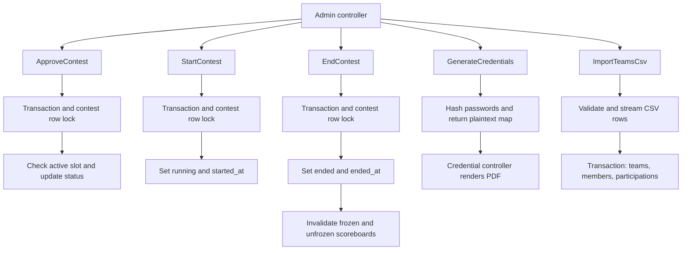
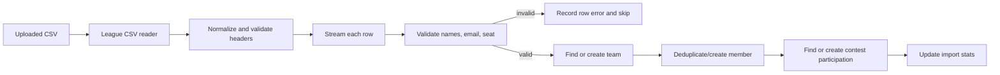

# Complete Actions

Five single-purpose action classes orchestrate transactional business operations. Controllers perform friendly pre-checks; actions add transactional safety and row-level locking so concurrent admin requests cannot create inconsistent state.

## Actions Included

| File | Method | Purpose |
| --- | --- | --- |
| `app/Actions/ApproveContest.php` | `execute(Contest, User): void` | Transitions draft → approved and respects `active_slot`. |
| `app/Actions/StartContest.php` | `execute(Contest): void` | Transitions approved → running and sets `started_at = now()`. |
| `app/Actions/EndContest.php` | `execute(Contest): void` | Transitions running → ended and sets `ended_at = now()`. |
| `app/Actions/GenerateCredentials.php` | `execute(Contest, bool $force = false): array` | Generates passwords and returns `[participation_id => plaintext]`. |
| `app/Actions/ImportTeamsCsv.php` | `execute(Contest, UploadedFile): array` | Streams CSV and creates teams, members, and participations. |

## Action Workflow



## Schema Note

Make `team_members.email` nullable so CSV rows without a member email can be imported:

```php
$table->string('email')->nullable();
```

This is a one-line migration change and requires no data migration on a fresh install.

## CSV Format (v1)

The supported format is one row per team member:

```csv
team_name,member_name,member_email,seat_number
Team Alpha,Alice Smith,alice@x.edu,12
Team Alpha,Bob Jones,bob@x.edu,12
Team Beta,Carol Lee,carol@y.edu,15
```

- `team_name` is required and groups rows into teams.
- `member_name` is required; each row represents one member.
- `member_email` is optional and validated when present.
- `seat_number` is optional and applied to the team from the first non-empty row.

A different CSV shape (one row per team with member columns, or members packed into a cell) requires a small change in `ImportTeamsCsv::processRow()`; see the format-flexibility note below.

## 1. `app/Actions/ApproveContest.php`

```php
<?php

namespace App\Actions;

use App\Models\Contest;
use App\Models\User;
use DomainException;
use Illuminate\Database\QueryException;
use Illuminate\Support\Facades\DB;
use Illuminate\Support\Facades\Log;

/**
 * Transition a draft contest to approved.
 *
 * Enforces the "one active contest at a time" invariant two ways:
 *   1. Application-level check inside a row-locked transaction — fast, gives
 *      a clean DomainException with a specific message about which contest
 *      is blocking.
 *   2. DB-level: the `contests.active_slot` generated column has a UNIQUE
 *      constraint, so a race that sneaks past (1) surfaces as a QueryException
 *      here — we catch it and re-throw as DomainException for consistency.
 *
 * On success:
 *   - status      = 'approved'
 *   - approved_at = now()
 *   - approved_by = $approver->id
 *   - active_slot = 1 (automatically via the generated column)
 *
 * Callers are expected to have pre-checked problems/teams presence and that
 * end_time isn't in the past; those are UX pre-checks in the controller, not
 * invariants this action needs to enforce.
 */
final class ApproveContest
{
    public function execute(Contest $contest, User $approver): void
    {
        DB::transaction(function () use ($contest, $approver) {
            // Row lock the contest being approved.
            /** @var Contest $fresh */
            $fresh = Contest::query()
                ->whereKey($contest->id)
                ->lockForUpdate()
                ->firstOrFail();

            if ($fresh->status !== Contest::STATUS_DRAFT) {
                throw new DomainException(
                    "Contest is not in draft state (current: {$fresh->status})."
                );
            }

            // Check whether another contest occupies the active slot.
            $blocking = Contest::query()
                ->whereKeyNot($fresh->id)
                ->occupiesActiveSlot()
                ->first();

            if ($blocking !== null) {
                throw new DomainException(
                    "Cannot approve: \"{$blocking->name}\" is still {$blocking->status}."
                );
            }

            try {
                $fresh->forceFill([
                    'status'      => Contest::STATUS_APPROVED,
                    'approved_at' => now(),
                    'approved_by' => $approver->id,
                ])->save();
            } catch (QueryException $e) {
                // Final safety net — the DB rejected the write because another
                // process approved a contest between our check and our save.
                Log::warning('ApproveContest: active_slot race lost', [
                    'contest_id' => $fresh->id,
                    'error'      => $e->getMessage(),
                ]);

                throw new DomainException(
                    'Another contest was approved concurrently. Please refresh and try again.',
                    previous: $e,
                );
            }

            $contest->refresh();

            Log::info('Contest approved', [
                'contest_id'  => $contest->id,
                'approved_by' => $approver->id,
            ]);
        });
    }
}
```

The row lock serializes concurrent approval attempts for the same contest. The active-slot query and caught unique-constraint exception handle races between different contests and convert the database error to a consistent `DomainException`.

## 2. `app/Actions/StartContest.php`

```php
<?php

namespace App\Actions;

use App\Models\Contest;
use DomainException;
use Illuminate\Support\Facades\DB;
use Illuminate\Support\Facades\Log;

/**
 * Manually start an approved contest.
 *
 * Normally the SyncContestState middleware transitions approved → running
 * automatically when start_time arrives. This action is the manual override —
 * the admin clicks "Start" to start early.
 *
 * On success:
 *   - status     = 'running'
 *   - started_at = now()  ← actual transition time, base for penalty math
 *
 * Note on started_at vs start_time: started_at is the *actual* moment the
 * contest began, which may differ from the scheduled start_time when the
 * admin starts early. Scoreboard penalty math uses started_at, not start_time.
 */
final class StartContest
{
    public function execute(Contest $contest): void
    {
        DB::transaction(function () use ($contest) {
            /** @var Contest $fresh */
            $fresh = Contest::query()
                ->whereKey($contest->id)
                ->lockForUpdate()
                ->firstOrFail();

            if ($fresh->status !== Contest::STATUS_APPROVED) {
                throw new DomainException(
                    "Contest is not in approved state (current: {$fresh->status})."
                );
            }

            $fresh->forceFill([
                'status'     => Contest::STATUS_RUNNING,
                'started_at' => now(),
            ])->save();

            $contest->refresh();

            Log::info('Contest started manually', [
                'contest_id' => $contest->id,
                'started_at' => $fresh->started_at?->toIso8601String(),
            ]);
        });
    }
}
```

The `SyncContestState` middleware normally starts a contest when `start_time` arrives. This action is the admin's manual early-start override. `started_at`, the actual transition time, is used as the scoreboard penalty base.

## 3. `app/Actions/EndContest.php`

```php
<?php

namespace App\Actions;

use App\Models\Contest;
use DomainException;
use Illuminate\Support\Facades\Cache;
use Illuminate\Support\Facades\DB;
use Illuminate\Support\Facades\Log;

/**
 * Manually end a running contest.
 *
 * Normally the SyncContestState middleware transitions running → ended
 * automatically when end_time arrives. This action is the manual override —
 * the admin clicks "End" to end early.
 *
 * On success:
 *   - status   = 'ended'
 *   - ended_at = now()
 *
 * Also invalidates the scoreboard cache so the frozen view immediately
 * becomes the unfrozen (revealed) view.
 */
final class EndContest
{
    public function execute(Contest $contest): void
    {
        DB::transaction(function () use ($contest) {
            /** @var Contest $fresh */
            $fresh = Contest::query()
                ->whereKey($contest->id)
                ->lockForUpdate()
                ->firstOrFail();

            if ($fresh->status !== Contest::STATUS_RUNNING) {
                throw new DomainException(
                    "Contest is not in running state (current: {$fresh->status})."
                );
            }

            $fresh->forceFill([
                'status'   => Contest::STATUS_ENDED,
                'ended_at' => now(),
            ])->save();

            $contest->refresh();

            // Clear scoreboard caches so the next read sees the revealed
            // (unfrozen) scoreboard.
            Cache::forget("scoreboard:contest:{$contest->id}:frozen");
            Cache::forget("scoreboard:contest:{$contest->id}:unfrozen");

            Log::info('Contest ended manually', [
                'contest_id' => $contest->id,
                'ended_at'   => $fresh->ended_at?->toIso8601String(),
            ]);
        });
    }
}
```

Ending a contest clears both frozen and unfrozen scoreboard cache entries so the next read reveals the final scoreboard.

## 4. `app/Actions/GenerateCredentials.php`

```php
<?php

namespace App\Actions;

use App\Models\Contest;
use App\Models\ContestParticipation;
use DomainException;
use Illuminate\Support\Facades\DB;
use Illuminate\Support\Facades\Log;
use Illuminate\Support\Str;

/**
 * Generate plaintext passwords for a contest's participations.
 *
 * Returns a map of [participation_id => plaintext password]. The plaintext
 * values exist ONLY in this return value — they are never persisted to disk
 * or the database. The caller (CredentialController) streams them into a
 * PDF and lets the browser download; after the response ends, the plaintext
 * is gone.
 *
 * If a participation somehow has no username yet (shouldn't happen if import
 * ran, but defensive), one is generated as `team-NNN` sequentially.
 *
 * Two modes:
 *   - $force = false (default): generate only for participations without
 *     credentials_generated_at set. Safe to call repeatedly — only picks up
 *     new teams imported since the last run.
 *   - $force = true: regenerate for ALL participations, invalidating
 *     existing passwords. Use when an admin needs to reprint the entire
 *     roster.
 *
 * Throws DomainException if the contest isn't in approved state — credentials
 * can't be generated before approval (teams aren't final) or after start
 * (teams are already logged in).
 */
final class GenerateCredentials
{
    private const PASSWORD_LENGTH = 10;

    /**
     * @return array<int, string>  [participation_id => plaintext password]
     */
    public function execute(Contest $contest, bool $force = false): array
    {
        if ($contest->status !== Contest::STATUS_APPROVED) {
            throw new DomainException(
                "Credentials can only be generated while the contest is approved "
                . "(current: {$contest->status})."
            );
        }

        $plainByParticipation = [];

        DB::transaction(function () use ($contest, $force, &$plainByParticipation) {
            $query = ContestParticipation::query()
                ->where('contest_id', $contest->id)
                ->orderBy('id');

            if (! $force) {
                $query->whereNull('credentials_generated_at');
            }

            /** @var ContestParticipation $participation */
            foreach ($query->lockForUpdate()->cursor() as $participation) {
                // Ensure username exists (defensive — should always be set).
                $username = $participation->username;
                if ($username === null || $username === '') {
                    $username = $this->nextAvailableUsername($contest);
                }

                $plainPassword = Str::password(self::PASSWORD_LENGTH);

                // The model's `password` cast is 'hashed' — passing plaintext
                // here results in a bcrypt hash in the DB. Do NOT wrap in
                // Hash::make() or it would be double-hashed.
                $participation->forceFill([
                    'username'                 => $username,
                    'password'                 => $plainPassword,
                    'credentials_generated_at' => now(),
                ])->save();

                $plainByParticipation[$participation->id] = $plainPassword;
            }
        });

        Log::info('Credentials generated', [
            'contest_id' => $contest->id,
            'count'      => count($plainByParticipation),
            'force'      => $force,
        ]);

        return $plainByParticipation;
    }

    /**
     * Find the next `team-NNN` username not already taken in this contest.
     */
    private function nextAvailableUsername(Contest $contest): string
    {
        $existing = ContestParticipation::query()
            ->where('contest_id', $contest->id)
            ->pluck('username')
            ->flip();

        $n = 1;
        do {
            $candidate = 'team-' . str_pad((string) $n, 3, '0', STR_PAD_LEFT);
            $n++;
        } while ($existing->has($candidate));

        return $candidate;
    }
}
```

Credentials can be generated only while the contest is approved. By default, only participations without `credentials_generated_at` are updated; `force: true` regenerates every password and invalidates the old ones. Plaintext is returned to the caller only and is intended for immediate PDF generation. The `password` cast hashes the assigned plaintext on save; do not call `Hash::make()` here or it will be double-hashed.

## 5. `app/Actions/ImportTeamsCsv.php`

```php
<?php

namespace App\Actions;

use App\Models\Contest;
use App\Models\ContestParticipation;
use App\Models\Team;
use App\Models\TeamMember;
use DomainException;
use Illuminate\Http\UploadedFile;
use Illuminate\Support\Facades\DB;
use Illuminate\Support\Facades\Log;
use Illuminate\Support\Facades\Storage;
use Illuminate\Support\Str;
use League\Csv\Reader;
use League\Csv\Statement;

/**
 * Stream a CSV of team data into teams, members and contest participations.
 *
 * Expected CSV format (one row per team member):
 *
 *     team_name,member_name,member_email,seat_number
 *     Team Alpha,Alice Smith,alice@x.edu,12
 *     Team Alpha,Bob Jones,bob@x.edu,12
 *     Team Beta,Carol Lee,carol@y.edu,
 *
 * Required columns:
 *   team_name   — groups rows into teams
 *   member_name — one row per member
 *
 * Optional columns:
 *   member_email — validated if present; stored as NULL when empty
 *   seat_number  — applied to the team (first non-empty row wins);
 *                  must be a positive integer if present
 *
 * Idempotent: re-importing the same CSV will not create duplicates. Teams
 * are matched by name (case-sensitive, but MySQL's collation may treat
 * different-cased names as the same — be aware), members by (team, email)
 * or (team, name) if no email, participations by (contest_id, team_id).
 *
 * Behavior on errors:
 *   - Per-row validation errors are collected and returned in `errors`.
 *     Valid rows are still imported. The admin is expected to fix the CSV
 *     and re-import — idempotent, so no duplicates will be created.
 *   - Any DB exception (unexpected) rolls back the entire transaction and
 *     re-throws. This should not happen in practice since all validations
 *     are done pre-insert.
 *
 * Return shape:
 *   [
 *     'created'                => int,    // new teams created
 *     'skipped'                => int,    // rows with validation errors
 *     'members_created'        => int,
 *     'participations_created' => int,
 *     'errors'                 => string[],
 *   ]
 */
final class ImportTeamsCsv
{
    private const MAX_ROW_ERRORS = 100;

    public function execute(Contest $contest, UploadedFile $file): array
    {
        if ($contest->status !== Contest::STATUS_DRAFT) {
            throw new DomainException(
                'Teams can only be imported while the contest is in draft state.'
            );
        }

        $reader = $this->openReader($file);
        $this->validateHeaders($reader);

        $stats = [
            'created'                => 0,
            'skipped'                => 0,
            'members_created'        => 0,
            'participations_created' => 0,
            'errors'                 => [],
        ];

        $seatByTeamName = [];  // track first non-empty seat per team

        DB::transaction(function () use ($reader, $contest, &$stats, &$seatByTeamName) {
            $statement = Statement::create()->offset(0);

            foreach ($statement->process($reader) as $rowIndex => $row) {
                $this->processRow(
                    contest: $contest,
                    row: $row,
                    rowNumber: $rowIndex + 2,  // +1 for 0-index, +1 for header
                    stats: $stats,
                    seatByTeamName: $seatByTeamName,
                );

                // Cap error collection to prevent unbounded memory on huge
                // bad CSVs.
                if (count($stats['errors']) >= self::MAX_ROW_ERRORS) {
                    $stats['errors'][] = sprintf(
                        'Too many errors — stopping after %d. Fix the CSV and re-import.',
                        self::MAX_ROW_ERRORS,
                    );
                    break;
                }
            }
        });

        Log::info('CSV import completed', [
            'contest_id' => $contest->id,
            'stats'      => [
                'created'                => $stats['created'],
                'skipped'                => $stats['skipped'],
                'members_created'        => $stats['members_created'],
                'participations_created' => $stats['participations_created'],
                'error_count'            => count($stats['errors']),
            ],
        ]);

        return $stats;
    }

    // ================================================================
    // CSV parsing
    // ================================================================

    private function openReader(UploadedFile $file): Reader
    {
        // League/CSV can read directly from the temp path — no need to copy
        // into our own storage.
        $reader = Reader::createFromPath($file->getRealPath(), 'r');
        $reader->setHeaderOffset(0);
        $reader->skipEmptyRecords();
        $reader->includeEmptyRecords(); // we validate empties ourselves

        return $reader;
    }

    private function validateHeaders(Reader $reader): void
    {
        $headers = array_map(
            fn ($h) => Str::snake(trim((string) $h)),
            $reader->getHeader() ?? [],
        );

        if (! in_array('team_name', $headers, true)) {
            throw new DomainException(
                'CSV is missing required header: team_name'
            );
        }

        if (! in_array('member_name', $headers, true)) {
            throw new DomainException(
                'CSV is missing required header: member_name. '
                . 'Use one row per team member.'
            );
        }
    }

    // ================================================================
    // Row processing
    // ================================================================

    /**
     * @param  array<string, string|null>  $row
     * @param  array{created:int,skipped:int,members_created:int,participations_created:int,errors:string[]}  $stats
     * @param  array<string, int|null>  $seatByTeamName
     */
    private function processRow(
        Contest $contest,
        array $row,
        int $rowNumber,
        array &$stats,
        array &$seatByTeamName,
    ): void {
        $teamName    = $this->value($row, 'team_name');
        $memberName  = $this->value($row, 'member_name');
        $memberEmail = $this->value($row, 'member_email');
        $seatRaw     = $this->value($row, 'seat_number');

        // ---- Validate -------------------------------------------------
        if ($teamName === '') {
            $stats['errors'][] = "Row {$rowNumber}: team_name is empty.";
            $stats['skipped']++;
            return;
        }
        if (mb_strlen($teamName) > 255) {
            $stats['errors'][] = "Row {$rowNumber}: team_name exceeds 255 characters.";
            $stats['skipped']++;
            return;
        }
        if ($memberName === '') {
            $stats['errors'][] = "Row {$rowNumber}: member_name is empty.";
            $stats['skipped']++;
            return;
        }
        if (mb_strlen($memberName) > 255) {
            $stats['errors'][] = "Row {$rowNumber}: member_name exceeds 255 characters.";
            $stats['skipped']++;
            return;
        }
        if ($memberEmail !== '' && ! filter_var($memberEmail, FILTER_VALIDATE_EMAIL)) {
            $stats['errors'][] = "Row {$rowNumber}: invalid email '{$memberEmail}'.";
            $stats['skipped']++;
            return;
        }
        if (mb_strlen($memberEmail) > 255) {
            $stats['errors'][] = "Row {$rowNumber}: member_email exceeds 255 characters.";
            $stats['skipped']++;
            return;
        }

        $seatNumber = null;
        if ($seatRaw !== '') {
            if (! ctype_digit($seatRaw)) {
                $stats['errors'][] = "Row {$rowNumber}: seat_number '{$seatRaw}' is not a positive integer.";
                $stats['skipped']++;
                return;
            }
            $seatNumber = (int) $seatRaw;
            if ($seatNumber < 1 || $seatNumber > 65535) {
                $stats['errors'][] = "Row {$rowNumber}: seat_number must be between 1 and 65535.";
                $stats['skipped']++;
                return;
            }
        }

        // Track the first seat we see for this team (all rows should agree,
        // but we don't enforce it — first wins).
        if ($seatNumber !== null && ! isset($seatByTeamName[$teamName])) {
            $seatByTeamName[$teamName] = $seatNumber;
        }

        // ---- Insert ---------------------------------------------------
        $team = Team::firstOrCreate(['name' => $teamName]);
        if ($team->wasRecentlyCreated) {
            $stats['created']++;
        }

        // Dedupe members by (team, email) when email present, else (team, name).
        $memberQuery = TeamMember::query()->where('team_id', $team->id);
        if ($memberEmail !== '') {
            $memberQuery->where('email', $memberEmail);
        } else {
            $memberQuery->where('name', $memberName)->whereNull('email');
        }

        if (! $memberQuery->exists()) {
            TeamMember::create([
                'team_id' => $team->id,
                'name'    => $memberName,
                'email'   => $memberEmail !== '' ? $memberEmail : null,
                'ordinal' => $team->members()->count(),
            ]);
            $stats['members_created']++;
        }

        // Find or create the participation for this (contest, team).
        $participation = ContestParticipation::firstOrCreate(
            [
                'contest_id' => $contest->id,
                'team_id'    => $team->id,
            ],
            [
                'username'    => $this->nextAvailableUsername($contest),
                // Placeholder password — replaced on credentials generation.
                // Random 64-char string means the hash is unpickable until
                // then; the plaintext is thrown away immediately.
                'password'    => Str::random(64),
                'seat_number' => $seatByTeamName[$teamName] ?? $seatNumber,
            ]
        );

        if ($participation->wasRecentlyCreated) {
            $stats['participations_created']++;
        } else {
            // If we learned a seat number this pass and none was set before,
            // fill it in.
            if (! $participation->seat_number && ($seatByTeamName[$teamName] ?? $seatNumber)) {
                $participation->update([
                    'seat_number' => $seatByTeamName[$teamName] ?? $seatNumber,
                ]);
            }
        }
    }

    private function value(array $row, string $key): string
    {
        return trim((string) ($row[$key] ?? ''));
    }

    /**
     * Find the next `team-NNN` username not already taken in this contest.
     */
    private function nextAvailableUsername(Contest $contest): string
    {
        $existing = ContestParticipation::query()
            ->where('contest_id', $contest->id)
            ->pluck('username')
            ->flip();

        $n = $existing->count() + 1;
        do {
            $candidate = 'team-' . str_pad((string) $n, 3, '0', STR_PAD_LEFT);
            $n++;
        } while ($existing->has($candidate));

        return $candidate;
    }
}
```

`execute()` rejects non-draft contests, validates required headers, streams rows from the upload's temporary path, and wraps processing in one database transaction. Invalid rows are counted and skipped while valid rows continue; error collection stops after 100 errors plus a final cap message. Unexpected database exceptions roll back and rethrow.

## CSV Import Path



## 6. Notes and Gotchas

### Row-level locking and active-slot races

Without `lockForUpdate()`, two admins approving the same draft concurrently can both pass a stale state check. Different drafts can also race for the single active slot. The row lock serializes approvals of the same contest; the active-slot pre-check and caught `QueryException` handle races between different contests. Both failure paths become a clean `DomainException` for the controller to catch and flash.

### `forceFill()` vs `update()`

Actions use `forceFill(...)->save()` for trusted system-managed fields such as `approved_at`, `approved_by`, `started_at`, and `ended_at`, which should not be user-supplied `$fillable` fields. `GenerateCredentials` similarly uses it for `credentials_generated_at`.

### Password cast: do not double-hash

`ContestParticipation` has `'password' => 'hashed'` in its casts. Assigning plaintext causes Laravel to bcrypt-hash it on save. Calling `Hash::make()` first would double-hash it and prevent authentication. `GenerateCredentials` passes plaintext directly; `ImportTeamsCsv` assigns `Str::random(64)` and that is hashed once by the cast.

### `Str::password()` vs `Str::random()`

`Str::password(10)` generates a 10-character password with letters, numbers, and symbols while avoiding visually confusing characters. It is intended for user-facing passwords that may be typed or printed. `Str::random(12)` is better suited to API keys/tokens. An example generated password is `kR7#mN2$pQ`.

### CSV re-import idempotency and known limitation

- Teams match by name.
- Members match by `(team, email)` when email is present; otherwise by `(team, name)`.
- Participations match by `(contest_id, team_id)`.
- Passwords are not regenerated on re-import. The placeholder `Str::random(64)` from the first import remains until `GenerateCredentials` runs.
- Re-importing after correcting a member's email adds a new member row because `(team, email)` no longer matches the old row. Re-import does not delete members missing from the new CSV; delete those separately if needed (a v2 feature).
- Safe workflow: import once, verify, then generate credentials.

### CSV format flexibility

The parser expects one row per member. For one row per team with `member1_name`, `member1_email`, etc., iterate the member columns in `processRow()`. For a single `members` cell such as `Alice <a@x>, Bob <b@x>`, split and parse the member strings. Both changes are small; the source assumes the standard format until an example CSV is provided.

### Why `Str::random(64)` for a placeholder password

A participation's password is non-null in the schema even before credentials are generated. A random 64-character value is hashed and discarded, making the account unusable until actual credentials are generated. `Hash::make(Str::uuid())` is similar but more expensive; an empty string is invalid or weak. The random plaintext is assigned inline and is never retained.

### `DomainException` handling

Controllers perform pre-checks such as `abort_unless($contest->isDraft(), 403)`. If the action throws `DomainException`, it currently bubbles up unless caught. For production-quality UX, either catch around each action call:

```php
try {
    $action->execute($contest, $request->user());
} catch (DomainException $e) {
    return back()->withErrors(['approval' => $e->getMessage()]);
}
```

or register one global handler in `bootstrap/app.php`:

```php
->withExceptions(function (Exceptions $exceptions) {
    $exceptions->render(function (DomainException $e, Request $request) {
        if ($request->expectsJson()) {
            return response()->json(['error' => $e->getMessage()], 422);
        }
        return back()->withErrors(['action' => $e->getMessage()]);
    });
})
```

The source recommends adding this before the contest-specific render, so all action `DomainException`s are handled uniformly.

### `ImportTeamsCsv` transaction boundary

The outer `DB::transaction` wraps the row loop. Validation errors do not throw; they increment `skipped` and continue. Unexpected database errors roll back the entire import. The validations are performed before inserts, so ordinary bad CSV data should not roll back valid rows.

### `ImportTeamsCsv` performance

For 200 teams × 3 members (600 rows), the source estimates roughly:

- `firstOrCreate` per team: 200 queries.
- `exists()` per member: 600 queries.
- `TeamMember::create()` per new member: up to 600 queries.
- `firstOrCreate` per participation: 200 queries.
- `nextAvailableUsername`: one query per new participation.

About 1,600 indexed queries, estimated at 2–3 seconds synchronously. A 10k+ team import could use bulk inserts, but that is not considered contest-scale.

### Seat-number disagreement

The first non-empty seat number for a team wins. If rows disagree (for example 12 then 15), the importer uses 12 and silently ignores the later value. To warn while still importing the row, add this check in `processRow()`:

```php
if (isset($seatByTeamName[$teamName])
    && $seatNumber !== null
    && $seatByTeamName[$teamName] !== $seatNumber
) {
    $stats['errors'][] = "Row {$rowNumber}: seat_number disagrees with earlier rows for team '{$teamName}' (using {$seatByTeamName[$teamName]}).";
    // Still use the first one — don't skip the row.
}
```

### Approval end-time check

`ApproveContest` intentionally does not check whether `end_time` is in the past. That is a business policy and a controller pre-check for a good UX message, not an invariant. If contests should be allowed to end immediately upon approval, relax the controller without changing the action.

### Manual start vs state-sync middleware

Either `StartContest` or `SyncContestState` can transition approved → running. The action uses `lockForUpdate()`; the middleware operates on the loaded `Contest` instance. Whichever transitions first wins; after that, the state is running and the other path does nothing. If a contestant request arrives after `start_time`, the middleware starts the contest on that request, as intended.

### Intentionally out of scope

- No notifications or broadcasts; deferred until Reverb is added.
- No audit log writes; the schema describes audit logging as optional and suggests a global model observer if desired.
- No scoreboard cache invalidation on approval/start; approved or newly started scoreboards are empty/trivial and have no existing cache. `EndContest` invalidates because it reveals the frozen scoreboard.
- No email sending; member emails are record-only in v1.
- No credential PDF generation; the controller receives plaintext credentials and renders the PDF.
