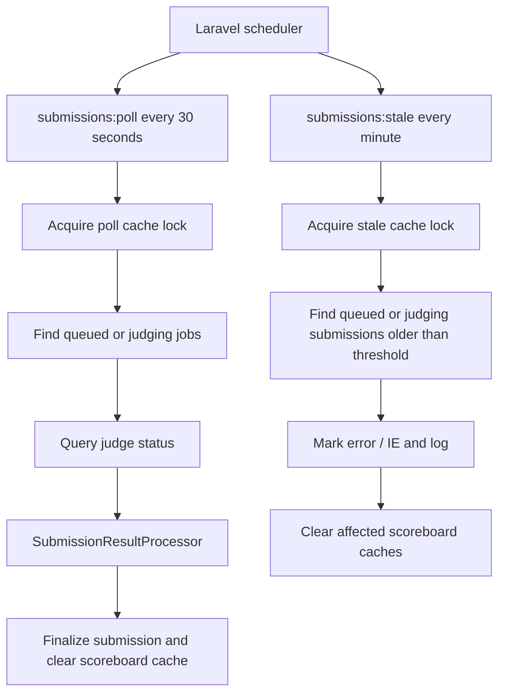

# Complete Console Commands

Two commands can be scheduled or invoked manually. They poll pending judge jobs and finalize submissions that remain stuck too long.

## Files Included

| File | Purpose |
| --- | --- |
| `app/Console/Commands/PollSubmissions.php` | `submissions:poll`: finds pending submissions the contestant's browser may have abandoned, queries the judge, and passes responses to `SubmissionResultProcessor`. |
| `app/Console/Commands/MarkStaleSubmissions.php` | `submissions:stale`: marks submissions stuck in queued/judging past a threshold as error / IE. |
| `routes/console.php` | Laravel 11 schedule registration. |

Both commands use a `Cache::lock()` so scheduled and manual invocations cannot race. Both support `--dry-run`; polling supports `--submission=` and `--limit=`, while stale marking supports `--minutes=`.

## Scheduled Workflow



The two scheduled commands run in the background. Their relative execution order is not guaranteed; their filters make either order correct. A completed submission no longer matches stale marking, and an error-finalized submission no longer matches polling.

## 1. `app/Console/Commands/PollSubmissions.php`

Runs every 30 seconds. It selects submissions that are queued or judging, have a `judge_job_id`, were submitted more than 10 seconds ago, and have not been checked in the last 30 seconds. The age and dedup checks are bypassed for an explicit `--submission` ID. The 120-second lock protects against scheduler/manual overlap.

```php
<?php

namespace App\Console\Commands;

use App\Exceptions\JudgeException;
use App\Models\Submission;
use App\Services\JudgeClient;
use App\Services\SubmissionResultProcessor;
use Illuminate\Console\Command;
use Illuminate\Support\Facades\Cache;
use Illuminate\Support\Facades\Log;

/**
 * Poll the judge for pending submissions.
 *
 * Runs every 30 seconds. Picks up submissions that:
 *   - are in `queued` or `judging` status
 *   - have a judge_job_id (i.e. the submit call succeeded)
 *   - were submitted more than 10 seconds ago (gives the contestant's own
 *     polling loop a chance to fire first — avoids double judge hits)
 *   - have not been checked in the last 30 seconds (skips submissions
 *     whose contestant tab is still open and actively polling)
 *
 * For each, calls JudgeClient->status() and hands the response to
 * SubmissionResultProcessor, which writes results transactionally and
 * invalidates the scoreboard cache.
 *
 * Uses a Cache::lock() so a manually-invoked `artisan` call cannot race
 * with the scheduler. The lock has a 120-second TTL — long enough to
 * cover a slow batch, short enough that a crashed run doesn't hold it
 * forever.
 */
final class PollSubmissions extends Command
{
    protected $signature = 'submissions:poll
                            {--submission= : Only process a single submission ID (bypasses age/dedup checks)}
                            {--dry-run : List what would be processed without calling the judge}
                            {--limit=100 : Maximum number of submissions to process in one run}';

    protected $description = 'Poll the judge for the status of pending submissions.';

    public function handle(JudgeClient $judge, SubmissionResultProcessor $processor): int
    {
        $lock = Cache::lock('submissions:poll:lock', 120);

        if (! $lock->get()) {
            $this->info('Another submissions:poll is already running — skipping this tick.');
            return self::SUCCESS;
        }

        try {
            return $this->run($judge, $processor);
        } finally {
            $lock->release();
        }
    }

    private function run(JudgeClient $judge, SubmissionResultProcessor $processor): int
    {
        $dryRun       = (bool) $this->option('dry-run');
        $singleId     = $this->option('submission');
        $limit        = max(1, (int) $this->option('limit'));

        $query = Submission::query()
            ->whereIn('status', [Submission::STATUS_QUEUED, Submission::STATUS_JUDGING])
            ->whereNotNull('judge_job_id')
            ->with('contestProblem.problem')
            ->orderBy('submitted_at');

        if ($singleId !== null) {
            $query->whereKey((int) $singleId);
        } else {
            $query
                ->where('submitted_at', '<', now()->subSeconds(10))
                ->where(function ($q) {
                    $q->whereNull('last_judge_check_at')
                      ->orWhere('last_judge_check_at', '<', now()->subSeconds(30));
                });
        }

        $total = (clone $query)->count();

        if ($total === 0) {
            $this->line('No pending submissions to poll.');
            return self::SUCCESS;
        }

        if ($dryRun) {
            $this->info("DRY RUN — {$total} pending submission(s) match the criteria:");
            $query->limit($limit)->each(function (Submission $s) {
                $this->line(sprintf(
                    '  #%d  job=%s  status=%s  submitted=%s  last_check=%s',
                    $s->id,
                    $s->judge_job_id,
                    $s->status,
                    $s->submitted_at?->toDateTimeString() ?? '—',
                    $s->last_judge_check_at?->toDateTimeString() ?? 'never',
                ));
            });
            return self::SUCCESS;
        }

        $stats = [
            'processed' => 0,
            'finalized' => 0,
            'pending'   => 0,
            'failed'    => 0,
        ];

        $query->limit($limit)->chunk(50, function ($chunk) use ($judge, $processor, $stats) {
            foreach ($chunk as $submission) {
                $stats['processed']++;
                $this->processOne($submission, $judge, $processor, $stats);
            }
        });

        $this->info(sprintf(
            'Poll complete: %d processed, %d finalized, %d still pending, %d failed.',
            $stats['processed'],
            $stats['finalized'],
            $stats['pending'],
            $stats['failed'],
        ));

        return self::SUCCESS;
    }

    /**
     * @param  array{processed:int, finalized:int, pending:int, failed:int}  $stats
     */
    private function processOne(
        Submission $submission,
        JudgeClient $judge,
        SubmissionResultProcessor $processor,
        array &$stats,
    ): void {
        try {
            $response = $judge->status($submission->judge_job_id);
            $finalized = $processor->apply($submission, $response);

            if ($finalized) {
                $stats['finalized']++;
                $this->line(sprintf(
                    '  #%d  %s  (%s)',
                    $submission->id,
                    $submission->fresh()->verdict,
                    $submission->fresh()->status,
                ));
            } else {
                $stats['pending']++;
            }
        } catch (JudgeException $e) {
            $stats['failed']++;

            Log::warning('submissions:poll — judge call failed', [
                'submission_id' => $submission->id,
                'job_id'        => $submission->judge_job_id,
                'reason'        => $e->getMessage(),
                'context'       => $e->context,
            ]);

            $this->warn(sprintf(
                '  #%d  FAILED: %s',
                $submission->id,
                $e->getMessage(),
            ));
        } catch (\Throwable $e) {
            $stats['failed']++;

            Log::error('submissions:poll — unexpected error', [
                'submission_id' => $submission->id,
                'job_id'        => $submission->judge_job_id,
                'error'         => $e->getMessage(),
            ]);

            report($e);
        }
    }
}
```

## 2. `app/Console/Commands/MarkStaleSubmissions.php`

Runs every minute. It marks queued/judging submissions older than 10 minutes by default as internal errors. `--minutes=N` overrides the threshold. This is the floor guarantee: even if the judge is permanently down, a submission eventually reaches a terminal state and stops being polled. Changed contests have both scoreboard cache variants invalidated.

```php
<?php

namespace App\Console\Commands;

use App\Models\Submission;
use App\Services\ScoreboardService;
use Illuminate\Console\Command;
use Illuminate\Support\Facades\Cache;
use Illuminate\Support\Facades\Log;

/**
 * Mark submissions stuck in `queued` or `judging` past a threshold as
 * errors so nothing stays pending forever.
 *
 * Runs every minute. Default threshold: 10 minutes from submitted_at.
 * Override with --minutes=N.
 *
 * This is the floor guarantee: even if the judge is down permanently,
 * every submission eventually reaches a terminal state and stops being
 * polled by PollSubmissions.
 *
 * Also invalidates the scoreboard cache so the UI reflects the change.
 */
final class MarkStaleSubmissions extends Command
{
    protected $signature = 'submissions:stale
                            {--minutes=10 : Age threshold in minutes}
                            {--dry-run : List what would be marked without updating}';

    protected $description = 'Mark stale submissions (stuck past threshold) as internal errors.';

    public function handle(ScoreboardService $scoreboard): int
    {
        $lock = Cache::lock('submissions:stale:lock', 60);
        if (! $lock->get()) {
            $this->info('Another submissions:stale is already running — skipping this tick.');
            return self::SUCCESS;
        }

        try {
            return $this->run($scoreboard);
        } finally {
            $lock->release();
        }
    }

    private function run(ScoreboardService $scoreboard): int
    {
        $dryRun     = (bool) $this->option('dry-run');
        $minutes    = max(1, (int) $this->option('minutes'));
        $threshold  = now()->subMinutes($minutes);

        $query = Submission::query()
            ->whereIn('status', [Submission::STATUS_QUEUED, Submission::STATUS_JUDGING])
            ->where('submitted_at', '<', $threshold)
            ->orderBy('submitted_at');

        $total = (clone $query)->count();

        if ($total === 0) {
            $this->line('No stale submissions.');
            return self::SUCCESS;
        }

        if ($dryRun) {
            $this->info("DRY RUN — {$total} stale submission(s) older than {$minutes} minute(s):");
            $query->each(function (Submission $s) {
                $this->line(sprintf(
                    '  #%d  status=%s  job=%s  submitted=%s',
                    $s->id,
                    $s->status,
                    $s->judge_job_id ?? '—',
                    $s->submitted_at?->toDateTimeString() ?? '—',
                ));
            });
            return self::SUCCESS;
        }

        $affectedContestIds = [];

        // Update in bulk for speed, but log each one so ops can see what
        // got cleaned up. Bulk update is fine here because the only fields
        // being set are status/verdict/judged_at — no per-row logic.
        $query->each(function (Submission $submission) use (&$affectedContestIds) {
            Log::warning('submissions:stale — marking submission as internal error', [
                'submission_id' => $submission->id,
                'job_id'        => $submission->judge_job_id,
                'status'        => $submission->status,
                'submitted_at'  => $submission->submitted_at?->toIso8601String(),
                'age_seconds'   => $submission->submitted_at
                    ? (int) $submission->submitted_at->diffInSeconds(now())
                    : null,
            ]);

            $submission->forceFill([
                'status'              => Submission::STATUS_ERROR,
                'verdict'             => Submission::VERDICT_INTERNAL_ERROR,
                'judged_at'           => now(),
                'last_judge_check_at' => now(),
            ])->save();

            $affectedContestIds[$submission->contest_id] = true;
        });

        // Invalidate scoreboard caches for affected contests.
        foreach (array_keys($affectedContestIds) as $contestId) {
            Cache::forget(ScoreboardService::cacheKey($contestId, false));
            Cache::forget(ScoreboardService::cacheKey($contestId, true));
        }

        $this->info(sprintf(
            'Marked %d stale submission(s) as Internal Error across %d contest(s).',
            $total,
            count($affectedContestIds),
        ));

        return self::SUCCESS;
    }
}
```

## 3. `routes/console.php` Schedule Registration

Laravel 11 removed `app/Console/Kernel.php` and moved scheduling to `routes/console.php`.

```php
<?php

use App\Console\Commands\MarkStaleSubmissions;
use App\Console\Commands\PollSubmissions;
use Illuminate\Support\Facades\Schedule;

/**
 * Poll pending submissions every 30 seconds.
 *
 * The command has an internal Cache lock, so even if this fires while a
 * previous run is still going (or someone invokes it manually), the second
 * run exits cleanly.
 */
Schedule::command(PollSubmissions::class)
    ->everyThirtySeconds()
    ->runInBackground()
    ->appendOutputTo(storage_path('logs/submissions-poll.log'));

/**
 * Mark submissions stuck past the threshold as errors, once per minute.
 *
 * Runs after the poll command in wall-clock time, so a stale submission
 * gets one final poll attempt before being marked IE.
 */
Schedule::command(MarkStaleSubmissions::class)
    ->everyMinute()
    ->runInBackground()
    ->appendOutputTo(storage_path('logs/submissions-stale.log'));
```

## 4. Notes and Behavior

### Poll selection and deduplication

The `submitted_at < now() - 10s` guard gives the contestant browser's two-second polling loop a chance to query the judge first. The background sweep waits 10 seconds to avoid duplicate calls. If the tab remains open, contestant-driven polling may resolve the verdict; if it closes, the sweep picks it up within roughly 10–40 seconds.

The `last_judge_check_at < now() - 30s` condition avoids the background process querying a job that an active contestant tab is already polling every two seconds. It reduces judge load to contestant requests plus abandoned submissions.

### Cache locks

Scheduler `withoutOverlapping()` helps with scheduler-managed runs on one server, but a manual `php artisan submissions:poll` could otherwise race the scheduler. The in-command `Cache::lock()` prevents that; a second caller exits immediately.

The poll lock TTL is 120 seconds. With the default limit of 100 and a slow judge call taking 500 ms, a run is expected to take at most about 50 seconds; 120 seconds allows headroom and releases after a crashed run.

### Poll limit and targeted submission

- `--limit` defaults to 100. Increasing it can process more backlog per run but risks exceeding the 120-second lock TTL; 200 submissions at 500 ms each would take about 100 seconds. Keep 100 unless measurements support a change.
- `--submission=` bypasses age/dedup filters and is intended to force-check one stuck submission:

  ```bash
  php artisan submissions:poll --submission=1234
  ```

  This calls the judge once for that submission and reports the result.

### Dry runs

Both commands support `--dry-run`. They list what would be processed or marked without calling the judge or changing the database. This is safe for production queue-depth checks.

### Stale query behavior

`MarkStaleSubmissions` uses `->each()` rather than a bulk update because it logs each record. Query `each()` streams records rather than loading them all at once. Even 10,000 stale submissions should complete in a few seconds, though that volume suggests a judge outage.

### Scoreboard cache invalidation

Both commands invalidate scoreboard cache when submission state changes. Without invalidation, a stale submission marked IE might continue to appear pending until the 5-second cache TTL expires. The next render after invalidation sees the new state.

### Background scheduling

`runInBackground()` launches commands as subprocesses so the scheduler is not blocked. If a poll run takes longer than its 30-second interval, the next scheduler tick still starts; the internal cache lock makes the overlapping invocation exit cleanly.

### Logs

- `storage/logs/submissions-poll.log`
- `storage/logs/submissions-stale.log`

Separate files keep operational output out of the main log stream. `Log::warning` / `Log::error` calls in the commands still go to `laravel.log` or the configured logging destination.

### Ordering and thresholds

The scheduler runs polling every 30 seconds and stale marking every 60 seconds. Since both are background processes, execution order is not guaranteed. The filters make either order safe:

- If the poller receives `Completed`, it finalizes the submission and stale marking no longer selects it.
- If the judge is down, polling can fail repeatedly; at the 10-minute threshold stale marking finalizes it as error/IE. Later poll runs no longer select it because it is not queued or judging.

### `--minutes=1` override

`submissions:stale --minutes=1` marks submissions older than one minute as stale. It is useful for demos, tests, or fail-fast cleanup during a known judge outage, but dangerous in production. Do not use it as the scheduler default.

### What the commands do not do

- **No broadcasts:** `SubmissionJudged` / `ScoreboardUpdated` events are deferred until Reverb or another event system is introduced.
- **No submission retry:** If a status query throws `JudgeException`, the poller logs and moves on. A slow judge can be queried on the next tick. If the initial judge submit was rejected, `SubmitController` already marks the submission error/IE, so it is not queued for polling.
- **No `last_judge_check_at` update on failed calls:** If `JudgeClient::status()` throws, the row is not updated. The next tick retries subject to the 30-second dedup condition, which is based on the older timestamp. Retrying sooner after an unreachable judge is intentional.
- **No rejudge count increment:** Stale marking is error finalization, not a rejudge. `status = 'error'` and `verdict = 'IE'` distinguishes a timeout from a legitimate judge result.

## 5. Manual Invocation Examples

```bash
# Normal scheduled tick (what cron/scheduler runs)
php artisan submissions:poll
php artisan submissions:stale

# Dry runs to see queue state
php artisan submissions:poll --dry-run
php artisan submissions:stale --dry-run

# Force-check a specific stuck submission
php artisan submissions:poll --submission=1234

# Aggressive cleanup during an outage
php artisan submissions:stale --minutes=2
```

## Source Ending

The provided `commands.txt` ends with the heading “What's next from the remaining list” and contains no text after it.
