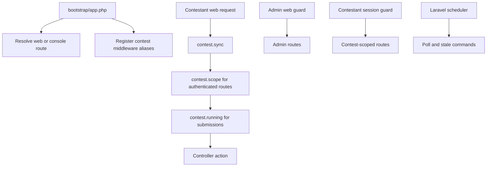
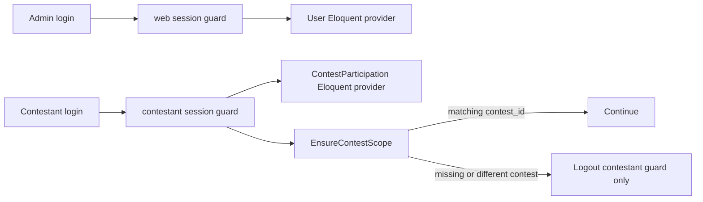

# Complete Config and Bootstrap

Everything needed to boot the app: Laravel bootstrap configuration, middleware registration and implementations, routes, schedule registration, selected config files, and `.env.example`.

> The requested source was named `config.txt`, but the workspace contains `cinfig.txt`. This document was converted from the available `cinfig.txt`.

## Included Files and Setup

| File | Purpose |
| --- | --- |
| `bootstrap/app.php` | Laravel 11 routing, middleware aliases, and exception handling. |
| `routes/web.php` | Admin and contestant routes. |
| `routes/console.php` | Schedule registration, repeated for completeness. |
| `config/app.php` | Timezone and locale highlights, emphasizing UTC. |
| `config/auth.php` | `web` guard for admins and `contestant` guard for participations. |
| `config/database.php` | MySQL charset/collation settings to verify. |
| `config/filesystems.php` | `test_cases` and `sources` disks. |
| `config/judge.php` | New judge-engine configuration. |
| `.env.example` | Environment variables for the application. |
| `app/Http/Middleware/SyncContestState.php` | Synchronizes contest state on requests. |
| `app/Http/Middleware/EnsureContestScope.php` | Blocks cross-contest access. |
| `app/Http/Middleware/EnsureContestRunning.php` | Blocks submissions outside the contest window. |
| `bootstrap/providers.php` | No changes needed. |

Install the composer packages:

```bash
composer require barryvdh/laravel-dompdf league/csv
```

## Bootstrap and Request Flow



## Authentication Guards



## 1. `bootstrap/app.php`

```php
<?php

use App\Http\Middleware\EnsureContestRunning;
use App\Http\Middleware\EnsureContestScope;
use App\Http\Middleware\SyncContestState;
use Illuminate\Foundation\Application;
use Illuminate\Foundation\Configuration\Exceptions;
use Illuminate\Foundation\Configuration\Middleware;
use Illuminate\Http\Request;

return Application::configure(basePath: dirname(__DIR__))
    ->withRouting(
        web: __DIR__.'/../routes/web.php',
        commands: __DIR__.'/../routes/console.php',
        health: '/up',
    )
    ->withMiddleware(function (Middleware $middleware) {
        // Custom middleware aliases — referenced by routes/web.php.
        $middleware->alias([
            'contest.sync'    => SyncContestState::class,
            'contest.scope'   => EnsureContestScope::class,
            'contest.running' => EnsureContestRunning::class,
        ]);

        // Redirect unauthenticated users based on which area they hit.
        // Default redirects to /login (doesn't exist for us), so we override.
        $middleware->redirectUsersTo(fn (Request $request) => route('admin.dashboard'));
        $middleware->redirectGuestsTo(function (Request $request) {
            // Contestant area → that contest's login
            if ($request->routeIs('contest.*') && $request->route('contest')) {
                return route('contest.login', $request->route('contest'));
            }
            return route('admin.login');
        });
    })
    ->withExceptions(function (Exceptions $exceptions) {
        // Contestant-facing routes get a friendly error page rather than
        // a raw 403 stack trace. Admin routes get the default behaviour.
        $exceptions->render(function (\Throwable $e, Request $request) {
            if ($request->routeIs('contest.*')
                && in_array($e->getStatusCode ?? null, [403, 404], true)
            ) {
                return response()->view('errors.contest-error', [
                    'status'  => $e->getStatusCode(),
                    'message' => $e->getMessage() ?: 'Something went wrong.',
                ], $e->getStatusCode());
            }
            return null;
        });
    })->create();
```

The source notes that `$e->getStatusCode` is checked as a dynamic property. For strict typing, replace it with an `instanceof` check against `Symfony\Component\HttpKernel\Exception\HttpExceptionInterface`. The `?? null` fallback skips the custom render for non-HTTP exceptions; this was described as a defensive refinement, not a correctness issue.

## 2. `routes/web.php`

```php
<?php

use App\Http\Controllers\Admin\AdminAuthController;
use App\Http\Controllers\Admin\AdminDashboardController;
use App\Http\Controllers\Admin\AdminQuestionController;
use App\Http\Controllers\Admin\AdminScoreboardController;
use App\Http\Controllers\Admin\AdminSubmissionController;
use App\Http\Controllers\Admin\ContestApprovalController;
use App\Http\Controllers\Admin\ContestController;
use App\Http\Controllers\Admin\ContestEndController;
use App\Http\Controllers\Admin\ContestProblemController;
use App\Http\Controllers\Admin\ContestStartController;
use App\Http\Controllers\Admin\CredentialController;
use App\Http\Controllers\Admin\ProblemController;
use App\Http\Controllers\Admin\TeamImportController;
use App\Http\Controllers\Admin\TestCaseController;
use App\Http\Controllers\Contest\ContestantAuthController;
use App\Http\Controllers\Contest\ContestantLandingController;
use App\Http\Controllers\Contest\ContestantProblemController;
use App\Http\Controllers\Contest\ContestantQuestionController;
use App\Http\Controllers\Contest\ContestantScoreboardController;
use App\Http\Controllers\Contest\ContestantSubmissionController;
use App\Http\Controllers\Contest\SubmitController;
use Illuminate\Support\Facades\Route;

/*
|--------------------------------------------------------------------------
| Landing
|--------------------------------------------------------------------------
*/
Route::get('/', function () {
    return auth('web')->check()
        ? redirect()->route('admin.dashboard')
        : redirect()->route('admin.login');
})->name('home');

/*
|--------------------------------------------------------------------------
| Admin
|--------------------------------------------------------------------------
*/
Route::prefix('admin')->name('admin.')->group(function () {
    // Auth (no middleware — these must be reachable when logged out)
    Route::get('login',   [AdminAuthController::class, 'showLogin'])->name('login');
    Route::post('login',  [AdminAuthController::class, 'login'])->name('login.store');
    Route::post('logout', [AdminAuthController::class, 'logout'])->name('logout');

    Route::middleware('auth:web')->group(function () {
        // Dashboard
        Route::get('/', AdminDashboardController::class)->name('dashboard');

        // ── Contest-scoped routes (need state sync) ───────────────────
        Route::middleware('contest.sync')->group(function () {
            // Contest CRUD
            Route::resource('contests', ContestController::class);

            // Contest lifecycle
            Route::post('contests/{contest}/approve', ContestApprovalController::class)->name('contests.approve');
            Route::post('contests/{contest}/start',   ContestStartController::class)->name('contests.start');
            Route::post('contests/{contest}/end',     ContestEndController::class)->name('contests.end');

            // Contest ↔ Problem attach/detach/reorder
            Route::get   ('contests/{contest}/problems',                   [ContestProblemController::class, 'index'])  ->name('contests.problems.index');
            Route::post  ('contests/{contest}/problems',                   [ContestProblemController::class, 'store'])  ->name('contests.problems.store');
            Route::patch ('contests/{contest}/problems/{contestProblem}',  [ContestProblemController::class, 'update']) ->name('contests.problems.update');
            Route::delete('contests/{contest}/problems/{contestProblem}',  [ContestProblemController::class, 'destroy'])->name('contests.problems.destroy');
            Route::post  ('contests/{contest}/problems/reorder',           [ContestProblemController::class, 'reorder'])->name('contests.problems.reorder');

            // Teams + credentials
            Route::get ('contests/{contest}/teams/import',  [TeamImportController::class, 'show']) ->name('contests.teams.import');
            Route::post('contests/{contest}/teams/import',  [TeamImportController::class, 'store'])->name('contests.teams.import.store');

            Route::get ('contests/{contest}/credentials',              [CredentialController::class, 'index'])     ->name('contests.credentials');
            Route::post('contests/{contest}/credentials/generate',     [CredentialController::class, 'generate'])  ->name('contests.credentials.generate');
            Route::post('contests/{contest}/credentials/regenerate',   [CredentialController::class, 'regenerate'])->name('contests.credentials.regenerate');

            // Submissions + rejudge
            Route::get ('contests/{contest}/submissions',                       [AdminSubmissionController::class, 'index'])  ->name('contests.submissions');
            Route::get ('contests/{contest}/submissions/{submission}',          [AdminSubmissionController::class, 'show'])   ->name('contests.submissions.show');
            Route::post('contests/{contest}/submissions/{submission}/rejudge',  [AdminSubmissionController::class, 'rejudge'])->name('contests.submissions.rejudge');

            // Admin scoreboard (unfrozen)
            Route::get('contests/{contest}/scoreboard', AdminScoreboardController::class)->name('contests.scoreboard');

            // Q&A
            Route::get ('contests/{contest}/questions',                        [AdminQuestionController::class, 'index']) ->name('contests.questions');
            Route::post('contests/{contest}/questions/{question}/answer',      [AdminQuestionController::class, 'answer'])->name('contests.questions.answer');
        });

        // ── Problem bank (not contest-scoped) ─────────────────────────
        Route::resource('problems', ProblemController::class);

        Route::get   ('problems/{problem}/test-cases',                             [TestCaseController::class, 'index'])   ->name('problems.test-cases');
        Route::post  ('problems/{problem}/test-cases',                             [TestCaseController::class, 'store'])   ->name('problems.test-cases.store');
        Route::patch ('problems/{problem}/test-cases/{testCase}',                  [TestCaseController::class, 'update'])  ->name('problems.test-cases.update');
        Route::delete('problems/{problem}/test-cases/{testCase}',                  [TestCaseController::class, 'destroy']) ->name('problems.test-cases.destroy');
        Route::get   ('problems/{problem}/test-cases/{testCase}/{side}',           [TestCaseController::class, 'download'])->name('problems.test-cases.download');
    });
});

/*
|--------------------------------------------------------------------------
| Contestant — every URL is scoped to a specific contest
|--------------------------------------------------------------------------
*/
Route::prefix('c/{contest:slug}')->name('contest.')->middleware('contest.sync')->group(function () {
    // Public-facing
    Route::get('/',        [ContestantLandingController::class, 'show'])     ->name('landing');
    Route::get('login',    [ContestantAuthController::class, 'showLogin'])   ->name('login');
    Route::post('login',   [ContestantAuthController::class, 'login'])       ->name('login.store');
    Route::post('logout',  [ContestantAuthController::class, 'logout'])      ->name('logout');

    // Public scoreboard (auth still enforced inside the controller for private contests)
    Route::get('scoreboard', ContestantScoreboardController::class)          ->name('scoreboard');

    // Authenticated contestant routes
    Route::middleware(['auth:contestant', 'contest.scope'])->group(function () {
        Route::get('problems',                          [ContestantProblemController::class, 'index'])   ->name('problems');
        Route::get('problems/{label}',                  [ContestantProblemController::class, 'show'])    ->name('problems.show');

        Route::get('submissions',                       [ContestantSubmissionController::class, 'index'])->name('submissions');
        Route::get('submissions/{submission}',          [ContestantSubmissionController::class, 'show']) ->name('submissions.show');
        Route::get('submissions/{submission}/status',   [ContestantSubmissionController::class, 'status'])->name('submissions.status');

        Route::get('questions',  [ContestantQuestionController::class, 'index'])->name('questions');
        Route::post('questions', [ContestantQuestionController::class, 'store'])->name('questions.store');

        // Submissions only allowed while contest is running
        Route::middleware('contest.running')->group(function () {
            Route::post('problems/{label}/submit', SubmitController::class)->name('submit');
        });
    });
});
```

### Route Notes

- `contest.sync` is applied to admin contest routes and all contestant routes. It is a no-op when `{contest}` is not resolved (for example, `POST /admin/contests` when creating a draft).
- The contestant scoreboard route is outside the auth group so a public venue projector can load it. The controller checks auth when `is_public = false`.
- Admin login routes are named `admin.login` (GET) and `admin.login.store` (POST), avoiding a name collision.
- `/` redirects based on the web session, giving admins a sensible entry point.

## 3. `routes/console.php`

```php
<?php

use App\Console\Commands\MarkStaleSubmissions;
use App\Console\Commands\PollSubmissions;
use Illuminate\Support\Facades\Schedule;

// Poll pending submissions every 30 seconds.
// Internal Cache lock ensures overlapping runs exit cleanly.
Schedule::command(PollSubmissions::class)
    ->everyThirtySeconds()
    ->runInBackground()
    ->appendOutputTo(storage_path('logs/submissions-poll.log'));

// Mark stale submissions as internal errors, once per minute.
Schedule::command(MarkStaleSubmissions::class)
    ->everyMinute()
    ->runInBackground()
    ->appendOutputTo(storage_path('logs/submissions-stale.log'));
```

## 4. `config/app.php` Highlights

Laravel 11's `config/app.php` is fine as-is; verify these values:

```php
'name'            => env('APP_NAME', 'CodeArena'),

// Business times are stored as UTC. The frontend converts for display.
'timezone'        => env('APP_TIMEZONE', 'UTC'),

// Keep these; they control Carbon's locale and date formatting.
'locale'          => env('APP_LOCALE', 'en'),
'fallback_locale' => env('APP_FALLBACK_LOCALE', 'en'),
'faker_locale'    => env('APP_FAKER_LOCALE', 'en_US'),
```

No other changes are needed to `config/app.php`.

## 5. `config/auth.php`

```php
<?php

return [

    /*
    |--------------------------------------------------------------------------
    | Authentication Defaults
    |--------------------------------------------------------------------------
    | The "web" guard is the default (used by Auth::user() etc.) and backs
    | admins. The "contestant" guard is used explicitly by contestant routes.
    */
    'defaults' => [
        'guard'     => env('AUTH_GUARD', 'web'),
        'passwords' => env('AUTH_PASSWORD_BROKER', 'users'),
    ],

    /*
    |--------------------------------------------------------------------------
    | Authentication Guards
    |--------------------------------------------------------------------------
    */
    'guards' => [
        'web' => [
            'driver'   => 'session',
            'provider' => 'users',
        ],
        'contestant' => [
            'driver'   => 'session',
            'provider' => 'participations',
        ],
    ],

    /*
    |--------------------------------------------------------------------------
    | User Providers
    |--------------------------------------------------------------------------
    */
    'providers' => [
        'users' => [
            'driver' => 'eloquent',
            'model'  => App\Models\User::class,
        ],
        'participations' => [
            'driver' => 'eloquent',
            'model'  => App\Models\ContestParticipation::class,
        ],
    ],

    /*
    |--------------------------------------------------------------------------
    | Resetting Passwords
    |--------------------------------------------------------------------------
    | Only admins have a reset flow; contestants use generated credentials
    | that are regenerated by an admin, not self-service.
    */
    'passwords' => [
        'users' => [
            'provider' => 'users',
            'table'    => env('AUTH_PASSWORD_RESET_TOKEN_TABLE', 'password_reset_tokens'),
            'expire'   => 60,
            'throttle' => 60,
        ],
    ],

    'password_timeout' => env('AUTH_PASSWORD_TIMEOUT', 10800),
];
```

## 6. `config/database.php` MySQL Settings

The default Laravel 11 MySQL block already uses `utf8mb4`. Verify these settings:

```php
'mysql' => [
    'driver'         => 'mysql',
    'url'            => env('DB_URL'),
    'host'           => env('DB_HOST', '127.0.0.1'),
    'port'           => env('DB_PORT', '3306'),
    'database'       => env('DB_DATABASE', 'codearena'),
    'username'       => env('DB_USERNAME', 'root'),
    'password'       => env('DB_PASSWORD', ''),
    'unix_socket'    => env('DB_SOCKET', ''),
    'charset'        => env('DB_CHARSET', 'utf8mb4'),
    'collation'      => env('DB_COLLATION', 'utf8mb4_unicode_ci'),
    'prefix'         => '',
    'prefix_indexes' => true,
    'strict'         => true,
    'engine'         => null,
    'options'        => extension_loaded('pdo_mysql') ? array_filter([
        PDO::MYSQL_ATTR_SSL_CA => env('MYSQL_ATTR_SSL_CA'),
    ]) : [],
],
```

Everything else in `config/database.php` (Redis, SQLite, PostgreSQL) can stay at the default because it is unused.

## 7. `config/filesystems.php`

```php
<?php

return [

    /*
    |--------------------------------------------------------------------------
    | Default Filesystem Disk
    |--------------------------------------------------------------------------
    */
    'default' => env('FILESYSTEM_DISK', 'local'),

    /*
    |--------------------------------------------------------------------------
    | Application-specific Disk Names
    |--------------------------------------------------------------------------
    | These point at the disks below. The models read them via
    | config('filesystems.test_cases_disk') and config('filesystems.sources_disk'),
    | so overriding via env swaps the disk without changing code.
    */
    'test_cases_disk' => env('TEST_CASES_DISK', 'test_cases'),
    'sources_disk'    => env('SOURCES_DISK', 'sources'),

    /*
    |--------------------------------------------------------------------------
    | Filesystem Disks
    |--------------------------------------------------------------------------
    */
    'disks' => [

        'local' => [
            'driver' => 'local',
            'root'   => storage_path('app/private'),
            'serve'  => true,
            'throw'  => false,
        ],

        'public' => [
            'driver'     => 'local',
            'root'       => storage_path('app/public'),
            'url'        => env('APP_URL').'/storage',
            'visibility' => 'public',
            'throw'      => false,
        ],

        // Test case files — input/output pairs for problems.
        // Swap 'driver' to 's3' + add bucket config to scale out.
        'test_cases' => [
            'driver' => 'local',
            'root'   => storage_path('app/private/test_cases'),
            'serve'  => true,
            'throw'  => false,
        ],

        // Submitted source code.
        'sources' => [
            'driver' => 'local',
            'root'   => storage_path('app/private/sources'),
            'serve'  => true,
            'throw'  => false,
        ],

        's3' => [
            'driver'                  => 's3',
            'key'                     => env('AWS_ACCESS_KEY_ID'),
            'secret'                  => env('AWS_SECRET_ACCESS_KEY'),
            'region'                  => env('AWS_DEFAULT_REGION'),
            'bucket'                  => env('AWS_BUCKET'),
            'url'                     => env('AWS_URL'),
            'endpoint'                => env('AWS_ENDPOINT'),
            'use_path_style_endpoint' => env('AWS_USE_PATH_STYLE_ENDPOINT', false),
            'throw'                   => false,
        ],

    ],

    /*
    |--------------------------------------------------------------------------
    | Symbolic Links
    |--------------------------------------------------------------------------
    */
    'links' => [
        public_path('storage') => storage_path('app/public'),
    ],
];
```

## 8. `config/judge.php` (New File)

```php
<?php

return [

    /*
    |--------------------------------------------------------------------------
    | Judge Engine Base URL
    |--------------------------------------------------------------------------
    | The FastAPI judge engine's base URL. Note: the judge docs are internally
    | inconsistent (they cite both port 9000 and 8000). Verify with the judge
    | operator and set JUDGE_BASE_URL accordingly.
    |
    | The judge has NO authentication. Keep it behind a firewall / on a
    | private network — never expose it to the internet.
    */
    'base_url' => env('JUDGE_BASE_URL', 'http://127.0.0.1:9000'),

    /*
    |--------------------------------------------------------------------------
    | Endpoint Paths
    |--------------------------------------------------------------------------
    */
    'submit_path'    => '/api/v1/submissions/',
    'status_path'    => '/api/v1/submissions/{job_id}',
    'languages_path' => '/api/v1/languages/',

    /*
    |--------------------------------------------------------------------------
    | Timeouts (seconds)
    |--------------------------------------------------------------------------
    | Submit is fast (returns 202 immediately). Status may be slower if the
    | judge is busy. Both bounded generously; JudgeClient throws
    | JudgeException::unreachable() on connection failure so the caller can
    | recover.
    */
    'submit_timeout' => (int) env('JUDGE_SUBMIT_TIMEOUT', 10),
    'status_timeout' => (int) env('JUDGE_STATUS_TIMEOUT', 30),

    /*
    |--------------------------------------------------------------------------
    | Language Cache TTL (seconds)
    |--------------------------------------------------------------------------
    | JudgeLanguages caches the /languages/ response for this long.
    */
    'languages_ttl' => (int) env('JUDGE_LANGUAGES_TTL', 300),
];
```

`JudgeLanguages` currently hardcodes `TTL_SECONDS = 300` as a class constant. To honor `judge.languages_ttl`, read the config value inside `JudgeLanguages::all()`; otherwise leave the constant. The source recommends leaving the constant for now while keeping the mismatch conscious.

## 9. `.env.example`

```dotenv
APP_NAME=CodeArena
APP_ENV=local
APP_KEY=
APP_DEBUG=true
APP_TIMEZONE=UTC
APP_URL=http://localhost

APP_LOCALE=en
APP_FALLBACK_LOCALE=en
APP_FAKER_LOCALE=en_US

APP_MAINTENANCE_DRIVER=file

PHP_CLI_SERVER_WORKERS=4

BCRYPT_ROUNDS=12

LOG_CHANNEL=stack
LOG_STACK=single
LOG_DEPRECATIONS_CHANNEL=null
LOG_LEVEL=debug

# ---------------------------------------------------------------
# Database
# ---------------------------------------------------------------
DB_CONNECTION=mysql
DB_HOST=127.0.0.1
DB_PORT=3306
DB_DATABASE=codearena
DB_USERNAME=root
DB_PASSWORD=
DB_CHARSET=utf8mb4
DB_COLLATION=utf8mb4_unicode_ci

# ---------------------------------------------------------------
# Session / Cache / Queue
# ---------------------------------------------------------------
# database drivers — no Redis dependency.
SESSION_DRIVER=database
SESSION_LIFETIME=120
SESSION_ENCRYPT=false
SESSION_PATH=/
SESSION_DOMAIN=null

CACHE_STORE=database

BROADCAST_CONNECTION=log
FILESYSTEM_DISK=local

# sync — no worker process needed. The judge owns its queue.
QUEUE_CONNECTION=sync

# ---------------------------------------------------------------
# Application-specific disks
# ---------------------------------------------------------------
TEST_CASES_DISK=test_cases
SOURCES_DISK=sources

# ---------------------------------------------------------------
# Judge Engine
# ---------------------------------------------------------------
# NOTE: verify port with judge operator — docs cite both 9000 and 8000.
JUDGE_BASE_URL=http://127.0.0.1:9000
JUDGE_SUBMIT_TIMEOUT=10
JUDGE_STATUS_TIMEOUT=30
JUDGE_LANGUAGES_TTL=300

# ---------------------------------------------------------------
# Seeded admin (used by AdminUserSeeder on first `db:seed`)
# ---------------------------------------------------------------
ADMIN_SEED_EMAIL=admin@codearena.test
ADMIN_SEED_PASSWORD=password

# ---------------------------------------------------------------
# Mail (not used in v1 — contestant emails are record-only)
# ---------------------------------------------------------------
MAIL_MAILER=log
MAIL_FROM_ADDRESS="hello@codearena.test"
MAIL_FROM_NAME="${APP_NAME}"

# ---------------------------------------------------------------
# Vite (frontend build — not used; we use CDN Bootstrap)
# ---------------------------------------------------------------
VITE_APP_NAME="${APP_NAME}"
```

## 10. `app/Http/Middleware/SyncContestState.php`

```php
<?php

namespace App\Http\Middleware;

use App\Models\Contest;
use Closure;
use Illuminate\Http\Request;
use Symfony\Component\HttpFoundation\Response;

/**
 * On every request that has a {contest} route parameter, ensure the contest's
 * status matches what its start/end times say it should be.
 *
 * This is belt to the scheduler's braces — if the scheduler fires a few
 * seconds late, the first request to hit the app after start_time flips
 * the state immediately rather than making the user wait for the next tick.
 *
 * No-op when there is no {contest} parameter in the route.
 */
final class SyncContestState
{
    public function handle(Request $request, Closure $next): Response
    {
        $contest = $request->route('contest');

        if ($contest instanceof Contest) {
            $contest->syncState();
        }

        return $next($request);
    }
}
```

## 11. `app/Http/Middleware/EnsureContestScope.php`

```php
<?php

namespace App\Http\Middleware;

use App\Models\Contest;
use Closure;
use Illuminate\Http\Request;
use Illuminate\Support\Facades\Auth;
use Symfony\Component\HttpFoundation\Response;

/**
 * Ensures the authenticated contestant belongs to the contest in the URL.
 *
 * If the guard holds a participation from a *different* contest (e.g. the
 * user navigated from contest A to contest B without logging out), we log
 * out only the contestant guard — NOT the whole session — so a simultaneous
 * admin session in the same browser is preserved.
 */
final class EnsureContestScope
{
    public function handle(Request $request, Closure $next): Response
    {
        $contest = $request->route('contest');

        if (! $contest instanceof Contest) {
            // Middleware applied to a route without a contest param — misconfiguration.
            abort(500, 'EnsureContestScope requires a {contest} route parameter.');
        }

        $participation = Auth::guard('contestant')->user();

        if (! $participation || $participation->contest_id !== $contest->id) {
            // Log out ONLY the contestant guard. Never invalidate the whole
            // session — that would also log out an admin logged in on the
            // same browser.
            Auth::guard('contestant')->logout();

            return redirect()
                ->route('contest.login', $contest->slug)
                ->withErrors(['auth' => 'Please log in to this contest to continue.']);
        }

        return $next($request);
    }
}
```

## 12. `app/Http/Middleware/EnsureContestRunning.php`

```php
<?php

namespace App\Http\Middleware;

use App\Models\Contest;
use Closure;
use Illuminate\Http\Request;
use Symfony\Component\HttpFoundation\Response;

/**
 * Blocks submissions to a contest that isn't in the running state.
 * Returns a friendly redirect with a flash error rather than a 403 — the
 * contestant should land back on the problem page with a clear message.
 *
 * Covers:
 *   - Contest approved but not started yet
 *   - Contest already ended (auto or manual)
 *   - Contest in draft (shouldn't be reachable, but defensive)
 */
final class EnsureContestRunning
{
    public function handle(Request $request, Closure $next): Response
    {
        $contest = $request->route('contest');

        if (! $contest instanceof Contest) {
            abort(404);
        }

        if (! $contest->acceptsSubmissions()) {
            return redirect()
                ->route('contest.landing', $contest->slug)
                ->withErrors([
                    'contest' => 'The contest is not currently accepting submissions.',
                ]);
        }

        return $next($request);
    }
}
```

## 13. `bootstrap/providers.php` (No Change Needed)

Laravel 11's `bootstrap/providers.php` lists application service providers. The app has no custom providers to add:

```php
<?php

return [
    App\Providers\AppServiceProvider::class,
];
```

`JudgeClient`, `JudgeLanguages`, `SubmissionResultProcessor`, and `ScoreboardService` are resolved through Laravel auto-wiring; no service provider binding is required. Add a `JudgeServiceProvider` later only if you want to bind/mock `JudgeClient` explicitly.

## 14. Notes and Gotchas

1. **Composer packages:** Install `barryvdh/laravel-dompdf` and `league/csv` before bootstrapping. DomPDF registers through package discovery; no manual provider registration is needed. `league/csv` is a library, not a Laravel package, and needs no registration.
2. **Queue migration:** Laravel's default `0001_01_01_000002_create_jobs_table.php` creates `jobs`, `job_batches`, and `failed_jobs`. With `QUEUE_CONNECTION=sync`, they are unused. Either leave the migration (harmless empty tables) or delete it and run `php artisan migrate:rollback --step=1` if already migrated. Leaving it is recommended so async queues can be enabled later without a new migration.
3. **Session and cache tables:** `SESSION_DRIVER=database` and `CACHE_STORE=database` require Laravel's default migrations for sessions, cache, and `cache_locks`. They are included on a fresh install; do not skip them.
4. **Contest route model binding:** Contestant routes use `{contest:slug}`; admin routes use `{contest}` and the default ID. This is intentional: admin URLs use opaque IDs and contestant URLs use readable slugs. The `Contest` model has both fields.
5. **`redirectGuestsTo`:** It guesses the destination from the route name. The `contest.*` prefix identifies contestant routes. Extend the closure if non-prefixed contestant routes are added.
6. **State synchronization and `active_slot`:** `SyncContestState` can transition approved → running, consuming the active slot. If two approved contests somehow exist, the second transition can hit the unique constraint. The database catching this state-machine violation is intentional protection.
7. **Contest scope does not invalidate the whole session:** If an admin is logged into the web guard and navigates to a contestant URL for a contest they do not participate in, only the contestant guard is logged out. The admin session remains active. This is deliberate for multi-guard session auth.
8. **`EnsureContestRunning` error key:** It flashes under `contest`, not `error`. The Blade template should display `$errors->first('contest')` in a banner, allowing a context-specific message rather than a generic authentication error.
9. **Judge base URL/port:** Judge docs conflict on port 9000 versus 8000. Verify with the judge operator. Use an internal host if the judge is on another machine/container (for example `http://judge:9000` in Docker Compose or `http://127.0.0.1:9000` locally). Never expose the unauthenticated judge publicly.
10. **No HMAC or callback secret:** The judge has no authentication and there is no callback endpoint, so `config/judge.php` has no `callback_secret`. If callback support is added later, add the config key and a `JudgeCallbackController`.
11. **Scheduling must be running:** `Schedule::command(...)` in `routes/console.php` requires `php artisan schedule:work` in development or the cron entry below in production. Without it, polling and stale commands do not run. Docker Compose is expected to wire this up.

```cron
* * * * * cd /path && php artisan schedule:run >> /dev/null 2>&1
```
