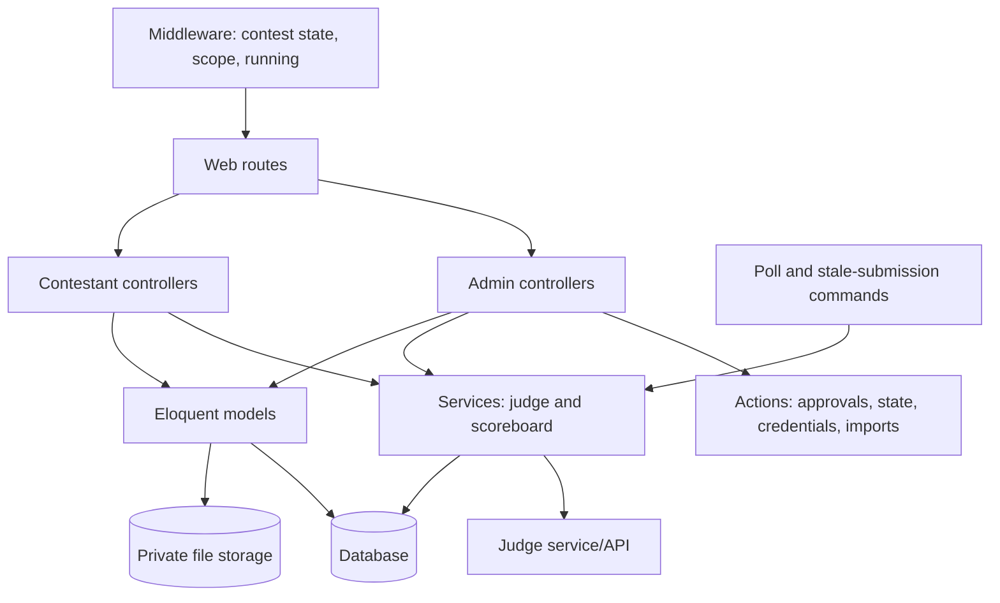
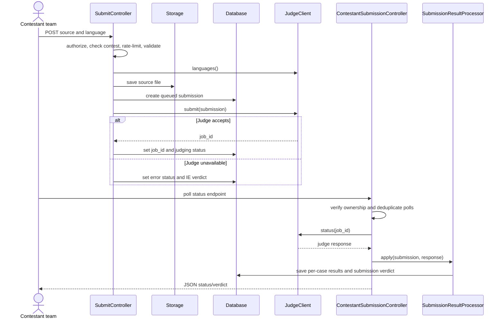

# Complete Controller Suite

This document contains the controller suite, route reference, supporting service/action dependencies, and verification notes from `new.txt`. Controller code is retained as provided; diagrams and headings organize the material without changing behavior.

> The source describes the suite as 21 controllers. Its numbered sections contain the base controller plus 14 admin and 7 contestant controller listings (22 class listings total). The listings below preserve all sections from the source.

## Controller and Service Flow



## Submission Judging Flow



## Supporting Classes Referenced by Controllers

These are services, actions, middleware, or commands rather than controllers. Their signatures and responsibilities are part of the controller contract.

| Class | Purpose / interface |
| --- | --- |
| `App\Services\JudgeClient` | HTTP client for the judge. Methods: `submit(Submission): array`, `status(string $jobId): array`, `languages(): array`, `mapVerdict(string): string`, `mapJudgeResultToSubmission(...)`. |
| `App\Services\SubmissionResultProcessor` | Parses a judge status response into `SubmissionResult` rows and updates `Submission`. `apply(Submission, array $judgeResponse): bool` returns true if newly finalized. |
| `App\Services\ScoreboardService` | `build(Contest, bool $frozen): array` builds ICPC rows; used by admin and contestant scoreboards. |
| `App\Actions\ApproveContest` | Runs approval transaction with active-slot check. |
| `App\Actions\StartContest` | Sets status to running and `started_at = now()`. |
| `App\Actions\EndContest` | Sets status to ended and `ended_at = now()`. |
| `App\Actions\GenerateCredentials` | Generates contest usernames/passwords and returns `array<participationId, plaintextPassword>`. |
| `App\Actions\ImportTeamsCsv` | Streams CSV, creates teams/members/participations, and returns per-row errors. |
| `App\Http\Middleware\SyncContestState` | Global; calls `$contest->syncState()` when `{contest}` is resolved. |
| `App\Http\Middleware\EnsureContestScope` | Verifies `auth('contestant')->user()->contest_id === $contest->id`. |
| `App\Http\Middleware\EnsureContestRunning` | Verifies `$contest->acceptsSubmissions()`. |
| `App\Console\Commands\PollSubmissions` | Runs `submissions:poll` every 30 seconds. |
| `App\Console\Commands\MarkStaleSubmissions` | Runs `submissions:stale` every 60 seconds. |

Every controller below extends the base `Controller`; the concrete controllers are declared `final` in the source.

## Base Controller

### `app/Http/Controllers/Controller.php`

```php
<?php

namespace App\Http\Controllers;

abstract class Controller
{
    //
}
```

# Admin Controllers

## Admin Authentication

### `app/Http/Controllers/Admin/AdminAuthController.php`

```php
<?php

namespace App\Http\Controllers\Admin;

use App\Http\Controllers\Controller;
use Illuminate\Http\Request;
use Illuminate\Support\Facades\Auth;
use Illuminate\Validation\ValidationException;

final class AdminAuthController extends Controller
{
    public function showLogin()
    {
        if (Auth::guard('web')->check()) {
            return redirect()->route('admin.dashboard');
        }

        return view('admin.auth.login');
    }

    public function login(Request $request)
    {
        $credentials = $request->validate([
            'email'    => ['required', 'email'],
            'password' => ['required', 'string'],
        ]);

        if (! Auth::guard('web')->attempt($credentials, $request->boolean('remember'))) {
            throw ValidationException::withMessages([
                'email' => 'These credentials do not match our records.',
            ]);
        }

        $request->session()->regenerate();

        return redirect()->intended(route('admin.dashboard'));
    }

    public function logout(Request $request)
    {
        Auth::guard('web')->logout();
        $request->session()->invalidate();
        $request->session()->regenerateToken();

        return redirect()->route('admin.login');
    }
}
```

## Admin Dashboard

### `app/Http/Controllers/Admin/AdminDashboardController.php`

```php
<?php

namespace App\Http\Controllers\Admin;

use App\Http\Controllers\Controller;
use App\Models\Contest;
use App\Models\Problem;
use App\Models\Submission;
use App\Models\Team;

final class AdminDashboardController extends Controller
{
    public function index()
    {
        $contests = Contest::query()
            ->with('creator')
            ->orderByRaw("FIELD(status, 'running', 'approved', 'draft', 'ended')")
            ->orderByDesc('start_time')
            ->get();

        $activeContest = Contest::activeContest();

        $stats = [
            'total_problems'     => Problem::count(),
            'total_teams'        => Team::count(),
            'total_contests'     => $contests->count(),
            'total_submissions'  => Submission::count(),
        ];

        return view('admin.dashboard', compact('contests', 'activeContest', 'stats'));
    }
}
```

## Contest Management

### `app/Http/Controllers/Admin/ContestController.php`

```php
<?php

namespace App\Http\Controllers\Admin;

use App\Http\Controllers\Controller;
use App\Models\Contest;
use Illuminate\Http\Request;
use Illuminate\Support\Facades\Auth;
use Illuminate\Support\Str;
use Illuminate\Validation\Rule;

final class ContestController extends Controller
{
    public function index()
    {
        $contests = Contest::query()
            ->withCount('participations', 'contestProblems')
            ->orderByRaw("FIELD(status, 'running', 'approved', 'draft', 'ended')")
            ->orderByDesc('start_time')
            ->paginate(20);

        return view('admin.contests.index', compact('contests'));
    }

    public function create()
    {
        // Creation of drafts is always allowed.
        return view('admin.contests.create');
    }

    public function store(Request $request)
    {
        $data = $this->validateContest($request, null);

        $data['slug'] = $this->uniqueSlug($data['name']);
        $data['created_by'] = Auth::id();
        $data['status'] = Contest::STATUS_DRAFT;

        $contest = Contest::create($data);

        return redirect()
            ->route('admin.contests.show', $contest)
            ->with('status', 'Draft contest created.');
    }

    public function show(Contest $contest)
    {
        $contest->load([
            'contestProblems.problem',
            'participations.team.members',
            'creator',
            'approver',
        ]);

        $stats = match ($contest->status) {
            Contest::STATUS_RUNNING => [
                'submissions_total'   => $contest->submissions()->count(),
                'submissions_pending' => $contest->submissions()->pending()->count(),
                'teams_count'         => $contest->participations()->count(),
                'questions_open'      => $contest->questions()->unanswered()->count(),
            ],
            Contest::STATUS_ENDED => [
                'submissions_total' => $contest->submissions()->count(),
                'teams_count'       => $contest->participations()->count(),
            ],
            default => [],
        };

        return view("admin.contests.show.{$contest->status}", compact('contest', 'stats'));
    }

    public function edit(Contest $contest)
    {
        abort_unless($contest->isDraft(), 403, 'Only draft contests can be edited.');

        return view('admin.contests.edit', compact('contest'));
    }

    public function update(Request $request, Contest $contest)
    {
        abort_unless($contest->isDraft(), 403, 'Only draft contests can be edited.');

        $data = $this->validateContest($request, $contest);

        // start_time is frozen once it has been reached.
        if ($contest->startTimeLocked() && $data['start_time'] !== $contest->start_time?->format('Y-m-d\\TH:i')) {
            return back()
                ->withInput()
                ->withErrors(['start_time' => 'Start time cannot be changed after it has been reached.']);
        }

        if (empty($data['slug']) && $data['name'] !== $contest->name) {
            $data['slug'] = $this->uniqueSlug($data['name'], $contest->id);
        }

        $contest->update($data);

        return redirect()
            ->route('admin.contests.show', $contest)
            ->with('status', 'Contest updated.');
    }

    public function destroy(Contest $contest)
    {
        abort_unless($contest->isDraft(), 403, 'Only draft contests can be deleted.');

        $contest->delete();

        return redirect()
            ->route('admin.contests.index')
            ->with('status', 'Draft contest deleted.');
    }

    // ----------------------------------------------------------------

    private function validateContest(Request $request, ?Contest $existing): array
    {
        $rules = [
            'name'           => ['required', 'string', 'max:255'],
            'start_time'     => ['required', 'date'],
            'end_time'       => ['required', 'date', 'after:start_time'],
            'freeze_minutes' => ['nullable', 'integer', 'min:0', 'max:600'],
            'is_public'      => ['sometimes', 'boolean'],
        ];

        if ($existing === null) {
            $rules['name'][] = 'unique:contests,name';
        } else {
            $rules['name'][] = Rule::unique('contests', 'name')->ignore($existing->id);
        }

        $data = $request->validate($rules);

        $data['freeze_minutes'] = (int) ($data['freeze_minutes'] ?? 0);
        $data['is_public']      = $request->boolean('is_public', true);

        return $data;
    }

    private function uniqueSlug(string $name, ?int $ignoreId = null): string
    {
        $base = Str::slug($name) ?: 'contest';
        $slug = $base;
        $i    = 1;

        while (Contest::where('slug', $slug)
            ->when($ignoreId, fn ($q) => $q->where('id', '!=', $ignoreId))
            ->exists()
        ) {
            $slug = "{$base}-{$i}";
            $i++;
        }

        return $slug;
    }
}
```

The `show` method dispatches to one of four Blade views: `show.draft`, `show.approved`, `show.running`, or `show.ended`, giving each contest state its own admin experience.

## Contest Problem Assignment

### `app/Http/Controllers/Admin/ContestProblemController.php`

```php
<?php

namespace App\Http\Controllers\Admin;

use App\Http\Controllers\Controller;
use App\Models\Contest;
use App\Models\ContestProblem;
use App\Models\Problem;
use Illuminate\Http\Request;

final class ContestProblemController extends Controller
{
    public function index(Contest $contest)
    {
        $contest->load('contestProblems.problem');

        $attachedIds  = $contest->contestProblems->pluck('problem_id')->all();
        $available    = Problem::whereNotIn('id', $attachedIds)
            ->orderBy('code')
            ->get();

        return view('admin.contests.tabs.problems', compact('contest', 'available'));
    }

    public function store(Request $request, Contest $contest)
    {
        abort_unless($contest->isDraft(), 403, 'Cannot modify problems after approval.');

        $data = $request->validate([
            'problem_id' => ['required', 'integer', 'exists:problems,id'],
            'label'      => ['required', 'string', 'max:3', 'regex:/^[A-Z]{1,3}$/'],
            'points'     => ['nullable', 'integer', 'min:0', 'max:9999'],
        ]);

        // Reject duplicates
        abort_if(
            $contest->contestProblems()->where('problem_id', $data['problem_id'])->exists(),
            422,
            'Problem is already attached to this contest.'
        );
        abort_if(
            $contest->contestProblems()->where('label', $data['label'])->exists(),
            422,
            'Label is already used in this contest.'
        );

        $sortOrder = (int) $contest->contestProblems()->max('sort_order') + 1;

        $contest->contestProblems()->create([
            'problem_id' => $data['problem_id'],
            'label'      => strtoupper($data['label']),
            'points'     => $data['points'] ?? 0,
            'sort_order' => $sortOrder,
        ]);

        return back()->with('status', 'Problem attached.');
    }

    public function update(Request $request, Contest $contest, ContestProblem $contestProblem)
    {
        abort_unless($contest->isDraft(), 403);
        abort_unless($contestProblem->contest_id === $contest->id, 404);

        $data = $request->validate([
            'label'  => ['required', 'string', 'max:3', 'regex:/^[A-Z]{1,3}$/'],
            'points' => ['nullable', 'integer', 'min:0', 'max:9999'],
        ]);

        // Reject label collisions
        abort_if(
            $contest->contestProblems()
                ->where('label', $data['label'])
                ->where('id', '!=', $contestProblem->id)
                ->exists(),
            422,
            'Label is already used in this contest.'
        );

        $contestProblem->update([
            'label'  => strtoupper($data['label']),
            'points' => $data['points'] ?? 0,
        ]);

        return back()->with('status', 'Problem updated.');
    }

    public function destroy(Contest $contest, ContestProblem $contestProblem)
    {
        abort_unless($contest->isDraft(), 403);
        abort_unless($contestProblem->contest_id === $contest->id, 404);

        $contestProblem->delete();

        return back()->with('status', 'Problem detached.');
    }

    /**
     * Bulk reorder via JSON array of contest_problem ids in new order.
     */
    public function reorder(Request $request, Contest $contest)
    {
        abort_unless($contest->isDraft(), 403);

        $data = $request->validate([
            'order'   => ['required', 'array'],
            'order.*' => ['required', 'integer'],
        ]);

        foreach ($data['order'] as $index => $id) {
            $contest->contestProblems()
                ->where('id', $id)
                ->update(['sort_order' => $index]);
        }

        return response()->noContent();
    }
}
```

## Contest Approval

### `app/Http/Controllers/Admin/ContestApprovalController.php`

```php
<?php

namespace App\Http\Controllers\Admin;

use App\Actions\ApproveContest;
use App\Http\Controllers\Controller;
use App\Models\Contest;
use Illuminate\Http\Request;

final class ContestApprovalController extends Controller
{
    public function __invoke(Request $request, Contest $contest, ApproveContest $action)
    {
        abort_unless($contest->isDraft(), 403, 'Only draft contests can be approved.');

        // Pre-checks for friendly errors (DB enforces the real invariant).
        $active = Contest::activeContest();
        if ($active !== null) {
            return back()->withErrors([
                'approval' => "Cannot approve: \"{$active->name}\" is still {$active->status}. End it first.",
            ]);
        }

        if ($contest->contestProblems()->count() === 0) {
            return back()->withErrors(['approval' => 'Attach at least one problem before approving.']);
        }

        if ($contest->participations()->count() === 0) {
            return back()->withErrors(['approval' => 'Import teams before approving.']);
        }

        if ($contest->end_time->isPast()) {
            return back()->withErrors(['approval' => 'Cannot approve a contest whose end time has already passed.']);
        }

        if ($contest->start_time->isPast()) {
            // Allowed: contest will auto-start on next sync (started_at will be now()).
            // Just warn the admin via flash on redirect.
            $warn = 'Note: start time is already in the past — the contest will start immediately.';
        } else {
            $warn = null;
        }

        $action->execute($contest, $request->user());

        return redirect()
            ->route('admin.contests.show', $contest)
            ->with('status', 'Contest approved.')
            ->when($warn, fn ($r) => $r->with('warning', $warn));
    }
}
```

## Manual Contest Start

### `app/Http/Controllers/Admin/ContestStartController.php`

```php
<?php

namespace App\Http\Controllers\Admin;

use App\Actions\StartContest;
use App\Http\Controllers\Controller;
use App\Models\Contest;

final class ContestStartController extends Controller
{
    public function __invoke(Contest $contest, StartContest $action)
    {
        abort_unless($contest->isApproved(), 403, 'Only approved contests can be started.');

        $action->execute($contest);

        return redirect()
            ->route('admin.contests.show', $contest)
            ->with('status', 'Contest started.');
    }
}
```

## Manual Contest End

### `app/Http/Controllers/Admin/ContestEndController.php`

```php
<?php

namespace App\Http\Controllers\Admin;

use App\Actions\EndContest;
use App\Http\Controllers\Controller;
use App\Models\Contest;

final class ContestEndController extends Controller
{
    public function __invoke(Contest $contest, EndContest $action)
    {
        abort_unless($contest->isRunning(), 403, 'Only running contests can be ended.');

        $action->execute($contest);

        return redirect()
            ->route('admin.contests.show', $contest)
            ->with('status', 'Contest ended.');
    }
}
```

## Team CSV Import

### `app/Http/Controllers/Admin/TeamImportController.php`

```php
<?php

namespace App\Http\Controllers\Admin;

use App\Actions\ImportTeamsCsv;
use App\Http\Controllers\Controller;
use App\Models\Contest;
use Illuminate\Http\Request;

final class TeamImportController extends Controller
{
    public function show(Contest $contest)
    {
        abort_unless($contest->isDraft(), 403, 'Teams can only be imported in draft state.');

        return view('admin.teams.import', compact('contest'));
    }

    public function store(Request $request, Contest $contest, ImportTeamsCsv $action)
    {
        abort_unless($contest->isDraft(), 403);

        $request->validate([
            'csv' => ['required', 'file', 'mimes:csv,txt', 'max:5120'],
        ]);

        $report = $action->execute($contest, $request->file('csv'));

        if (! empty($report['errors'])) {
            return back()->with([
                'status' => "Imported {$report['created']} team(s), {$report['skipped']} skipped.",
                'errors' => $report['errors'],
            ]);
        }

        return redirect()
            ->route('admin.contests.show', $contest)
            ->with('status', "Imported {$report['created']} team(s).");
    }
}
```

## Credential PDF

### `app/Http/Controllers/Admin/CredentialController.php`

```php
<?php

namespace App\Http\Controllers\Admin;

use App\Actions\GenerateCredentials;
use App\Http\Controllers\Controller;
use App\Models\Contest;
use Barryvdh\DomPDF\Facade\Pdf;

final class CredentialController extends Controller
{
    public function index(Contest $contest)
    {
        abort_unless($contest->isApproved(), 403, 'Credentials are only available in approved state.');

        $participations = $contest->participations()
            ->with('team.members')
            ->orderBy('username')
            ->get();

        return view('admin.credentials.index', compact('contest', 'participations'));
    }

    /**
     * Generate missing credentials, stream the PDF immediately.
     * Plaintext passwords live only in this request.
     */
    public function generate(Contest $contest, GenerateCredentials $action)
    {
        abort_unless($contest->isApproved(), 403);

        $plainByParticipation = $action->execute($contest);

        if (empty($plainByParticipation)) {
            return back()->withErrors([
                'generate' => 'All teams already have credentials. Use "regenerate all" to invalidate existing ones.',
            ]);
        }

        $participations = $contest->participations()
            ->with('team.members')
            ->whereIn('id', array_keys($plainByParticipation))
            ->orderBy('username')
            ->get();

        $pdf = Pdf::loadView('pdf.credentials', [
            'contest'        => $contest,
            'participations' => $participations,
            'plainByParticipation' => $plainByParticipation,
        ])->setPaper('a4');

        return $pdf->download("credentials-{$contest->slug}.pdf");
    }

    /**
     * Regenerate ALL credentials (invalidates existing). Streams PDF.
     */
    public function regenerate(Contest $contest, GenerateCredentials $action)
    {
        abort_unless($contest->isApproved(), 403);

        $plainByParticipation = $action->execute($contest, force: true);

        $participations = $contest->participations()
            ->with('team.members')
            ->orderBy('username')
            ->get();

        $pdf = Pdf::loadView('pdf.credentials', [
            'contest'        => $contest,
            'participations' => $participations,
            'plainByParticipation' => $plainByParticipation,
        ])->setPaper('a4');

        return $pdf->download("credentials-{$contest->slug}.pdf");
    }
}
```

Plaintext passwords exist only for the current request while the credential PDF is generated and downloaded. `generate` creates missing credentials only; `regenerate` invalidates and replaces all credentials.

## Problem Bank

### `app/Http/Controllers/Admin/ProblemController.php`

```php
<?php

namespace App\Http\Controllers\Admin;

use App\Http\Controllers\Controller;
use App\Models\Problem;
use Illuminate\Http\Request;
use Illuminate\Support\Facades\Auth;
use Illuminate\Validation\Rule;

final class ProblemController extends Controller
{
    public function index()
    {
        $problems = Problem::query()
            ->withCount('testCases', 'contestProblems')
            ->orderBy('code')
            ->paginate(30);

        return view('admin.problems.index', compact('problems'));
    }

    public function create()
    {
        return view('admin.problems.create');
    }

    public function store(Request $request)
    {
        $data = $this->validateProblem($request);
        $data['created_by'] = Auth::id();

        $problem = Problem::create($data);

        return redirect()
            ->route('admin.problems.show', $problem)
            ->with('status', 'Problem created.');
    }

    public function show(Problem $problem)
    {
        $problem->load(['testCases', 'contestProblems.contest']);

        return view('admin.problems.show', compact('problem'));
    }

    public function edit(Problem $problem)
    {
        if ($problem->isInUse()) {
            return redirect()
                ->route('admin.problems.show', $problem)
                ->withErrors(['edit' => 'This problem is used by a locked contest. Editing is disabled.']);
        }

        return view('admin.problems.edit', compact('problem'));
    }

    public function update(Request $request, Problem $problem)
    {
        if ($problem->isInUse()) {
            return back()->withErrors(['edit' => 'This problem is used by a locked contest. Editing is disabled.']);
        }

        $data = $this->validateProblem($request, $problem);
        $problem->update($data);

        return redirect()
            ->route('admin.problems.show', $problem)
            ->with('status', 'Problem updated.');
    }

    public function destroy(Problem $problem)
    {
        if ($problem->isInUse()) {
            return back()->withErrors(['delete' => 'This problem is used by a locked contest. Delete blocked.']);
        }

        $problem->delete();

        return redirect()
            ->route('admin.problems.index')
            ->with('status', 'Problem deleted.');
    }

    private function validateProblem(Request $request, ?Problem $existing = null): array
    {
        $code = $request->input('code');
        $rules = [
            'code'             => [
                'required', 'string', 'max:20',
                $existing
                    ? Rule::unique('problems', 'code')->ignore($existing->id)
                    : 'unique:problems,code',
            ],
            'title'            => ['required', 'string', 'max:255'],
            'statement_md'     => ['required', 'string'],
            'time_limit_ms'    => ['required', 'integer', 'min:100', 'max:60000'],
            'memory_limit_mb'  => ['required', 'integer', 'min:16', 'max:2048'],
        ];

        return $request->validate($rules);
    }
}
```

## Test Case Management

### `app/Http/Controllers/Admin/TestCaseController.php`

```php
<?php

namespace App\Http\Controllers\Admin;

use App\Http\Controllers\Controller;
use App\Models\Problem;
use App\Models\TestCase;
use Illuminate\Http\Request;
use Illuminate\Support\Facades\Storage;

final class TestCaseController extends Controller
{
    public function index(Problem $problem)
    {
        $problem->load('testCases');

        return view('admin.problems.test-cases', compact('problem'));
    }

    public function store(Request $request, Problem $problem)
    {
        if ($problem->isInUse()) {
            return back()->withErrors(['upload' => 'Cannot add test cases: problem is locked by a contest.']);
        }

        $data = $request->validate([
            'input'           => ['required', 'file', 'max:10240'],
            'output'          => ['required', 'file', 'max:10240'],
            'kind'            => ['required', 'in:sample,hidden'],
        ]);

        $ordinal = $problem->nextTestCaseOrdinal();
        $id      = (int) (TestCase::max('id') ?? 0) + 1;  // safe-ish pre-id for path
        $disk    = config('filesystems.test_cases_disk', 'local');

        $inputPath  = "problems/{$problem->id}/test-cases/{$id}-{$ordinal}.in";
        $outputPath = "problems/{$problem->id}/test-cases/{$id}-{$ordinal}.out";

        $inputBody  = $request->file('input')->get();
        $outputBody = $request->file('output')->get();

        Storage::disk($disk)->put($inputPath, $inputBody);
        Storage::disk($disk)->put($outputPath, $outputBody);

        $problem->testCases()->create([
            'ordinal'           => $ordinal,
            'kind'              => $data['kind'],
            'input_path'        => $inputPath,
            'output_path'       => $outputPath,
            'input_sha256'      => hash('sha256', $inputBody),
            'output_sha256'     => hash('sha256', $outputBody),
            'input_size_bytes'  => strlen($inputBody),
            'output_size_bytes' => strlen($outputBody),
        ]);

        return back()->with('status', 'Test case added.');
    }

    public function update(Request $request, Problem $problem, TestCase $testCase)
    {
        abort_unless($testCase->problem_id === $problem->id, 404);
        if ($problem->isInUse()) {
            return back()->withErrors(['update' => 'Cannot modify test cases: problem is locked.']);
        }

        $data = $request->validate([
            'kind' => ['required', 'in:sample,hidden'],
        ]);

        $testCase->update(['kind' => $data['kind']]);

        return back()->with('status', 'Test case updated.');
    }

    public function destroy(Problem $problem, TestCase $testCase)
    {
        abort_unless($testCase->problem_id === $problem->id, 404);
        if ($problem->isInUse()) {
            return back()->withErrors(['delete' => 'Cannot delete test cases: problem is locked.']);
        }

        $testCase->delete();  // File cleanup via model booted()

        return back()->with('status', 'Test case deleted.');
    }

    public function download(Problem $problem, TestCase $testCase, string $side)
    {
        abort_unless($testCase->problem_id === $problem->id, 404);
        abort_unless(in_array($side, ['input', 'output'], true), 404);

        $disk = config('filesystems.test_cases_disk', 'local');
        $path = $side === 'input' ? $testCase->input_path : $testCase->output_path;

        return Storage::disk($disk)->download($path, "test-{$testCase->ordinal}.{$side}.txt");
    }
}
```

The test-case files are saved before the database row is created. The generated pre-ID for the storage path is noted in the source as "safe-ish". Deleting the model triggers file cleanup through its `booted()` hook.

## Admin Submission Monitoring and Rejudge

### `app/Http/Controllers/Admin/AdminSubmissionController.php`

```php
<?php

namespace App\Http\Controllers\Admin;

use App\Http\Controllers\Controller;
use App\Models\Contest;
use App\Models\Submission;
use App\Services\JudgeClient;
use Illuminate\Http\Request;

final class AdminSubmissionController extends Controller
{
    public function index(Request $request, Contest $contest)
    {
        $query = $contest->submissions()
            ->with(['participation.team', 'contestProblem.problem'])
            ->orderByDesc('submitted_at');

        if ($filter = $request->query('status')) {
            if ($filter === 'pending') {
                $query->whereIn('status', [Submission::STATUS_QUEUED, Submission::STATUS_JUDGING]);
            } else {
                $query->where('status', $filter);
            }
        }

        if ($verdict = $request->query('verdict')) {
            $query->where('verdict', $verdict);
        }

        if ($problem = $request->query('problem')) {
            $query->whereHas('contestProblem', fn ($q) => $q->where('label', $problem));
        }

        $submissions = $query->paginate(50)->withQueryString();

        return view('admin.contests.tabs.submissions', compact('contest', 'submissions'));
    }

    public function show(Contest $contest, Submission $submission)
    {
        abort_unless($submission->contest_id === $contest->id, 404);

        $submission->load(['participation.team.members', 'contestProblem.problem', 'results.testCase']);

        return view('admin.submissions.show', compact('contest', 'submission'));
    }

    public function rejudge(Request $request, Contest $contest, Submission $submission, JudgeClient $judge)
    {
        abort_unless($submission->contest_id === $contest->id, 404);
        abort_unless($submission->isFinal(), 422, 'Only finalized submissions can be rejudged.');

        $submission->results()->delete();

        $submission->update([
            'status'           => Submission::STATUS_QUEUED,
            'verdict'          => null,
            'max_time_ms'      => null,
            'max_memory_kb'    => null,
            'score'            => null,
            'judged_at'        => null,
            'rejudge_count'    => $submission->rejudge_count + 1,
            'last_rejudged_at' => now(),
            'last_rejudged_by' => $request->user()->id,
            'last_judge_check_at' => null,
        ]);

        try {
            $response = $judge->submit($submission);
            $submission->update([
                'judge_job_id' => $response['job_id'],
                'status'       => Submission::STATUS_JUDGING,
            ]);
        } catch (\Throwable $e) {
            report($e);
            $submission->update(['status' => Submission::STATUS_ERROR, 'verdict' => 'IE']);

            return back()->withErrors(['rejudge' => 'Judge unreachable — submission marked as Internal Error.']);
        }

        return back()->with('status', 'Submission queued for rejudge.');
    }
}
```

## Admin Scoreboard

### `app/Http/Controllers/Admin/AdminScoreboardController.php`

```php
<?php

namespace App\Http\Controllers\Admin;

use App\Http\Controllers\Controller;
use App\Models\Contest;
use App\Services\ScoreboardService;
use Illuminate\Http\Request;

final class AdminScoreboardController extends Controller
{
    public function show(Request $request, Contest $contest, ScoreboardService $scoreboard)
    {
        $rows = $scoreboard->build($contest, frozen: false);  // admin sees truth

        if ($request->wantsJson() || $request->boolean('json')) {
            return response()->json(['rows' => $rows]);
        }

        return view('admin.contests.tabs.scoreboard', compact('contest', 'rows'));
    }
}
```

## Admin Questions

### `app/Http/Controllers/Admin/AdminQuestionController.php`

```php
<?php

namespace App\Http\Controllers\Admin;

use App\Http\Controllers\Controller;
use App\Models\Contest;
use App\Models\ContestQuestion;
use Illuminate\Http\Request;

final class AdminQuestionController extends Controller
{
    public function index(Contest $contest)
    {
        $questions = $contest->questions()
            ->with(['participation.team.members', 'answeredBy'])
            ->orderByRaw('answered_at IS NOT NULL')   // unanswered first
            ->orderByDesc('created_at')
            ->get();

        return view('admin.contests.tabs.questions', compact('contest', 'questions'));
    }

    public function answer(Request $request, Contest $contest, ContestQuestion $question)
    {
        abort_unless($question->contest_id === $contest->id, 404);

        $data = $request->validate([
            'answer'     => ['required', 'string', 'max:5000'],
            'visibility' => ['required', 'in:public,private'],
        ]);

        $question->update([
            'answer'      => $data['answer'],
            'visibility'  => $data['visibility'],
            'answered_by' => $request->user()->id,
            'answered_at' => now(),
        ]);

        return back()->with('status', 'Answer saved.');
    }
}
```

# Contestant Controllers

## Contestant Authentication

### `app/Http/Controllers/Contest/ContestantAuthController.php`

```php
<?php

namespace App\Http\Controllers\Contest;

use App\Http\Controllers\Controller;
use App\Models\Contest;
use App\Models\ContestParticipation;
use Illuminate\Http\Request;
use Illuminate\Support\Facades\Auth;
use Illuminate\Support\Facades\Hash;
use Illuminate\Validation\ValidationException;

final class ContestantAuthController extends Controller
{
    public function showLogin(Contest $contest)
    {
        if ($this->alreadyLoggedIn($contest)) {
            return redirect()->route('contest.problems', $contest->slug);
        }

        return view('contest.auth.login', compact('contest'));
    }

    public function login(Request $request, Contest $contest)
    {
        $credentials = $request->validate([
            'username' => ['required', 'string'],
            'password' => ['required', 'string'],
        ]);

        $participation = ContestParticipation::query()
            ->where('contest_id', $contest->id)
            ->where('username', $credentials['username'])
            ->first();

        if (! $participation || ! Hash::check($credentials['password'], $participation->password)) {
            throw ValidationException::withMessages([
                'username' => 'Invalid credentials for this contest.',
            ]);
        }

        Auth::guard('contestant')->login($participation);
        $request->session()->regenerate();

        return redirect()->intended(route('contest.problems', $contest->slug));
    }

    public function logout(Request $request, Contest $contest)
    {
        Auth::guard('contestant')->logout();
        $request->session()->invalidate();
        $request->session()->regenerateToken();

        return redirect()->route('contest.login', $contest->slug);
    }

    private function alreadyLoggedIn(Contest $contest): bool
    {
        $user = Auth::guard('contestant')->user();

        return $user !== null && $user->contest_id === $contest->id;
    }
}
```

## Contestant Landing

### `app/Http/Controllers/Contest/ContestantLandingController.php`

```php
<?php

namespace App\Http\Controllers\Contest;

use App\Http\Controllers\Controller;
use App\Models\Contest;
use Illuminate\Support\Facades\Auth;

final class ContestantLandingController extends Controller
{
    public function show(Contest $contest)
    {
        $participation = Auth::guard('contestant')->user();

        return view('contest.landing', [
            'contest'       => $contest,
            'participation' => $participation && $participation->contest_id === $contest->id
                ? $participation
                : null,
        ]);
    }
}
```

## Contestant Problems

### `app/Http/Controllers/Contest/ContestantProblemController.php`

```php
<?php

namespace App\Http\Controllers\Contest;

use App\Http\Controllers\Controller;
use App\Models\Contest;
use App\Models\ContestProblem;
use App\Models\Submission;
use Illuminate\Support\Facades\Auth;

final class ContestantProblemController extends Controller
{
    public function index(Contest $contest)
    {
        $participation = Auth::guard('contestant')->user();

        $problems = $contest->contestProblems()
            ->with('problem')
            ->orderBy('sort_order')
            ->get();

        // Map of contest_problem_id => best status for the current team.
        $statusByContestProblem = [];
        if ($participation) {
            $subs = Submission::query()
                ->where('participation_id', $participation->id)
                ->where('is_sample_run', false)
                ->get(['contest_problem_id', 'verdict', 'status']);

            foreach ($subs as $sub) {
                $prev = $statusByContestProblem[$sub->contest_problem_id] ?? null;
                if ($sub->verdict === 'AC') {
                    $statusByContestProblem[$sub->contest_problem_id] = 'solved';
                } elseif ($prev !== 'solved') {
                    $statusByContestProblem[$sub->contest_problem_id] = 'attempted';
                }
            }
        }

        return view('contest.problems.index', compact('contest', 'problems', 'statusByContestProblem'));
    }

    public function show(Contest $contest, string $label)
    {
        $contestProblem = $contest->contestProblems()
            ->with(['problem.sampleTestCases'])
            ->where('label', strtoupper($label))
            ->firstOrFail();

        $participation = Auth::guard('contestant')->user();

        $mySubmissions = $participation
            ? Submission::query()
                ->where('participation_id', $participation->id)
                ->where('contest_problem_id', $contestProblem->id)
                ->where('is_sample_run', false)
                ->orderByDesc('submitted_at')
                ->limit(20)
                ->get()
            : collect();

        return view('contest.problems.show', [
            'contest'          => $contest,
            'contestProblem'   => $contestProblem,
            'problem'          => $contestProblem->problem,
            'samples'          => $contestProblem->problem->sampleTestCases,
            'mySubmissions'    => $mySubmissions,
        ]);
    }
}
```

## Submission Intake

### `app/Http/Controllers/Contest/SubmitController.php`

```php
<?php

namespace App\Http\Controllers\Contest;

use App\Http\Controllers\Controller;
use App\Models\Contest;
use App\Models\Submission;
use App\Services\JudgeClient;
use Illuminate\Http\Request;
use Illuminate\Support\Facades\Auth;
use Illuminate\Support\Facades\RateLimiter;
use Illuminate\Support\Facades\Storage;

final class SubmitController extends Controller
{
    public function store(Request $request, Contest $contest, string $label, JudgeClient $judge)
    {
        $participation = Auth::guard('contestant')->user();
        abort_unless($participation && $participation->contest_id === $contest->id, 403);
        abort_unless($contest->acceptsSubmissions(), 403, 'Contest is not running.');

        $contestProblem = $contest->contestProblems()
            ->where('label', strtoupper($label))
            ->firstOrFail();

        // Rate limit: 1 submission per 3 seconds per participation.
        $rateKey = "submit:{$participation->id}";
        if (RateLimiter::tooManyAttempts($rateKey, 1)) {
            return back()->withErrors([
                'rate' => 'Please wait ' . RateLimiter::availableIn($rateKey) . 's before submitting again.',
            ]);
        }
        RateLimiter::hit($rateKey, 3);

        // Validate: source OR source_file, exactly one required.
        $request->validate([
            'language'    => ['required', 'string', 'max:32'],
            'source'      => ['nullable', 'string', 'max:200000', 'required_without:source_file'],
            'source_file' => ['nullable', 'file', 'max:2048', 'required_without:source'],
        ]);

        $sourceCode = $request->filled('source')
            ? $request->input('source')
            : $request->file('source_file')->get();

        // Verify language is supported by the judge.
        $languages = collect($judge->languages())
            ->pluck('name')
            ->map(fn ($n) => strtolower($n))
            ->all();

        if (! in_array(strtolower($request->input('language')), $languages, true)) {
            return back()->withErrors(['language' => 'Selected language is not available.']);
        }

        $disk = config('filesystems.sources_disk', 'local');
        $path = "sources/{$contest->id}/{$participation->id}/" . uniqid('sub_', true) . '.txt';
        Storage::disk($disk)->put($path, $sourceCode);

        $submission = Submission::create([
            'contest_id'          => $contest->id,
            'participation_id'    => $participation->id,
            'contest_problem_id'  => $contestProblem->id,
            'language'            => strtolower($request->input('language')),
            'source_path'         => $path,
            'status'              => Submission::STATUS_QUEUED,
            'is_sample_run'       => false,
            'submitted_at'        => now(),
        ]);

        try {
            $response = $judge->submit($submission);
            $submission->update([
                'judge_job_id' => $response['job_id'],
                'status'       => Submission::STATUS_JUDGING,
            ]);
        } catch (\Throwable $e) {
            report($e);
            $submission->update([
                'status'  => Submission::STATUS_ERROR,
                'verdict' => 'IE',
            ]);

            return redirect()
                ->route('contest.submissions.show', [$contest->slug, $submission])
                ->withErrors(['submit' => 'Judge is unreachable. Submission recorded but could not be judged.']);
        }

        return redirect()
            ->route('contest.submissions.show', [$contest->slug, $submission])
            ->with('status', 'Submission queued for judging.');
    }
}
```

The source may be submitted as pasted text or an uploaded file, with exactly one required. Submission frequency is limited to one every three seconds per participation. The language must appear in the judge's reported language list. The source is saved to the configured source disk before the database row is created and sent to the judge.

## Contestant Submission History and Status Polling

### `app/Http/Controllers/Contest/ContestantSubmissionController.php`

```php
<?php

namespace App\Http\Controllers\Contest;

use App\Http\Controllers\Controller;
use App\Models\Contest;
use App\Models\Submission;
use App\Services\SubmissionResultProcessor;
use App\Services\JudgeClient;
use Illuminate\Http\Request;
use Illuminate\Support\Facades\Auth;

final class ContestantSubmissionController extends Controller
{
    public function index(Contest $contest)
    {
        $participation = Auth::guard('contestant')->user();

        $submissions = Submission::query()
            ->where('participation_id', $participation->id)
            ->where('is_sample_run', false)
            ->with('contestProblem.problem')
            ->orderByDesc('submitted_at')
            ->paginate(30);

        return view('contest.submissions.index', compact('contest', 'submissions'));
    }

    public function show(Contest $contest, Submission $submission)
    {
        $this->authorizeOwnership($contest, $submission);

        $submission->load([
            'contestProblem.problem',
            'results.testCase',
        ]);

        return view('contest.submissions.show', compact('contest', 'submission'));
    }

    /**
     * AJAX endpoint: polled by the submission detail page.
     * Dedups by last_judge_check_at to avoid hammering the judge when the
     * contestant has multiple tabs open.
     */
    public function status(
        Request $request,
        Contest $contest,
        Submission $submission,
        JudgeClient $judge,
        SubmissionResultProcessor $processor,
    ) {
        $this->authorizeOwnership($contest, $submission);

        // 1. Final → return immediately.
        if ($submission->isFinal()) {
            return $this->statusResponse($submission);
        }

        // 2. Dedup: if checked less than 2 seconds ago, don't re-hit judge.
        if ($submission->last_judge_check_at
            && $submission->last_judge_check_at->gt(now()->subSeconds(2))
        ) {
            return $this->statusResponse($submission);
        }

        // 3. Poll judge.
        try {
            $response = $judge->status($submission->judge_job_id);
        } catch (\Throwable $e) {
            report($e);

            return $this->statusResponse($submission);
        }

        $processor->apply($submission, $response);
        $submission->refresh();

        return $this->statusResponse($submission);
    }

    // ----------------------------------------------------------------

    private function authorizeOwnership(Contest $contest, Submission $submission): void
    {
        $participation = Auth::guard('contestant')->user();

        abort_unless(
            $participation
            && $submission->participation_id === $participation->id
            && $submission->contest_id === $contest->id,
            403
        );
    }

    private function statusResponse(Submission $submission)
    {
        return response()->json([
            'is_final' => $submission->isFinal(),
            'status'   => $submission->status,
            'verdict'  => $submission->verdict,
            'url'      => route('contest.submissions.show', [$submission->contest_id, $submission]),
        ]);
    }
}
```

Final submissions return immediately. Non-final requests are deduplicated when the judge was checked within the last two seconds. Judge errors are reported and return the current status; successful responses are passed to `SubmissionResultProcessor`, then the model is refreshed before JSON is returned.

## Contestant Scoreboard

### `app/Http/Controllers/Contest/ContestantScoreboardController.php`

```php
<?php

namespace App\Http\Controllers\Contest;

use App\Http\Controllers\Controller;
use App\Models\Contest;
use App\Services\ScoreboardService;
use Illuminate\Http\Request;

final class ContestantScoreboardController extends Controller
{
    public function show(Request $request, Contest $contest, ScoreboardService $scoreboard)
    {
        // Public access allowed if contest.is_public, otherwise require auth.
        if (! $contest->is_public) {
            $this->requireContestantAuth($contest);
        }

        $frozen = $contest->freeze_minutes > 0 && $contest->isRunning();
        $rows   = $scoreboard->build($contest, frozen: $frozen);

        if ($request->wantsJson() || $request->boolean('json')) {
            return response()->json([
                'rows'    => $rows,
                'frozen'  => $frozen,
                'status'  => $contest->status,
                'ends_at' => $contest->end_time?->toIso8601String(),
            ]);
        }

        return view('contest.scoreboard', compact('contest', 'rows', 'frozen'));
    }

    private function requireContestantAuth(Contest $contest): void
    {
        $participation = auth('contestant')->user();

        abort_unless(
            $participation && $participation->contest_id === $contest->id,
            403,
            'This scoreboard is not public.'
        );
    }
}
```

The public scoreboard requires no login when `contest.is_public` is true. Otherwise, a contestant session scoped to that contest is required. During a running contest, the scoreboard is frozen when `freeze_minutes > 0`. Both HTML and JSON responses are supported; admins always receive an unfrozen scoreboard through their own controller.

## Contestant Questions

### `app/Http/Controllers/Contest/ContestantQuestionController.php`

```php
<?php

namespace App\Http\Controllers\Contest;

use App\Http\Controllers\Controller;
use App\Models\Contest;
use App\Models\ContestQuestion;
use Illuminate\Http\Request;
use Illuminate\Support\Facades\Auth;

final class ContestantQuestionController extends Controller
{
    public function index(Contest $contest)
    {
        $participation = Auth::guard('contestant')->user();

        $questions = $contest->questions()
            ->visibleToTeams($participation->id)
            ->with('participation.team')
            ->orderByDesc('created_at')
            ->get();

        return view('contest.questions.index', compact('contest', 'questions'));
    }

    public function store(Request $request, Contest $contest)
    {
        abort_unless($contest->acceptsSubmissions(), 403, 'Contest is not running.');

        $participation = Auth::guard('contestant')->user();

        $data = $request->validate([
            'body' => ['required', 'string', 'max:2000'],
        ]);

        // Rate limit: 1 question per 30 seconds per participation.
        if (\Illuminate\Support\Facades\RateLimiter::tooManyAttempts("question:{$participation->id}", 1)) {
            return back()->withErrors(['body' => 'Please wait before sending another question.']);
        }
        \Illuminate\Support\Facades\RateLimiter::hit("question:{$participation->id}", 30);

        ContestQuestion::create([
            'contest_id'       => $contest->id,
            'participation_id' => $participation->id,
            'body'             => $data['body'],
            'visibility'       => ContestQuestion::VISIBILITY_PRIVATE,
        ]);

        return back()->with('status', 'Question submitted to the admin.');
    }
}
```

## Admin and Contestant Route Reference

The following `routes/web.php` definitions bind the controllers. Middleware groups enforce web authentication and contest scope; submission additionally requires a running contest.

```php
<?php

// Admin
Route::prefix('admin')->name('admin.')->group(function () {
    Route::get('login',  [AdminAuthController::class, 'showLogin'])->name('login');
    Route::post('login', [AdminAuthController::class, 'login']);
    Route::post('logout',[AdminAuthController::class, 'logout'])->name('logout');

    Route::middleware('auth:web')->group(function () {
        Route::get('/', AdminDashboardController::class)->name('dashboard');

        Route::resource('contests', ContestController::class);

        Route::get('contests/{contest}/problems',                    [ContestProblemController::class, 'index'])->name('contests.problems.index');
        Route::post('contests/{contest}/problems',                   [ContestProblemController::class, 'store'])->name('contests.problems.store');
        Route::patch('contests/{contest}/problems/{contestProblem}', [ContestProblemController::class, 'update'])->name('contests.problems.update');
        Route::delete('contests/{contest}/problems/{contestProblem}',[ContestProblemController::class, 'destroy'])->name('contests.problems.destroy');
        Route::post('contests/{contest}/problems/reorder',           [ContestProblemController::class, 'reorder'])->name('contests.problems.reorder');

        Route::post('contests/{contest}/approve', ContestApprovalController::class)->name('contests.approve');
        Route::post('contests/{contest}/start',   ContestStartController::class)->name('contests.start');
        Route::post('contests/{contest}/end',     ContestEndController::class)->name('contests.end');

        Route::get('contests/{contest}/teams/import',  [TeamImportController::class, 'show'])->name('contests.teams.import');
        Route::post('contests/{contest}/teams/import', [TeamImportController::class, 'store'])->name('contests.teams.import.store');

        Route::get('contests/{contest}/credentials',             [CredentialController::class, 'index'])->name('contests.credentials');
        Route::post('contests/{contest}/credentials/generate',    [CredentialController::class, 'generate'])->name('contests.credentials.generate');
        Route::post('contests/{contest}/credentials/regenerate',  [CredentialController::class, 'regenerate'])->name('contests.credentials.regenerate');

        Route::resource('problems', ProblemController::class);

        Route::get('problems/{problem}/test-cases',                          [TestCaseController::class, 'index'])->name('problems.test-cases');
        Route::post('problems/{problem}/test-cases',                         [TestCaseController::class, 'store'])->name('problems.test-cases.store');
        Route::patch('problems/{problem}/test-cases/{testCase}',             [TestCaseController::class, 'update'])->name('problems.test-cases.update');
        Route::delete('problems/{problem}/test-cases/{testCase}',            [TestCaseController::class, 'destroy'])->name('problems.test-cases.destroy');
        Route::get('problems/{problem}/test-cases/{testCase}/{side}',        [TestCaseController::class, 'download'])->name('problems.test-cases.download');

        Route::get('contests/{contest}/submissions',                  [AdminSubmissionController::class, 'index'])->name('contests.submissions');
        Route::get('contests/{contest}/submissions/{submission}',     [AdminSubmissionController::class, 'show'])->name('contests.submissions.show');
        Route::post('contests/{contest}/submissions/{submission}/rejudge', [AdminSubmissionController::class, 'rejudge'])->name('contests.submissions.rejudge');

        Route::get('contests/{contest}/scoreboard', AdminScoreboardController::class)->name('contests.scoreboard');

        Route::get('contests/{contest}/questions',                    [AdminQuestionController::class, 'index'])->name('contests.questions');
        Route::post('contests/{contest}/questions/{question}/answer',  [AdminQuestionController::class, 'answer'])->name('contests.questions.answer');
    });
});

// Contestant
Route::prefix('c/{contest:slug}')->name('contest.')->group(function () {
    Route::get('/',        [ContestantLandingController::class, 'show'])->name('landing');
    Route::get('login',    [ContestantAuthController::class, 'showLogin'])->name('login');
    Route::post('login',   [ContestantAuthController::class, 'login']);
    Route::post('logout',  [ContestantAuthController::class, 'logout'])->name('logout');

    // Public scoreboard (auth check happens inside the controller)
    Route::get('scoreboard', ContestantScoreboardController::class)->name('scoreboard');

    Route::middleware(['auth:contestant', 'contest.scope'])->group(function () {
        Route::get('problems',                       [ContestantProblemController::class, 'index'])->name('problems');
        Route::get('problems/{label}',               [ContestantProblemController::class, 'show'])->name('problems.show');
        Route::get('submissions',                    [ContestantSubmissionController::class, 'index'])->name('submissions');
        Route::get('submissions/{submission}',       [ContestantSubmissionController::class, 'show'])->name('submissions.show');
        Route::get('submissions/{submission}/status',[ContestantSubmissionController::class, 'status'])->name('submissions.status');

        Route::get('questions',  [ContestantQuestionController::class, 'index'])->name('questions');
        Route::post('questions', [ContestantQuestionController::class, 'store'])->name('questions.store');

        Route::middleware('contest.running')->group(function () {
            Route::post('problems/{label}/submit', SubmitController::class)->name('submit');
        });
    });
});
```

## Verification Checklist from the Source

| Requirement | Controller / supporting implementation |
| --- | --- |
| Create contest with start time and duration | `ContestController::store` |
| Edit times until start | `ContestController::update` and `startTimeLocked()` |
| Assign problems from bank | `ContestProblemController::store` |
| Share problems across contests | `contest_problems` pivot (schema) |
| Allow only one approved/running contest | `ContestApprovalController` and `active_slot` database column |
| Allow multiple drafts | `ContestController::create` / `store`; no active-slot check |
| Import teams by CSV | `TeamImportController::store` → `ImportTeamsCsv` action |
| Lock contest after approval | `ApproveContest` action and `isDraft()` guards |
| Prevent edit/delete after approval | Mutation controllers check draft status |
| Manual and timed start/end | Start/end controllers, `SyncContestState` middleware, scheduler |
| Generate credential PDF | `CredentialController::generate` and `regenerate` |
| Contestant login | `ContestantAuthController::login` |
| Submit source code | `SubmitController::store` |
| Display verdicts | `ContestantSubmissionController::show` and `status` polling endpoint |
| Live leaderboard | Contestant scoreboard (polled by JS) and admin scoreboard |
| Contest Q&A | Contestant and admin question controllers |

## Remaining Work and Open Items

These are referenced by the controllers but are not controllers themselves:

- Actions: `ApproveContest`, `StartContest`, `EndContest`, `GenerateCredentials`, `ImportTeamsCsv`.
- Services: `JudgeClient`, `SubmissionResultProcessor`, `ScoreboardService`.
- Middleware: `SyncContestState`, `EnsureContestScope`, `EnsureContestRunning`.
- Commands: `PollSubmissions`, `MarkStaleSubmissions`.
- Blade views: four contest-state views, plus problem, test-case, and credential pages and the other referenced views.

Three open items shape the actions and surrounding behavior:

1. **CSV format:** Confirm the input format to implement `ImportTeamsCsv` correctly.
2. **Q&A visibility default:** `ContestantQuestionController::store` currently creates private questions. Change to public if that is the desired workflow.
3. **Partial scoring:** `is_sample_run` and `score` are wired, but the scoreboard currently treats all contests as pure ICPC.
