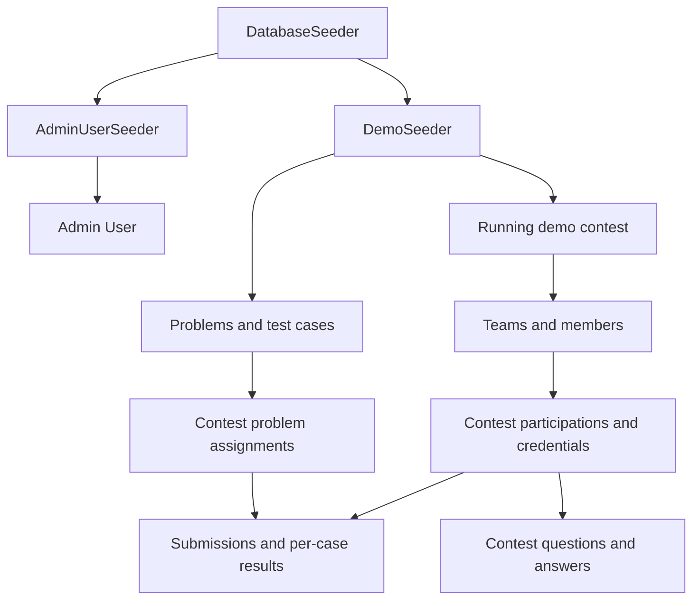

# Complete Factories and Seeders

This reference contains all 11 factories (one per business model) and all 3 seeders from `factories.txt`. Each PHP listing is included in full, followed by factory behavior, seed order, and operational notes.

## Files Included

| File | Purpose |
| --- | --- |
| `database/factories/UserFactory.php` | Admin user; defaults to admin role. |
| `database/factories/TeamFactory.php` | Team with `withMembers(int $count = 3)` state. |
| `database/factories/TeamMemberFactory.php` | Individual team member. |
| `database/factories/ContestFactory.php` | Draft/approved/running/ended states; see `active_slot` constraint. |
| `database/factories/ContestParticipationFactory.php` | Contest-scoped team credentials. |
| `database/factories/ProblemFactory.php` | Problem bank entry. |
| `database/factories/ContestProblemFactory.php` | Attaches problem to contest and auto-picks a label. |
| `database/factories/TestCaseFactory.php` | Writes test-case files and computes hashes. |
| `database/factories/SubmissionFactory.php` | Verdict states and `forParticipation()`. |
| `database/factories/SubmissionResultFactory.php` | Per-test-case result. |
| `database/factories/ContestQuestionFactory.php` | Q&A entry. |
| `database/seeders/DatabaseSeeder.php` | Calls `AdminUserSeeder` and `DemoSeeder`. |
| `database/seeders/AdminUserSeeder.php` | Creates one admin idempotently. |
| `database/seeders/DemoSeeder.php` | Idempotent demo playthrough: problem bank, contest, teams, submissions, and questions. |

## Factory and Seeder Flow



## Important: The `active_slot` Constraint

The contests table has a generated column:

```sql
CASE WHEN status IN ('approved', 'running') THEN 1 ELSE NULL END
```

with a `UNIQUE` constraint. Only one contest can be approved or running at a time; the database enforces this business rule.

- Do not create two approved/running contests in the same test. The second insert raises a unique-constraint exception, which is correct behavior.
- If a test needs an existing running contest and then another contest, end or delete the first one, or use the `ended()` state for the second.
- `DemoSeeder` creates one running contest with `firstOrCreate`, so repeated `db:seed` runs are safe.

## 1. `database/factories/UserFactory.php`

```php
<?php

namespace Database\Factories;

use App\Models\User;
use Illuminate\Database\Eloquent\Factories\Factory;
use Illuminate\Support\Facades\Hash;
use Illuminate\Support\Str;

/**
 * @extends \Illuminate\Database\Eloquent\Factories\Factory<\App\Models\User>
 */
class UserFactory extends Factory
{
    protected $model = User::class;

    /**
     * Same password reused across test users so tests can log in with a known value.
     */
    protected static ?string $password = null;

    public function definition(): array
    {
        return [
            'name'              => fake()->name(),
            'email'             => fake()->unique()->safeEmail(),
            'password'          => static::$password ??= Hash::make('password'),
            'role'              => User::ROLE_ADMIN,
            'remember_token'    => Str::random(10),
        ];
    }

    public function admin(): static
    {
        return $this->state(fn () => ['role' => User::ROLE_ADMIN]);
    }

    public function operator(): static
    {
        return $this->state(fn () => ['role' => User::ROLE_OPERATOR]);
    }
}
```

## 2. `database/factories/TeamFactory.php`

```php
<?php

namespace Database\Factories;

use App\Models\Team;
use App\Models\TeamMember;
use Illuminate\Database\Eloquent\Factories\Factory;

/**
 * @extends \Illuminate\Database\Eloquent\Factories\Factory<\App\Models\Team>
 */
class TeamFactory extends Factory
{
    protected $model = Team::class;

    public function definition(): array
    {
        return [
            'name' => fake()->unique()->company(),
        ];
    }

    /**
     * Attach N members via the TeamMember factory.
     */
    public function withMembers(int $count = 3): static
    {
        return $this->afterCreating(function (Team $team) use ($count) {
            TeamMember::factory()->count($count)->for($team)->create();
        });
    }
}
```

## 3. `database/factories/TeamMemberFactory.php`

```php
<?php

namespace Database\Factories;

use App\Models\Team;
use App\Models\TeamMember;
use Illuminate\Database\Eloquent\Factories\Factory;

/**
 * @extends \Illuminate\Database\Eloquent\Factories\Factory<\App\Models\TeamMember>
 */
class TeamMemberFactory extends Factory
{
    protected $model = TeamMember::class;

    public function definition(): array
    {
        return [
            'team_id' => Team::factory(),
            'name'    => fake()->name(),
            'email'   => fake()->unique()->safeEmail(),
            'ordinal' => 0,
        ];
    }
}
```

## 4. `database/factories/ContestFactory.php`

```php
<?php

namespace Database\Factories;

use App\Models\Contest;
use App\Models\User;
use Illuminate\Database\Eloquent\Factories\Factory;
use Illuminate\Support\Str;

/**
 * @extends \Illuminate\Database\Eloquent\Factories\Factory<\App\Models\Contest>
 *
 * IMPORTANT: The `active_slot` generated column enforces a UNIQUE
 * constraint across APPROVED and RUNNING contests. Do NOT call
 * ->approved()->create() or ->running()->create() more than once
 * in the same test without ending the previous one first — otherwise
 * the second insert throws a unique-constraint violation.
 */
class ContestFactory extends Factory
{
    protected $model = Contest::class;

    public function definition(): array
    {
        $start = now()->addDay();
        $end   = (clone $start)->addHours(3);

        return [
            'slug'           => Str::slug(fake()->unique()->words(3, true)) . '-' . Str::random(4),
            'name'           => fake()->unique()->catchPhrase(),
            'status'         => Contest::STATUS_DRAFT,
            'start_time'     => $start,
            'end_time'       => $end,
            'started_at'     => null,
            'ended_at'       => null,
            'freeze_minutes' => 0,
            'is_public'      => true,
            'approved_at'    => null,
            'approved_by'    => null,
            'created_by'     => User::factory(),
        ];
    }

    public function draft(): static
    {
        return $this->state(fn () => [
            'status'      => Contest::STATUS_DRAFT,
            'started_at'  => null,
            'ended_at'    => null,
            'approved_at' => null,
            'approved_by' => null,
        ]);
    }

    public function approved(): static
    {
        return $this->state(fn () => [
            'status'      => Contest::STATUS_APPROVED,
            'start_time'  => now()->addHour(),
            'end_time'    => now()->addHours(4),
            'started_at'  => null,
            'ended_at'    => null,
            'approved_at' => now(),
            'approved_by' => User::factory(),
        ]);
    }

    public function running(): static
    {
        return $this->state(function () {
            $startedAt = now()->subHour();
            return [
                'status'     => Contest::STATUS_RUNNING,
                'start_time' => $startedAt,
                'end_time'   => $startedAt->copy()->addHours(3),
                'started_at' => $startedAt,
                'ended_at'   => null,
                'approved_at'=> $startedAt->copy()->subHour(),
                'approved_by'=> User::factory(),
            ];
        });
    }

    public function ended(): static
    {
        return $this->state(function () {
            $startedAt = now()->subHours(5);
            return [
                'status'     => Contest::STATUS_ENDED,
                'start_time' => $startedAt,
                'end_time'   => $startedAt->copy()->addHours(3),
                'started_at' => $startedAt,
                'ended_at'   => $startedAt->copy()->addHours(3),
                'approved_at'=> $startedAt->copy()->subHour(),
                'approved_by'=> User::factory(),
            ];
        });
    }
}
```

## 5. `database/factories/ContestParticipationFactory.php`

```php
<?php

namespace Database\Factories;

use App\Models\Contest;
use App\Models\ContestParticipation;
use App\Models\Team;
use Illuminate\Database\Eloquent\Factories\Factory;
use Illuminate\Support\Facades\Hash;
use Illuminate\Support\Str;

/**
 * @extends \Illuminate\Database\Eloquent\Factories\Factory<\App\Models\ContestParticipation>
 */
class ContestParticipationFactory extends Factory
{
    protected $model = ContestParticipation::class;

    protected static ?string $passwordHash = null;

    public function definition(): array
    {
        return [
            'contest_id'               => Contest::factory(),
            'team_id'                  => Team::factory(),
            'username'                 => 'team-' . fake()->unique()->numerify('#####'),
            'password'                 => static::$passwordHash ??= Hash::make('password'),
            'seat_number'              => fake()->optional(0.7)->numberBetween(1, 100),
            'credentials_generated_at' => null,
        ];
    }

    public function forContest(Contest $contest): static
    {
        return $this->state(fn () => ['contest_id' => $contest->id]);
    }

    public function forTeam(Team $team): static
    {
        return $this->state(fn () => ['team_id' => $team->id]);
    }

    public function withGeneratedCredentials(): static
    {
        return $this->state(fn () => [
            'credentials_generated_at' => now(),
        ]);
    }
}
```

## 6. `database/factories/ProblemFactory.php`

```php
<?php

namespace Database\Factories;

use App\Models\Problem;
use App\Models\User;
use Illuminate\Database\Eloquent\Factories\Factory;

/**
 * @extends \Illuminate\Database\Eloquent\Factories\Factory<\App\Models\Problem>
 */
class ProblemFactory extends Factory
{
    protected $model = Problem::class;

    public function definition(): array
    {
        $title = fake()->unique()->sentence(3);

        return [
            'code'            => strtoupper(fake()->unique()->bothify('???-####')),
            'title'           => $title,
            'statement_md'    => "# {$title}\n\n" . fake()->paragraphs(2, true),
            'time_limit_ms'   => fake()->randomElement([1000, 1500, 2000]),
            'memory_limit_mb' => fake()->randomElement([128, 256, 512]),
            'created_by'      => User::factory(),
        ];
    }
}
```

## 7. `database/factories/ContestProblemFactory.php`

```php
<?php

namespace Database\Factories;

use App\Models\Contest;
use App\Models\ContestProblem;
use App\Models\Problem;
use Illuminate\Database\Eloquent\Factories\Factory;

/**
 * @extends \Illuminate\Database\Eloquent\Factories\Factory<\App\Models\ContestProblem>
 *
 * Auto-assigns the next free A/B/C/... label within the contest, unless
 * the caller explicitly sets `label`.
 */
class ContestProblemFactory extends Factory
{
    protected $model = ContestProblem::class;

    public function definition(): array
    {
        return [
            'contest_id' => Contest::factory(),
            'problem_id' => Problem::factory(),
            'label'      => '', // filled in afterMaking
            'points'     => 0,
            'sort_order' => 0,
        ];
    }

    public function configure(): static
    {
        return $this->afterMaking(function (ContestProblem $cp) {
            // Only auto-fill if the caller didn't set a label.
            if (! empty($cp->label)) {
                return;
            }

            $taken = ContestProblem::query()
                ->where('contest_id', $cp->contest_id)
                ->pluck('label')
                ->all();

            foreach (range('A', 'Z') as $letter) {
                if (! in_array($letter, $taken, true)) {
                    $cp->label = $letter;
                    break;
                }
            }

            if (empty($cp->label)) {
                $cp->label = 'AA'; // fallback for contests with >26 problems
            }
        });
    }
}
```

## 8. `database/factories/TestCaseFactory.php`

```php
<?php

namespace Database\Factories;

use App\Models\Problem;
use App\Models\TestCase;
use Illuminate\Database\Eloquent\Factories\Factory;
use Illuminate\Support\Facades\Storage;
use Illuminate\Support\Str;

/**
 * @extends \Illuminate\Database\Eloquent\Factories\Factory<\App\Models\TestCase>
 *
 * Writes real files to the configured test_cases disk after creation.
 * Uses placeholder paths/hashes during insert, then updates with actuals.
 */
class TestCaseFactory extends Factory
{
    protected $model = TestCase::class;

    public function definition(): array
    {
        return [
            'problem_id'        => Problem::factory(),
            'ordinal'           => 1,
            'kind'              => TestCase::KIND_SAMPLE,
            // Placeholders — real values are written in afterCreating
            'input_path'        => 'pending',
            'output_path'       => 'pending',
            'input_sha256'      => str_repeat('0', 64),
            'output_sha256'     => str_repeat('0', 64),
            'input_size_bytes'  => 0,
            'output_size_bytes' => 0,
        ];
    }

    public function sample(): static
    {
        return $this->state(fn () => ['kind' => TestCase::KIND_SAMPLE]);
    }

    public function hidden(): static
    {
        return $this->state(fn () => ['kind' => TestCase::KIND_HIDDEN]);
    }

    public function configure(): static
    {
        return $this->afterCreating(function (TestCase $testCase) {
            $disk          = config('filesystems.test_cases_disk', 'local');
            $inputContent  = "input-"  . Str::random(12) . "\n";
            $outputContent = "output-" . Str::random(12) . "\n";

            $inputPath  = "problems/{$testCase->problem_id}/test-cases/{$testCase->id}.in";
            $outputPath = "problems/{$testCase->problem_id}/test-cases/{$testCase->id}.out";

            Storage::disk($disk)->put($inputPath, $inputContent);
            Storage::disk($disk)->put($outputPath, $outputContent);

            $testCase->forceFill([
                'input_path'        => $inputPath,
                'output_path'       => $outputPath,
                'input_sha256'      => hash('sha256', $inputContent),
                'output_sha256'     => hash('sha256', $outputContent),
                'input_size_bytes'  => strlen($inputContent),
                'output_size_bytes' => strlen($outputContent),
            ])->save();
        });
    }
}
```

## 9. `database/factories/SubmissionFactory.php`

```php
<?php

namespace Database\Factories;

use App\Models\Contest;
use App\Models\ContestParticipation;
use App\Models\ContestProblem;
use App\Models\Submission;
use Illuminate\Database\Eloquent\Factories\Factory;
use Illuminate\Support\Facades\Storage;
use Illuminate\Support\Str;

/**
 * @extends \Illuminate\Database\Eloquent\Factories\Factory<\App\Models\Submission>
 *
 * Default creates an "Accepted / done" submission. Use states for other
 * verdicts. For realistic test data where all foreign keys belong to the
 * same contest, use forParticipation($participation, $contestProblem).
 */
class SubmissionFactory extends Factory
{
    protected $model = Submission::class;

    public function definition(): array
    {
        $jobId = 'job_' . Str::lower(Str::random(12));

        return [
            'contest_id'          => Contest::factory(),
            'participation_id'    => ContestParticipation::factory(),
            'contest_problem_id'  => ContestProblem::factory(),
            'language'            => fake()->randomElement(['python', 'cpp']),
            'source_path'         => 'sources/pending-' . Str::random(16) . '.txt',
            'status'              => Submission::STATUS_DONE,
            'verdict'             => Submission::VERDICT_ACCEPTED,
            'max_time_ms'         => fake()->numberBetween(10, 1500),
            'max_memory_kb'       => fake()->numberBetween(8000, 60000),
            'score'               => null,
            'judge_job_id'        => $jobId,
            'is_sample_run'       => false,
            'submitted_at'        => now()->subMinutes(fake()->numberBetween(1, 60)),
            'judged_at'           => now()->subSeconds(fake()->numberBetween(1, 30)),
            'rejudge_count'       => 0,
            'last_rejudged_at'    => null,
            'last_rejudged_by'    => null,
            'last_judge_check_at' => null,
        ];
    }

    /**
     * Tie every FK to the same contest (realistic case).
     */
    public function forParticipation(
        ContestParticipation $participation,
        ContestProblem $contestProblem,
    ): static {
        return $this->state(fn () => [
            'contest_id'         => $participation->contest_id,
            'participation_id'   => $participation->id,
            'contest_problem_id' => $contestProblem->id,
        ]);
    }

    public function accepted(): static
    {
        return $this->state(fn () => [
            'status'        => Submission::STATUS_DONE,
            'verdict'       => Submission::VERDICT_ACCEPTED,
            'max_time_ms'   => fake()->numberBetween(10, 800),
            'max_memory_kb' => fake()->numberBetween(8000, 40000),
            'judged_at'     => now(),
        ]);
    }

    public function wrongAnswer(): static
    {
        return $this->state(fn () => [
            'status'        => Submission::STATUS_DONE,
            'verdict'       => Submission::VERDICT_WRONG_ANSWER,
            'judged_at'     => now(),
        ]);
    }

    public function timeLimit(): static
    {
        return $this->state(fn () => [
            'status'        => Submission::STATUS_DONE,
            'verdict'       => Submission::VERDICT_TIME_LIMIT,
            'judged_at'     => now(),
        ]);
    }

    public function compileError(): static
    {
        return $this->state(fn () => [
            'status'        => Submission::STATUS_DONE,
            'verdict'       => Submission::VERDICT_COMPILE_ERROR,
            'max_time_ms'   => null,
            'max_memory_kb' => null,
            'judged_at'     => now(),
        ]);
    }

    public function pending(): static
    {
        return $this->state(fn () => [
            'status'              => Submission::STATUS_JUDGING,
            'verdict'             => null,
            'max_time_ms'         => null,
            'max_memory_kb'       => null,
            'judged_at'           => null,
            'last_judge_check_at' => null,
        ]);
    }

    public function sampleRun(): static
    {
        return $this->state(fn () => ['is_sample_run' => true]);
    }

    public function configure(): static
    {
        return $this->afterCreating(function (Submission $submission) {
            $disk    = config('filesystems.sources_disk', 'local');
            $content = "// fake source\nprint('hello')\n";
            $path    = "sources/{$submission->contest_id}/{$submission->participation_id}/{$submission->id}.txt";

            Storage::disk($disk)->put($path, $content);
            $submission->forceFill(['source_path' => $path])->save();
        });
    }
}
```

## 10. `database/factories/SubmissionResultFactory.php`

```php
<?php

namespace Database\Factories;

use App\Models\Submission;
use App\Models\SubmissionResult;
use App\Models\TestCase;
use Illuminate\Database\Eloquent\Factories\Factory;

/**
 * @extends \Illuminate\Database\Eloquent\Factories\Factory<\App\Models\SubmissionResult>
 */
class SubmissionResultFactory extends Factory
{
    protected $model = SubmissionResult::class;

    public function definition(): array
    {
        return [
            'submission_id' => Submission::factory(),
            'test_case_id'  => TestCase::factory(),
            'verdict'       => Submission::VERDICT_ACCEPTED,
            'time_ms'       => fake()->numberBetween(10, 1500),
            'memory_kb'     => fake()->numberBetween(8000, 60000),
            'message'       => null,
        ];
    }

    public function forSubmissionAndTestCase(Submission $submission, TestCase $testCase): static
    {
        return $this->state(fn () => [
            'submission_id' => $submission->id,
            'test_case_id'  => $testCase->id,
        ]);
    }

    public function accepted(): static
    {
        return $this->state(fn () => ['verdict' => Submission::VERDICT_ACCEPTED]);
    }

    public function wrongAnswer(): static
    {
        return $this->state(fn () => [
            'verdict' => Submission::VERDICT_WRONG_ANSWER,
            'message' => 'Expected 5, got 6',
        ]);
    }

    public function timeLimit(): static
    {
        return $this->state(fn () => ['verdict' => Submission::VERDICT_TIME_LIMIT]);
    }

    public function runtimeError(): static
    {
        return $this->state(fn () => [
            'verdict' => Submission::VERDICT_RUNTIME_ERROR,
            'message' => 'IndexError: list index out of range',
        ]);
    }
}
```

## 11. `database/factories/ContestQuestionFactory.php`

```php
<?php

namespace Database\Factories;

use App\Models\Contest;
use App\Models\ContestParticipation;
use App\Models\ContestQuestion;
use Illuminate\Database\Eloquent\Factories\Factory;

/**
 * @extends \Illuminate\Database\Eloquent\Factories\Factory<\App\Models\ContestQuestion>
 */
class ContestQuestionFactory extends Factory
{
    protected $model = ContestQuestion::class;

    public function definition(): array
    {
        return [
            'contest_id'       => Contest::factory(),
            'participation_id' => ContestParticipation::factory(),
            'body'             => fake()->sentence(12) . '?',
            'answer'           => null,
            'answered_by'      => null,
            'answered_at'      => null,
            'visibility'       => ContestQuestion::VISIBILITY_PRIVATE,
        ];
    }

    public function unanswered(): static
    {
        return $this->state(fn () => [
            'answer'      => null,
            'answered_by' => null,
            'answered_at' => null,
        ]);
    }

    public function answeredPublic(): static
    {
        return $this->state(fn () => [
            'answer'      => fake()->paragraph(),
            'answered_at' => now(),
            'visibility'  => ContestQuestion::VISIBILITY_PUBLIC,
        ]);
    }

    public function answeredPrivate(): static
    {
        return $this->state(fn () => [
            'answer'      => fake()->paragraph(),
            'answered_at' => now(),
            'visibility'  => ContestQuestion::VISIBILITY_PRIVATE,
        ]);
    }
}
```

# Seeders

## 12. `database/seeders/DatabaseSeeder.php`

```php
<?php

namespace Database\Seeders;

use Illuminate\Database\Seeder;

class DatabaseSeeder extends Seeder
{
    public function run(): void
    {
        $this->call([
            AdminUserSeeder::class,
            DemoSeeder::class,
        ]);
    }
}
```

## 13. `database/seeders/AdminUserSeeder.php`

```php
<?php

namespace Database\Seeders;

use App\Models\User;
use Illuminate\Database\Seeder;
use Illuminate\Support\Facades\Hash;

/**
 * Idempotent: running twice won't create duplicates.
 * Password comes from ADMIN_SEED_PASSWORD env, or defaults to "password".
 * After first login, change immediately via admin settings.
 */
class AdminUserSeeder extends Seeder
{
    public function run(): void
    {
        $email    = env('ADMIN_SEED_EMAIL', 'admin@codearena.test');
        $password = env('ADMIN_SEED_PASSWORD', 'password');

        User::firstOrCreate(
            ['email' => $email],
            [
                'name'     => 'Administrator',
                'password' => Hash::make($password),
                'role'     => User::ROLE_ADMIN,
            ]
        );

        $this->command->info("Admin user: {$email}  password: {$password}");
    }
}
```

The seeder is idempotent and uses `ADMIN_SEED_EMAIL` / `ADMIN_SEED_PASSWORD`, defaulting to `admin@codearena.test` / `password`. Change the password immediately after the first login. The seeder prints the credentials to the command output.

## 14. `database/seeders/DemoSeeder.php`

```php
<?php

namespace Database\Seeders;

use App\Models\Contest;
use App\Models\ContestParticipation;
use App\Models\ContestProblem;
use App\Models\ContestQuestion;
use App\Models\Problem;
use App\Models\Submission;
use App\Models\SubmissionResult;
use App\Models\Team;
use App\Models\TeamMember;
use App\Models\TestCase;
use App\Models\User;
use Illuminate\Database\Seeder;
use Illuminate\Support\Facades\DB;
use Illuminate\Support\Facades\Hash;

/**
 * Creates a complete demo playthrough:
 *   - 3 problems with sample + hidden test cases
 *   - 1 running contest attached to those problems
 *   - 5 teams with members
 *   - Participations with known passwords
 *   - ~20 submissions with mixed verdicts
 *   - A couple of Q&A threads
 *
 * Idempotent on slug / email / team name / problem code — running twice
 * leaves the database untouched after the first pass.
 *
 * Contestant demo credentials printed at the end.
 */
class DemoSeeder extends Seeder
{
    public function run(): void
    {
        $admin = User::where('email', env('ADMIN_SEED_EMAIL', 'admin@codearena.test'))->first()
            ?? User::factory()->create([
                'email'    => env('ADMIN_SEED_EMAIL', 'admin@codearena.test'),
                'password' => Hash::make('password'),
            ]);

        // ---------------------------------------------------------------
        // 1. Problem bank
        // ---------------------------------------------------------------
        $problems = $this->seedProblems($admin);

        // ---------------------------------------------------------------
        // 2. Contest (running) — firstOrCreate by slug, so idempotent
        // ---------------------------------------------------------------
        $contest = Contest::firstOrCreate(
            ['slug' => 'demo-contest-2024'],
            [
                'name'           => 'Demo Contest 2024',
                'status'         => Contest::STATUS_RUNNING,
                'start_time'     => now()->subHour(),
                'end_time'       => now()->addHours(2),
                'started_at'     => now()->subHour(),
                'ended_at'       => null,
                'freeze_minutes' => 0,
                'is_public'      => true,
                'approved_at'    => now()->subHours(2),
                'approved_by'    => $admin->id,
                'created_by'     => $admin->id,
            ]
        );

        // ---------------------------------------------------------------
        // 3. Attach problems to contest as A/B/C
        // ---------------------------------------------------------------
        $labels = ['A', 'B', 'C'];
        $contestProblems = [];
        foreach ($problems as $i => $problem) {
            $cp = ContestProblem::firstOrCreate(
                ['contest_id' => $contest->id, 'problem_id' => $problem->id],
                [
                    'label'      => $labels[$i],
                    'points'     => 0,
                    'sort_order' => $i,
                ]
            );
            $contestProblems[$problem->id] = $cp;
        }

        // ---------------------------------------------------------------
        // 4. Teams + members + participations
        // ---------------------------------------------------------------
        $teamSpecs = [
            ['name' => 'Algorithm Avengers',  'members' => ['Alice Smith', 'Bob Jones']],
            ['name' => 'Binary Bandits',      'members' => ['Carol Lee', 'Dave Kim', 'Eve Chen']],
            ['name' => 'Cache Me If You Can', 'members' => ['Frank Wu', 'Grace Patel']],
            ['name' => 'Divide and Conquer',  'members' => ['Henry Ito', 'Ivy Nair']],
            ['name' => 'Edge Case',           'members' => ['Jack Adams', 'Kara Brown']],
        ];

        $participations = [];
        $plainPasswords = [];

        foreach ($teamSpecs as $idx => $spec) {
            $team = Team::firstOrCreate(['name' => $spec['name']]);

            foreach ($spec['members'] as $ordinal => $memberName) {
                TeamMember::firstOrCreate(
                    [
                        'team_id' => $team->id,
                        'name'    => $memberName,
                    ],
                    [
                        'email'   => strtolower(str_replace(' ', '.', $memberName)) . '@example.test',
                        'ordinal' => $ordinal,
                    ]
                );
            }

            $username = 'team-' . str_pad((string) ($idx + 1), 3, '0', STR_PAD_LEFT);
            $password = 'demo-pass-' . ($idx + 1);

            $participation = ContestParticipation::firstOrCreate(
                ['contest_id' => $contest->id, 'team_id' => $team->id],
                [
                    'username'                 => $username,
                    'password'                 => Hash::make($password),
                    'seat_number'              => $idx + 1,
                    'credentials_generated_at' => now()->subHours(2),
                ]
            );

            $participations[] = $participation;
            $plainPasswords[$username] = $password;
        }

        // ---------------------------------------------------------------
        // 5. Submissions with mixed verdicts
        //    Guard: only seed submissions if none exist yet for this contest.
        // ---------------------------------------------------------------
        if ($contest->submissions()->count() === 0) {
            $this->seedSubmissions($contest, $participations, $contestProblems, $problems);
        }

        // ---------------------------------------------------------------
        // 6. Q&A
        // ---------------------------------------------------------------
        if ($contest->questions()->count() === 0) {
            $this->seedQuestions($contest, $participations, $admin);
        }

        // ---------------------------------------------------------------
        // 7. Print a summary
        // ---------------------------------------------------------------
        $this->command->info('');
        $this->command->info('========== DEMO SEEDED ==========');
        $this->command->info("Contest URL: /c/{$contest->slug}");
        $this->command->info('Contestant login credentials:');
        foreach ($plainPasswords as $username => $password) {
            $this->command->info("  {$username} / {$password}");
        }
        $this->command->info('=================================');
    }

    // =================================================================
    // Helpers
    // =================================================================

    /**
     * @return array<int, Problem>
     */
    private function seedProblems(User $admin): array
    {
        $specs = [
            [
                'code'  => 'A-PLUS-B',
                'title' => 'A Plus B',
                'body'  => "# A + B\n\nRead two integers and print their sum.",
                'samples' => [
                    ["2 3\n",  "5\n"],
                    ["10 20\n","30\n"],
                ],
                'hidden' => [
                    ["-5 5\n", "0\n"],
                    ["1000000 999999\n", "1999999\n"],
                ],
            ],
            [
                'code'  => 'PALINDROME',
                'title' => 'Palindrome Check',
                'body'  => "# Palindrome\n\nRead a string and print `YES` if it is a palindrome, otherwise `NO`.",
                'samples' => [
                    ["racecar\n", "YES\n"],
                    ["hello\n",   "NO\n"],
                ],
                'hidden' => [
                    ["a\n",       "YES\n"],
                    ["abba\n",    "YES\n"],
                    ["abc\n",     "NO\n"],
                ],
            ],
            [
                'code'  => 'FIZZBUZZ',
                'title' => 'FizzBuzz',
                'body'  => "# FizzBuzz\n\nRead N. Print numbers 1..N, 'Fizz' for multiples of 3, 'Buzz' for 5, 'FizzBuzz' for 15.",
                'samples' => [
                    ["5\n", "1\n2\nFizz\n4\nBuzz\n"],
                ],
                'hidden' => [
                    ["15\n", "1\n2\nFizz\n4\nBuzz\nFizz\n7\n8\nFizz\nBuzz\n11\nFizz\n13\n14\nFizzBuzz\n"],
                ],
            ],
        ];

        $result = [];
        foreach ($specs as $spec) {
            $problem = Problem::firstOrCreate(
                ['code' => $spec['code']],
                [
                    'title'           => $spec['title'],
                    'statement_md'    => $spec['body'],
                    'time_limit_ms'   => 1000,
                    'memory_limit_mb' => 256,
                    'created_by'      => $admin->id,
                ]
            );

            // Only seed test cases if none exist.
            if ($problem->testCases()->count() === 0) {
                $ordinal = 1;

                foreach ($spec['samples'] as [$input, $output]) {
                    $this->createTestCase($problem, $ordinal++, TestCase::KIND_SAMPLE, $input, $output);
                }
                foreach ($spec['hidden'] as [$input, $output]) {
                    $this->createTestCase($problem, $ordinal++, TestCase::KIND_HIDDEN, $input, $output);
                }
            }

            $result[] = $problem;
        }

        return $result;
    }

    private function createTestCase(
        Problem $problem,
        int $ordinal,
        string $kind,
        string $input,
        string $output,
    ): TestCase {
        $disk = config('filesystems.test_cases_disk', 'local');
        $id   = (int) (TestCase::max('id') ?? 0) + 1;

        $inputPath  = "problems/{$problem->id}/test-cases/{$id}-{$ordinal}.in";
        $outputPath = "problems/{$problem->id}/test-cases/{$id}-{$ordinal}.out";

        \Illuminate\Support\Facades\Storage::disk($disk)->put($inputPath, $input);
        \Illuminate\Support\Facades\Storage::disk($disk)->put($outputPath, $output);

        return TestCase::create([
            'problem_id'        => $problem->id,
            'ordinal'           => $ordinal,
            'kind'              => $kind,
            'input_path'        => $inputPath,
            'output_path'       => $outputPath,
            'input_sha256'      => hash('sha256', $input),
            'output_sha256'     => hash('sha256', $output),
            'input_size_bytes'  => strlen($input),
            'output_size_bytes' => strlen($output),
        ]);
    }

    /**
     * @param  array<int, ContestParticipation> $participations
     * @param  array<int, ContestProblem>       $contestProblems   keyed by problem_id
     * @param  array<int, Problem>              $problems
     */
    private function seedSubmissions(
        Contest $contest,
        array $participations,
        array $contestProblems,
        array $problems,
    ): void {
        // Scenario:
        //  - Team 1 solves A and B, one WA on A first.
        //  - Team 2 solves A, one pending submission on B.
        //  - Team 3 solves all three.
        //  - Team 4 solves A only, one TLE on C.
        //  - Team 5 nothing solved, one CE.
        $scenarios = [
            [
                'team'   => 0,
                'items'  => [
                    ['problem' => 0, 'verdict' => Submission::VERDICT_WRONG_ANSWER, 'offset_min' => 55],
                    ['problem' => 0, 'verdict' => Submission::VERDICT_ACCEPTED,     'offset_min' => 50],
                    ['problem' => 1, 'verdict' => Submission::VERDICT_ACCEPTED,     'offset_min' => 30],
                ],
            ],
            [
                'team'  => 1,
                'items' => [
                    ['problem' => 0, 'verdict' => Submission::VERDICT_ACCEPTED, 'offset_min' => 45],
                    ['problem' => 1, 'pending' => true,                          'offset_min' => 5],
                ],
            ],
            [
                'team'  => 2,
                'items' => [
                    ['problem' => 0, 'verdict' => Submission::VERDICT_ACCEPTED, 'offset_min' => 58],
                    ['problem' => 1, 'verdict' => Submission::VERDICT_ACCEPTED, 'offset_min' => 40],
                    ['problem' => 2, 'verdict' => Submission::VERDICT_ACCEPTED, 'offset_min' => 20],
                ],
            ],
            [
                'team'  => 3,
                'items' => [
                    ['problem' => 0, 'verdict' => Submission::VERDICT_ACCEPTED, 'offset_min' => 52],
                    ['problem' => 2, 'verdict' => Submission::VERDICT_TIME_LIMIT, 'offset_min' => 25],
                ],
            ],
            [
                'team'  => 4,
                'items' => [
                    ['problem' => 0, 'verdict' => Submission::VERDICT_COMPILE_ERROR, 'offset_min' => 40],
                ],
            ],
        ];

        $startedAt = $contest->started_at ?? $contest->start_time;

        DB::transaction(function () use ($scenarios, $participations, $contestProblems, $problems, $startedAt, $contest) {
            foreach ($scenarios as $scenario) {
                $participation = $participations[$scenario['team']];

                foreach ($scenario['items'] as $item) {
                    $problem         = $problems[$item['problem']];
                    $contestProblem  = $contestProblems[$problem->id];
                    $isPending       = ! empty($item['pending']);
                    $verdict         = $isPending ? null : $item['verdict'];

                    $submittedAt = $startedAt->copy()->addMinutes($item['offset_min']);

                    $submission = Submission::create([
                        'contest_id'          => $contest->id,
                        'participation_id'    => $participation->id,
                        'contest_problem_id'  => $contestProblem->id,
                        'language'            => 'python',
                        'source_path'         => 'sources/pending',
                        'status'              => $isPending ? Submission::STATUS_JUDGING : Submission::STATUS_DONE,
                        'verdict'             => $verdict,
                        'max_time_ms'         => $isPending ? null : 120,
                        'max_memory_kb'       => $isPending ? null : 12000,
                        'judge_job_id'        => 'job_demo_' . $submission_id_placeholder = uniqid(),
                        'is_sample_run'       => false,
                        'submitted_at'        => $submittedAt,
                        'judged_at'           => $isPending ? null : $submittedAt->copy()->addSeconds(8),
                    ]);

                    $sourcePath = "sources/{$contest->id}/{$participation->id}/{$submission->id}.txt";
                    \Illuminate\Support\Facades\Storage::disk(config('filesystems.sources_disk', 'local'))
                        ->put($sourcePath, "print('demo source')\n");
                    $submission->forceFill(['source_path' => $sourcePath])->save();

                    // Create per-test-case results for non-pending submissions.
                    if (! $isPending) {
                        $this->seedSubmissionResults($submission, $problem, $verdict);
                    }
                }
            }
        });
    }

    private function seedSubmissionResults(Submission $submission, Problem $problem, string $verdict): void
    {
        $testCases = $problem->testCases()->orderBy('ordinal')->get();
        $firstFailureIdx = null;

        // Accepted → all pass. Otherwise → fail at a specific case and stop.
        if ($verdict !== Submission::VERDICT_ACCEPTED) {
            $firstFailureIdx = $testCases->count() > 1 ? 1 : 0;
        }

        foreach ($testCases as $idx => $testCase) {
            if ($firstFailureIdx !== null && $idx > $firstFailureIdx) {
                break; // early stop — judge stops at first failure
            }

            $isFailing = $firstFailureIdx !== null && $idx === $firstFailureIdx;
            $caseVerdict = $isFailing ? $verdict : Submission::VERDICT_ACCEPTED;

            SubmissionResult::create([
                'submission_id' => $submission->id,
                'test_case_id'  => $testCase->id,
                'verdict'       => $caseVerdict,
                'time_ms'       => $caseVerdict === Submission::VERDICT_TIME_LIMIT ? 2000 : random_int(20, 300),
                'memory_kb'     => random_int(8000, 30000),
                'message'       => $isFailing && $caseVerdict === Submission::VERDICT_WRONG_ANSWER
                    ? 'Output mismatch'
                    : null,
            ]);
        }
    }

    /**
     * @param array<int, ContestParticipation> $participations
     */
    private function seedQuestions(Contest $contest, array $participations, User $admin): void
    {
        $q1 = ContestQuestion::create([
            'contest_id'       => $contest->id,
            'participation_id' => $participations[0]->id,
            'body'             => 'For problem A, can the numbers be negative?',
            'visibility'       => ContestQuestion::VISIBILITY_PRIVATE,
        ]);

        $q2 = ContestQuestion::create([
            'contest_id'       => $contest->id,
            'participation_id' => $participations[1]->id,
            'body'             => 'Is FizzBuzz case-sensitive?',
            'answer'           => 'Yes — output must be exactly "Fizz", "Buzz", "FizzBuzz".',
            'answered_by'      => $admin->id,
            'answered_at'      => now()->subMinutes(15),
            'visibility'       => ContestQuestion::VISIBILITY_PUBLIC,
        ]);

        ContestQuestion::create([
            'contest_id'       => $contest->id,
            'participation_id' => $participations[3]->id,
            'body'             => 'What is the maximum N for FizzBuzz?',
            'visibility'       => ContestQuestion::VISIBILITY_PRIVATE,
        ]);
    }
}
```

The demo contains 3 problems, sample and hidden test cases, one running contest, 5 teams with members, contest-scoped credentials, about 20 submissions with varied verdicts, and a few Q&A examples. Its seeded contest is `demo-contest-2024`.

## 15. Notes and Gotchas

- **Active contest uniqueness:** Creating a second approved/running contest in a test triggers a `QueryException` because both would have `active_slot = 1`. End the first contest or use `ended()` for the next.
- **Demo seeder idempotency:** It uses `firstOrCreate` by problem code, contest slug, team name, and `(contest_id, team_id)` participation. It creates submissions only when the contest has none, and questions only when the contest has none.
- **Factory file writes:** `TestCaseFactory` and `SubmissionFactory` write files in `afterCreating` hooks:
  - `TestCase::factory()->create()` inserts placeholders, writes real files, then updates hashes and paths (2 database writes).
  - `TestCase::factory()->make()` does not write files.
  - `Submission::factory()->create()` inserts a placeholder path, writes the source, then updates its path (2 database writes).
- **Fake storage in tests:** Configure `filesystems.test_cases_disk` or `.env`; use `Storage::fake(config('filesystems.test_cases_disk', 'local'))`. Deleting a `TestCase` invokes its model `booted()` cleanup hook.
- **Participation factory password:** Defaults to `password`. Demo-specific values such as `demo-pass-1` are set by `DemoSeeder` and printed for login testing.
- **Seeded login output:** After `php artisan db:seed`, the command prints a contestant credential list such as:

  ```text
  Contestant login credentials:
    team-001 / demo-pass-1
    team-002 / demo-pass-2
    ...
  ```

  This is the copy/paste path for smoke testing.
- **Demo active slot:** The demo seeder's running contest occupies `active_slot`. Approving another draft is blocked until the demo contest ends. For a full lifecycle demo, end it first.
- **Demo timing:** The demo contest starts one hour before seed time (`start_time = now()->subHour()`), so it is already running and accepts submissions when first opened.
- **Admin seed credentials:** `ADMIN_SEED_EMAIL` and `ADMIN_SEED_PASSWORD` configure credentials. Defaults are `admin@codearena.test` / `password`. Add these variables to `.env.example` and change the password after first login.
- **Submission result relationships:** The default `SubmissionResultFactory` creates unrelated `Submission` and `TestCase` records. That is fine for schema tests but wrong for scoreboard tests. Use `forSubmissionAndTestCase($s, $tc)` or construct matching data as the demo seeder does.
