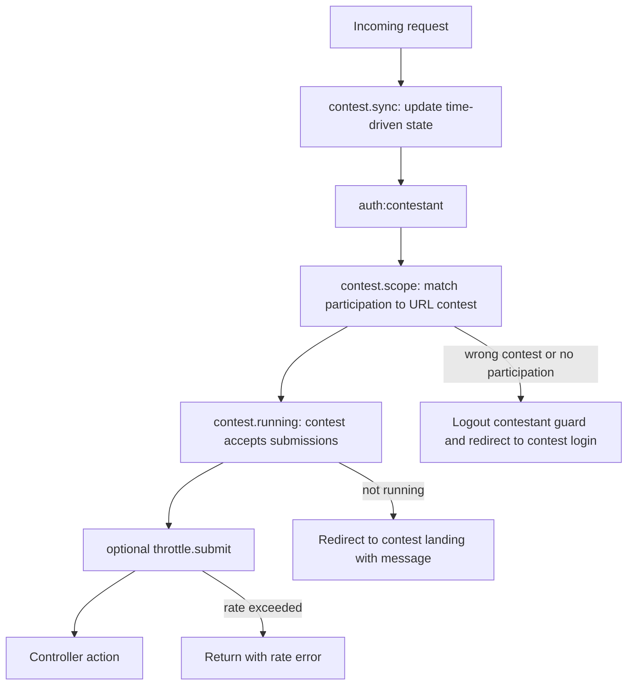
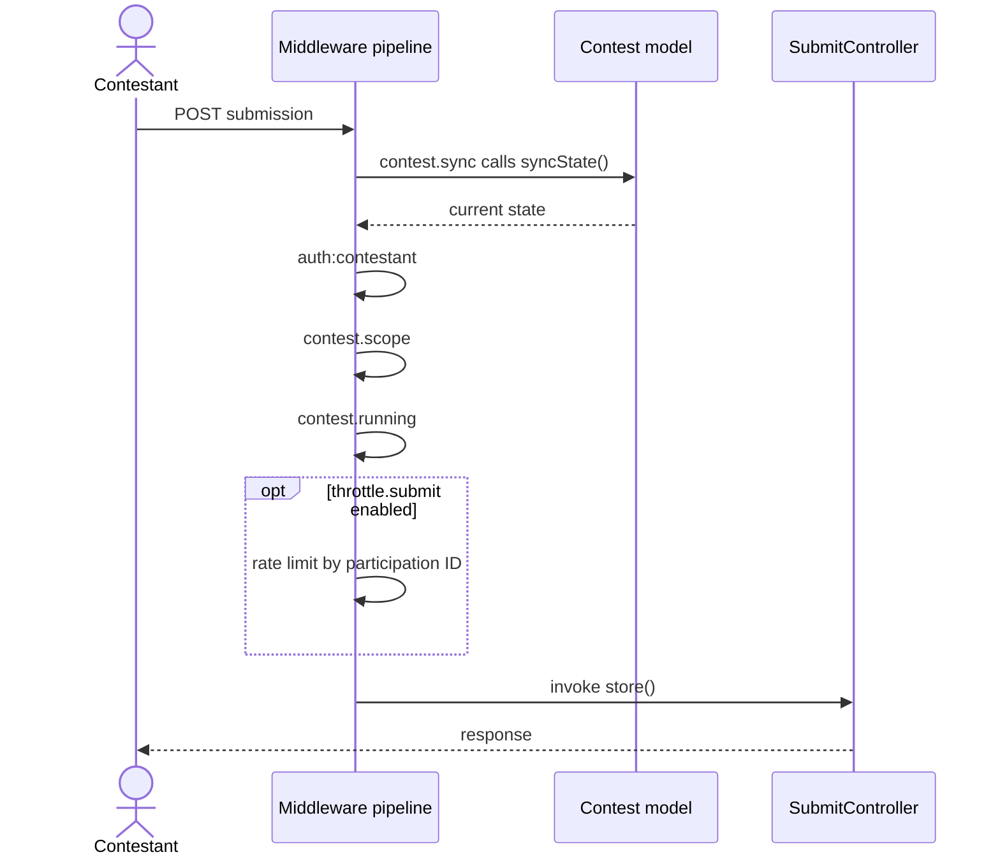

# Complete Middleware

Three middleware classes are required for the application. All three are referenced from `bootstrap/app.php`. This guide includes their implementations, an optional fourth middleware, registration examples, request ordering, concerns that do not need middleware, and test examples.

## Middleware Summary

| File | Alias | Purpose |
| --- | --- | --- |
| `app/Http/Middleware/SyncContestState.php` | `contest.sync` | Synchronizes the contest state machine on requests that have a `{contest}` route parameter. |
| `app/Http/Middleware/EnsureContestScope.php` | `contest.scope` | Blocks cross-contest access for contestant accounts. |
| `app/Http/Middleware/EnsureContestRunning.php` | `contest.running` | Blocks submissions while a contest is not running. |
| `app/Http/Middleware/ThrottleSubmissions.php` | `throttle.submit` | Optional per-team submission rate limiter; currently rate limiting is inlined in `SubmitController`. |

## Request Middleware Flow



The order matters: synchronize state before checking whether submissions are allowed; authenticate and scope the contestant before revealing contest running state.

## 1. `app/Http/Middleware/SyncContestState.php`

```php
<?php

namespace App\Http\Middleware;

use App\Models\Contest;
use Closure;
use Illuminate\Http\Request;
use Symfony\Component\HttpFoundation\Response;

/**
 * On every request that has a {contest} route parameter, ensure the contest's
 * status matches what its start/end times say it should be.
 *
 * This is belt to the scheduler's braces — if the scheduler fires a few
 * seconds late, the first request to hit the app after start_time flips
 * the state immediately rather than making the user wait for the next tick.
 *
 * No-op when:
 *   - there is no {contest} parameter in the route (e.g. POST /admin/contests)
 *   - the route parameter resolves to something that isn't a Contest model
 *   - the contest is already in the correct state (syncState() is a no-op)
 *
 * Idempotent and safe to call on every request.
 */
final class SyncContestState
{
    public function handle(Request $request, Closure $next): Response
    {
        $contest = $request->route('contest');

        if ($contest instanceof Contest) {
            // syncState() checks approved→running and running→ended based on
            // start_time/end_time. It only writes when a transition happens,
            // so during steady state this is one comparison + zero writes.
            $contest->syncState();
        }

        return $next($request);
    }
}
```

The scheduler runs every minute. If a contest starts at 11:00:00 and the scheduler does not run until 11:00:45, a contestant submitting at 11:00:05 would otherwise see an `approved` contest and be rejected. This middleware updates state on the first request after the scheduled transition. The scheduler remains the fallback when no one visits the app, ensuring background jobs and notifications also see current state.

## 2. `app/Http/Middleware/EnsureContestScope.php`

```php
<?php

namespace App\Http\Middleware;

use App\Models\Contest;
use Closure;
use Illuminate\Http\Request;
use Illuminate\Support\Facades\Auth;
use Symfony\Component\HttpFoundation\Response;

/**
 * Ensures the authenticated contestant belongs to the contest in the URL.
 *
 * If the guard holds a participation from a *different* contest (e.g. the
 * user navigated from contest A to contest B without logging out), we log
 * out ONLY the contestant guard — not the whole session — so a simultaneous
 * admin session in the same browser is preserved.
 *
 * Applied to all authenticated contestant routes:
 *   /c/{slug}/problems
 *   /c/{slug}/problems/{label}
 *   /c/{slug}/submissions
 *   /c/{slug}/questions
 *   /c/{slug}/problems/{label}/submit
 */
final class EnsureContestScope
{
    public function handle(Request $request, Closure $next): Response
    {
        $contest = $request->route('contest');

        if (! $contest instanceof Contest) {
            // Middleware applied to a route without a contest param — this is
            // a developer error, not a user-facing condition. Fail loudly.
            abort(500, 'EnsureContestScope requires a {contest} route parameter.');
        }

        $participation = Auth::guard('contestant')->user();

        if (! $participation || $participation->contest_id !== $contest->id) {
            // Log out ONLY the contestant guard. Never invalidate the whole
            // session — that would also log out an admin logged in via the
            // web guard in the same browser.
            Auth::guard('contestant')->logout();

            return redirect()
                ->route('contest.login', $contest->slug)
                ->withErrors([
                    'auth' => 'Please log in to this contest to continue.',
                ]);
        }

        return $next($request);
    }
}
```

Laravel stores session data per guard. Calling `$request->session()->invalidate()` to clear the contestant would also remove the admin's `web` guard state in the same browser. `Auth::guard('contestant')->logout()` removes only that guard's session key, preserving the admin session and multi-tab admin/contestant use.

Example: Alice logs into Contest A, then navigates to `/c/contest-b/problems`. The contestant guard returns her Contest A participation; its `contest_id` does not match Contest B's ID. This middleware logs out the contestant guard and redirects to Contest B's login, where she can enter Contest B credentials. No cross-contest data is exposed.

## 3. `app/Http/Middleware/EnsureContestRunning.php`

```php
<?php

namespace App\Http\Middleware;

use App\Models\Contest;
use Closure;
use Illuminate\Http\Request;
use Symfony\Component\HttpFoundation\Response;

/**
 * Blocks submissions to a contest that isn't in the running state.
 * Returns a friendly redirect with a flash error rather than a 403 — the
 * contestant should land back on the problem page with a clear message.
 *
 * Covers:
 *   - Contest approved but not started yet
 *   - Contest already ended (auto or manual)
 *   - Contest in draft (shouldn't be reachable, but defensive)
 *
 * Applied only to submission routes:
 *   POST /c/{slug}/problems/{label}/submit
 */
final class EnsureContestRunning
{
    public function handle(Request $request, Closure $next): Response
    {
        $contest = $request->route('contest');

        if (! $contest instanceof Contest) {
            abort(404);
        }

        if (! $contest->acceptsSubmissions()) {
            return redirect()
                ->route('contest.landing', $contest->slug)
                ->withErrors([
                    'contest' => 'The contest is not currently accepting submissions.',
                ]);
        }

        return $next($request);
    }
}
```

A redirect with a flash message is a recovery path, unlike a dead-end 403 page. Contestants whose contest just ended land on the contest page with a clear explanation. Apply this only to submission routes: contestants may still view problems before a contest starts or after it ends.

## 4. Optional `app/Http/Middleware/ThrottleSubmissions.php`

The submission rate limit is currently inlined in `SubmitController`:

```php
$rateKey = "submit:{$participation->id}";
if (RateLimiter::tooManyAttempts($rateKey, 1)) {
    return back()->withErrors(['rate' => 'Please wait...']);
}
RateLimiter::hit($rateKey, 3);
```

If the limit should be shared by other endpoints such as run-on-samples or self-rejudge, it can be extracted to middleware:

```php
<?php

namespace App\Http\Middleware;

use Closure;
use Illuminate\Http\Request;
use Illuminate\Support\Facades\Auth;
use Illuminate\Support\Facades\RateLimiter;
use Symfony\Component\HttpFoundation\Response;

/**
 * Rate limit submissions per participation: 1 per 3 seconds.
 *
 * Centralizes what was previously inlined in SubmitController, so any
 * future endpoint that counts against the submit limit (run on samples,
 * self-rejudge, etc.) can reuse it via alias.
 *
 * Keyed by participation ID (not IP) so a shared lab network doesn't
 * cause one team to throttle another.
 */
final class ThrottleSubmissions
{
    private const MAX_ATTEMPTS = 1;
    private const DECAY_SECONDS = 3;

    public function handle(Request $request, Closure $next): Response
    {
        $participation = Auth::guard('contestant')->user();

        if (! $participation) {
            // No participant — let downstream auth handle it.
            return $next($request);
        }

        $key = "submit:{$participation->id}";

        if (RateLimiter::tooManyAttempts($key, self::MAX_ATTEMPTS)) {
            $seconds = RateLimiter::availableIn($key);

            return back()->withErrors([
                'rate' => "Please wait {$seconds} second(s) before submitting again.",
            ]);
        }

        RateLimiter::hit($key, self::DECAY_SECONDS);

        return $next($request);
    }
}
```

If enabled, register the alias in `bootstrap/app.php`:

```php
$middleware->alias([
    'contest.sync'    => SyncContestState::class,
    'contest.scope'   => EnsureContestScope::class,
    'contest.running' => EnsureContestRunning::class,
    'throttle.submit' => ThrottleSubmissions::class,
]);
```

Then add it to the submit route in `routes/web.php`:

```php
Route::middleware(['contest.running', 'throttle.submit'])->group(function () {
    Route::post('problems/{label}/submit', SubmitController::class)->name('submit');
});
```

If you do not use the middleware, remove the rate-limiter block from `SubmitController::store`; no other change is needed. The source recommends keeping the limit inline for v1 because there is no second endpoint to share it with. Add the middleware when a second consumer appears; otherwise it is unnecessary indirection (YAGNI).

## 5. Consolidated `bootstrap/app.php` Middleware Registration

This repeats the middleware registration from the configuration reference. The optional alias is commented out.

```php
<?php

use App\Http\Middleware\EnsureContestRunning;
use App\Http\Middleware\EnsureContestScope;
use App\Http\Middleware\SyncContestState;
use Illuminate\Foundation\Application;
use Illuminate\Foundation\Configuration\Exceptions;
use Illuminate\Foundation\Configuration\Middleware;
use Illuminate\Http\Request;

return Application::configure(basePath: dirname(__DIR__))
    ->withRouting(
        web: __DIR__.'/../routes/web.php',
        commands: __DIR__.'/../routes/console.php',
        health: '/up',
    )
    ->withMiddleware(function (Middleware $middleware) {
        $middleware->alias([
            'contest.sync'    => SyncContestState::class,
            'contest.scope'   => EnsureContestScope::class,
            'contest.running' => EnsureContestRunning::class,
            // 'throttle.submit' => ThrottleSubmissions::class,  // optional
        ]);

        $middleware->redirectUsersTo(fn (Request $request) => route('admin.dashboard'));
        $middleware->redirectGuestsTo(function (Request $request) {
            if ($request->routeIs('contest.*') && $request->route('contest')) {
                return route('contest.login', $request->route('contest'));
            }
            return route('admin.login');
        });
    })
    ->withExceptions(function (Exceptions $exceptions) {
        // ... (see config section)
    })->create();
```

## 6. Middleware Execution Order

### Admin request: `GET /admin/contests/5/submissions`

1. `StartSession` (Laravel default).
2. `ShareErrorsFromSession` (default).
3. `VerifyCsrfToken` (default; for GET it is a no-op).
4. `SyncContestState` flips the contest to running if `start_time` has passed.
5. `auth:web` verifies the admin session.
6. Route-model binding resolves `{contest}` (the source notes this resolution is already available by the middleware/controller stage).
7. `AdminSubmissionController::index` runs.

### Contestant submission: `POST /c/demo-2024/problems/A/submit`

1. `StartSession`.
2. `ShareErrorsFromSession`.
3. `VerifyCsrfToken` rejects a missing/invalid token.
4. `SyncContestState` ensures status matches the wall clock.
5. `auth:contestant` verifies a participation is logged in.
6. `EnsureContestScope` verifies it belongs to this contest.
7. `EnsureContestRunning` verifies the contest accepts submissions.
8. Optional `ThrottleSubmissions` enforces the rate limit.
9. `SubmitController::store` runs.



`SyncContestState` must run before `EnsureContestRunning`; otherwise the latter can reject a submission after the scheduled start time but before the scheduler updates the state. `EnsureContestScope` must run before `EnsureContestRunning`: scope is a security check, while running is a business-state check. A scope failure should yield a login redirect, not reveal the contest's running state.

## 7. What Does Not Need Middleware

| Concern | Where handled | Why not middleware |
| --- | --- | --- |
| Admin authentication | `auth:web` (Laravel default) | Default behavior is sufficient. |
| Contestant authentication | `auth:contestant` (Laravel default) | The custom guard is already configured in `config/auth.php`. |
| CSRF protection | `VerifyCsrfToken` (Laravel default) | Default behavior is correct; forms use `@csrf`. |
| Session handling | `StartSession`, `ShareErrorsFromSession` (defaults) | Default behavior is correct. |
| Rate limiting | Inline in `SubmitController`; optional middleware in section 4 | Extract only if shared by multiple endpoints. |
| Contest editability (`isDraft`) | Each mutation method uses `abort_unless($contest->isDraft())` | A single `EnsureEditable` does not fit different route requirements: credentials require approved, answers may require running, rejudge may be allowed in any state. |
| Single-active-contest invariant | Database `active_slot` generated column plus approval pre-check | Database enforcement is the correct floor; the pre-check improves UX. |
| Submission ownership | `ContestantSubmissionController::authorizeOwnership()` | Inline is adequate; ownership is not a cross-cutting concern here. |
| Admin role | Not enforced in v1 (single role) | Add `EnsureAdminRole` if distinct roles are introduced. |
| JSON responses for AJAX | Controllers explicitly return `response()->json()` | No middleware is needed. |

Do not add `PreventLockedContestEdits` middleware by default. Per-route rules differ enough that the abstraction would be more complex than inline `abort_unless()` calls and less explicit in route files.

## 8. Testing Notes

### `SyncContestStateTest`

```php
public function test_flips_approved_contest_to_running_when_start_time_passed(): void
{
    $contest = Contest::factory()->approved()->create([
        'start_time' => now()->subMinute(),
    ]);

    $this->get(route('contest.landing', $contest->slug));

    $this->assertSame('running', $contest->fresh()->status);
    $this->assertNotNull($contest->fresh()->started_at);
}

public function test_does_not_flip_approved_contest_before_start_time(): void
{
    $contest = Contest::factory()->approved()->create([
        'start_time' => now()->addHour(),
    ]);

    $this->get(route('contest.landing', $contest->slug));

    $this->assertSame('approved', $contest->fresh()->status);
}
```

### `EnsureContestScopeTest`

```php
public function test_blocks_cross_contest_access(): void
{
    $contestA = Contest::factory()->running()->create();
    $contestB = Contest::factory()->ended()->create();
    $participation = ContestParticipation::factory()->forContest($contestA)->create();

    $this->actingAs($participation, 'contestant')
        ->get(route('contest.problems', $contestB->slug))
        ->assertRedirect(route('contest.login', $contestB->slug));

    $this->assertGuest('contestant');
    // crucially, this should NOT affect an admin session
    // $this->assertAuthenticated('web');
}

public function test_does_not_log_out_admin_when_contestant_scope_fails(): void
{
    $admin = User::factory()->create();
    $contestA = Contest::factory()->running()->create();
    $contestB = Contest::factory()->ended()->create();
    $participation = ContestParticipation::factory()->forContest($contestA)->create();

    $this->actingAs($admin, 'web');

    $this->actingAs($participation, 'contestant')
        ->get(route('contest.problems', $contestB->slug));

    // admin session survived the contestant logout
    $this->assertAuthenticated('web');
    $this->assertGuest('contestant');
}
```

### `EnsureContestRunningTest`

```php
public function test_blocks_submission_to_approved_contest(): void
{
    $contest = Contest::factory()->approved()->create();
    $participation = ContestParticipation::factory()->forContest($contest)->create();
    $problem = ContestProblem::factory()->for($contest)->create();

    $this->actingAs($participation, 'contestant')
        ->post(route('contest.submit', [$contest->slug, $problem->label]), [])
        ->assertRedirect(route('contest.landing', $contest->slug))
        ->assertSessionHasErrors('contest');
}

public function test_allows_submission_to_running_contest(): void
{
    $contest = Contest::factory()->running()->create();
    // ... set up participation, problem, and post a valid submission
}
```

The `active_slot` unique constraint means a test cannot have two running contests at once. Use `ended()` for the second contest, as in the cross-contest scope tests above.
