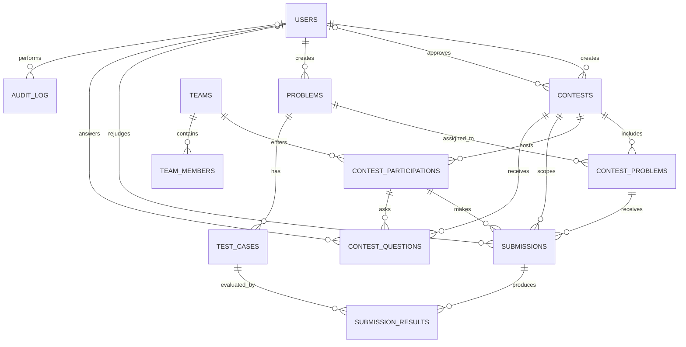
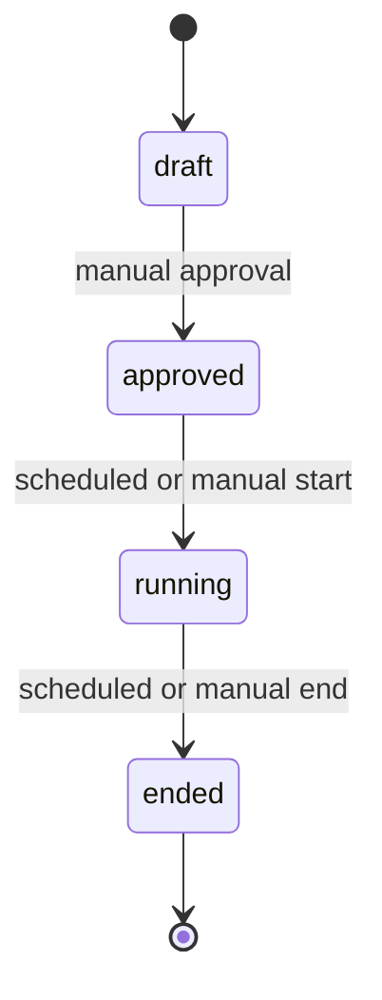
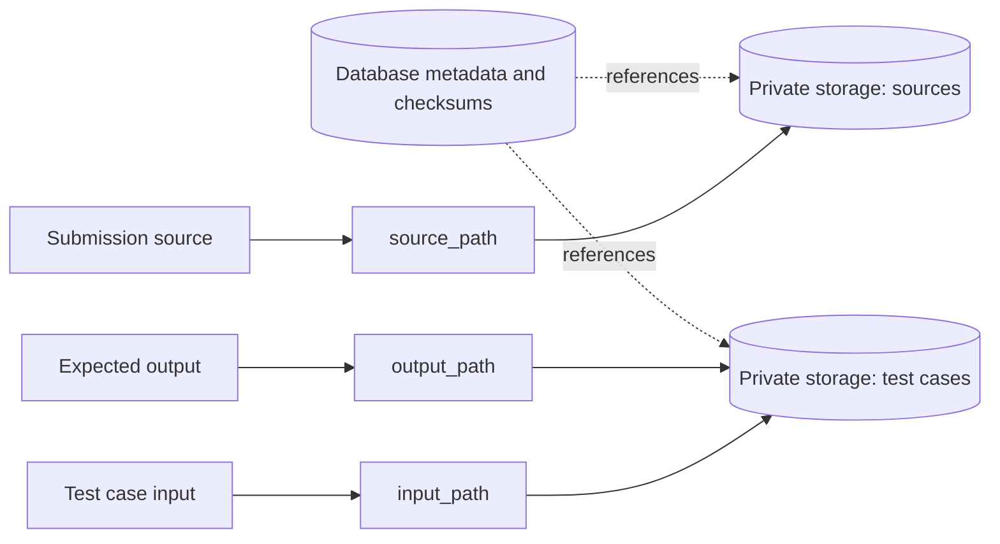

# Contest Platform Database Schema

Complete schema design for a MySQL 8 contest platform. Tables are grouped by domain; columns, constraints, and intended use are documented below.

## Conventions

- Business timestamps use `DATETIME` and are stored in UTC. MySQL `TIMESTAMP` columns are retained for Laravel convention/framework fields.
- Primary keys use `BIGINT UNSIGNED` (`$table->id()` in Laravel).
- Tables use nullable `created_at` and `updated_at` timestamp columns unless noted otherwise.
- Stable status and kind sets use MySQL `ENUM` values.
- Foreign keys default to `ON DELETE CASCADE`, with exceptions noted on the relevant columns.

## Entity Relationship Diagram



`AUDIT_LOG` is optional. Laravel framework tables are omitted from this domain relationship diagram. A submission references both its contest and its contest-scoped participation/problem assignment; the application must ensure those contest IDs agree.

## Contest Lifecycle



There is no scheduled intermediate state. A scheduler or `SyncContestState` middleware transitions directly from `approved` to `running` and from `running` to `ended` based on configured times.

## 1. Users

Admin and operator accounts. Both roles are treated as admins in v1.

| Column | Type | Constraints | Purpose |
| --- | --- | --- | --- |
| `id` | `BIGINT UNSIGNED` | PK, AUTO_INCREMENT | Primary key |
| `name` | `VARCHAR(255)` | NOT NULL | Display name in the admin panel |
| `email` | `VARCHAR(255)` | NOT NULL, UNIQUE | Login identifier |
| `password` | `VARCHAR(255)` | NOT NULL | bcrypt hash (`Laravel Hash::make`) |
| `role` | `ENUM('admin','operator')` | NOT NULL, DEFAULT `'admin'` | Reserved for v2; both roles act as admins in v1 |
| `remember_token` | `VARCHAR(100)` | NULL | Laravel remember-me cookie support |
| `created_at` | `TIMESTAMP` | NULL | Laravel timestamp |
| `updated_at` | `TIMESTAMP` | NULL | Laravel timestamp |

`remember_token` uses Laravel's framework type. Business-time columns elsewhere use `DATETIME`. `email_verified_at` is omitted because admins are created by other admins. `password_reset_tokens` is unnecessary unless self-service password reset is added.

## 2. Teams and Team Members

Teams are global identities across contests; membership records hold multiple members per team.

### `teams`

| Column | Type | Constraints | Purpose |
| --- | --- | --- | --- |
| `id` | `BIGINT UNSIGNED` | PK | Primary key |
| `name` | `VARCHAR(255)` | NOT NULL, UNIQUE | Globally unique team identity; supports import deduplication |
| `created_at` | `TIMESTAMP` | NULL | Laravel timestamp |
| `updated_at` | `TIMESTAMP` | NULL | Laravel timestamp |

There is no affiliation column. If organizations become relevant, consider `affiliation VARCHAR(255) NULL` and a composite unique constraint on `(name, affiliation)`.

### `team_members`

| Column | Type | Constraints | Purpose |
| --- | --- | --- | --- |
| `id` | `BIGINT UNSIGNED` | PK | Primary key |
| `team_id` | `BIGINT UNSIGNED` | FK → `teams.id`, ON DELETE CASCADE | Owning team |
| `name` | `VARCHAR(255)` | NOT NULL | Member display name |
| `email` | `VARCHAR(255)` | NOT NULL | Record-keeping; available for future notifications |
| `ordinal` | `SMALLINT UNSIGNED` | NOT NULL, DEFAULT `0` | Preserves CSV order, such as team leader first |
| `created_at` | `TIMESTAMP` | NULL | Laravel timestamp |
| `updated_at` | `TIMESTAMP` | NULL | Laravel timestamp |

Index: `INDEX(team_id)` for listing team members.

A separate relational table makes member lookup and bulk email practical. Expected normalized CSV shape is one row per member, repeating the team name:

```csv
team_name,member_name,member_email
Team Alpha,Alice Smith,alice@x.edu
Team Alpha,Bob Jones,bob@x.edu
Team Beta,Carol Lee,carol@y.edu
```

A one-row-per-team CSV with numbered member columns is also parseable, but the importer needs an example to confirm the format.

## 3. Contests

The central event entity.

| Column | Type | Constraints | Purpose |
| --- | --- | --- | --- |
| `id` | `BIGINT UNSIGNED` | PK | Primary key |
| `slug` | `VARCHAR(100)` | NOT NULL, UNIQUE | URL-safe identifier for `/c/{slug}/...`; generated from the name and editable in draft |
| `name` | `VARCHAR(255)` | NOT NULL | Contest display name |
| `status` | `ENUM('draft','approved','running','ended')` | NOT NULL, DEFAULT `'draft'` | Contest state |
| `start_time` | `DATETIME` | NOT NULL | Scheduled start time |
| `end_time` | `DATETIME` | NOT NULL | Scheduled end time |
| `started_at` | `DATETIME` | NULL | Actual start; canonical base for ICPC penalty calculations |
| `ended_at` | `DATETIME` | NULL | Actual end, retained for historical duration |
| `freeze_minutes` | `SMALLINT UNSIGNED` | NOT NULL, DEFAULT `0` | Scoreboard freeze window; zero disables freezing |
| `is_public` | `TINYINT(1)` / `BOOLEAN` | NOT NULL, DEFAULT `1` | Whether the scoreboard is public without login |
| `approved_at` | `DATETIME` | NULL | Approval time for audit |
| `approved_by` | `BIGINT UNSIGNED` | FK → `users.id`, ON DELETE SET NULL | Approving user |
| `created_by` | `BIGINT UNSIGNED` | NOT NULL, FK → `users.id`, ON DELETE RESTRICT | Creating user |
| `active_slot` | `TINYINT` | Stored generated column; UNIQUE | `1` when status is approved/running, otherwise NULL; enforces one active contest |
| `created_at` | `TIMESTAMP` | NULL | Laravel timestamp |
| `updated_at` | `TIMESTAMP` | NULL | Laravel timestamp |

Generated expression for `active_slot`:

```sql
CASE WHEN status IN ('approved', 'running') THEN 1 ELSE NULL END
```

MySQL permits multiple `NULL` values in a unique index, so only one row can have `active_slot = 1`. This enforces the single-active-contest rule atomically, including concurrent approvals. Keep the application check for a user-friendly error.

Indexes:

- `INDEX(status, start_time)` for approved contests ready to start.
- `INDEX(status, end_time)` for running contests ready to end.

State transitions: `draft → approved` manually; `approved → running` at `start_time` or manually; `running → ended` at `end_time` or manually. When auto-starting, set `started_at = start_time` to absorb scheduler jitter; when starting manually, set it to the current time. This gives penalty calculations one reliable start instant. `ended_at` records the actual end.

## 4. Contest Participations

A team's contest-scoped identity and credentials.

| Column | Type | Constraints | Purpose |
| --- | --- | --- | --- |
| `id` | `BIGINT UNSIGNED` | PK | Primary key |
| `contest_id` | `BIGINT UNSIGNED` | FK → `contests.id`, ON DELETE CASCADE | Contest |
| `team_id` | `BIGINT UNSIGNED` | FK → `teams.id`, ON DELETE RESTRICT | Team; protects historical participation records |
| `username` | `VARCHAR(50)` | NOT NULL | Contest-scoped login, e.g. `team-042` |
| `password` | `VARCHAR(255)` | NOT NULL | bcrypt hash; plaintext is never stored |
| `seat_number` | `SMALLINT UNSIGNED` | NULL | Optional physical seat/lab number for credential PDFs |
| `credentials_generated_at` | `TIMESTAMP` | NULL | Last credential generation time for audit/UI display |
| `created_at` | `TIMESTAMP` | NULL | Laravel timestamp |
| `updated_at` | `TIMESTAMP` | NULL | Laravel timestamp |

Unique constraints:

- `UNIQUE(contest_id, username)` so usernames can repeat across different contests.
- `UNIQUE(contest_id, team_id)` so a team participates once per contest.

Index: `INDEX(contest_id)` for loading contest participants. Credentials belong to the participation, so regenerating credentials for one contest does not affect the same team's other contests.

## 5. Problems

A shared problem bank; problems are attached to contests through `contest_problems`.

| Column | Type | Constraints | Purpose |
| --- | --- | --- | --- |
| `id` | `BIGINT UNSIGNED` | PK | Primary key |
| `code` | `VARCHAR(20)` | NOT NULL, UNIQUE | Stable identifier such as `TWO-SUM` or `GRAPH-01` |
| `title` | `VARCHAR(255)` | NOT NULL | Contestant-facing title |
| `statement_md` | `LONGTEXT` | NOT NULL | Markdown statement rendered to HTML |
| `time_limit_ms` | `INT UNSIGNED` | NOT NULL, DEFAULT `1000` | Judge time limit per submission |
| `memory_limit_mb` | `INT UNSIGNED` | NOT NULL, DEFAULT `256` | Judge memory limit per submission |
| `created_by` | `BIGINT UNSIGNED` | NOT NULL, FK → `users.id`, ON DELETE RESTRICT | Creating user for audit |
| `created_at` | `TIMESTAMP` | NULL | Laravel timestamp |
| `updated_at` | `TIMESTAMP` | NULL | Laravel timestamp |

Editing a problem's statement or test cases is forbidden once any contest using it is approved. Enforce this in the application, not the schema.

## 6. Contest Problems

Associates problems with contests and stores contest-specific labels and scoring settings.

| Column | Type | Constraints | Purpose |
| --- | --- | --- | --- |
| `id` | `BIGINT UNSIGNED` | PK | Primary key |
| `contest_id` | `BIGINT UNSIGNED` | FK → `contests.id`, ON DELETE CASCADE | Contest |
| `problem_id` | `BIGINT UNSIGNED` | FK → `problems.id`, ON DELETE RESTRICT | Shared problem |
| `label` | `VARCHAR(3)` | NOT NULL | Contest-facing label (`A`, `B`, …, `AA`) |
| `points` | `SMALLINT UNSIGNED` | NOT NULL, DEFAULT `0` | Maximum points in partial-scoring mode; ignored in pure ICPC mode |
| `sort_order` | `SMALLINT UNSIGNED` | NOT NULL, DEFAULT `0` | Explicit display order |
| `created_at` | `TIMESTAMP` | NULL | Laravel timestamp |
| `updated_at` | `TIMESTAMP` | NULL | Laravel timestamp |

Unique constraints: `UNIQUE(contest_id, problem_id)` and `UNIQUE(contest_id, label)`. Index: `INDEX(contest_id)`. The same problem can have a different label and points in different contests. Freeze this association once the contest is approved.

## 7. Test Cases

Stores test-case metadata; input and output files live in file or object storage.

| Column | Type | Constraints | Purpose |
| --- | --- | --- | --- |
| `id` | `BIGINT UNSIGNED` | PK | Primary key |
| `problem_id` | `BIGINT UNSIGNED` | FK → `problems.id`, ON DELETE CASCADE | Owning problem |
| `ordinal` | `SMALLINT UNSIGNED` | NOT NULL | Position within the problem |
| `kind` | `ENUM('sample','hidden')` | NOT NULL | Samples are shown to contestants; hidden cases are judge-only |
| `input_path` | `VARCHAR(500)` | NOT NULL | Storage key for input file |
| `output_path` | `VARCHAR(500)` | NOT NULL | Storage key for expected output |
| `input_sha256` | `CHAR(64)` | NOT NULL | Input integrity checksum |
| `output_sha256` | `CHAR(64)` | NOT NULL | Output integrity checksum |
| `input_size_bytes` | `INT UNSIGNED` | NOT NULL | Input size sanity check/display |
| `output_size_bytes` | `INT UNSIGNED` | NOT NULL | Output size sanity check/display |
| `created_at` | `TIMESTAMP` | NULL | Laravel timestamp |
| `updated_at` | `TIMESTAMP` | NULL | Laravel timestamp |

Unique constraint: `UNIQUE(problem_id, ordinal)`. Index: `INDEX(problem_id, kind)` for sample/hidden lookup. Ordinals are intended to be sequential without gaps.

Files are stored outside the database to avoid database bloat and to support judges that accept presigned URLs.

## 8. Submissions

One row per submission.

| Column | Type | Constraints | Purpose |
| --- | --- | --- | --- |
| `id` | `BIGINT UNSIGNED` | PK | Primary key |
| `contest_id` | `BIGINT UNSIGNED` | FK → `contests.id`, ON DELETE CASCADE | Denormalized for fast scoreboard queries |
| `participation_id` | `BIGINT UNSIGNED` | FK → `contest_participations.id`, ON DELETE CASCADE | Submitting team's contest identity |
| `contest_problem_id` | `BIGINT UNSIGNED` | FK → `contest_problems.id`, ON DELETE CASCADE | Problem assignment and contest-specific label |
| `language` | `VARCHAR(32)` | NOT NULL | Internal language name, e.g. `cpp17`; mapped to judge language ID |
| `source_path` | `VARCHAR(500)` | NOT NULL | Storage key for submitted source |
| `status` | `ENUM('queued','judging','done','error')` | NOT NULL, DEFAULT `'queued'` | Queue/judge processing state |
| `verdict` | `VARCHAR(16)` | NULL | Final judge verdict (`AC`, `WA`, `TLE`, `MLE`, `RE`, `CE`, `IE`, etc.); extensible |
| `max_time_ms` | `INT UNSIGNED` | NULL | Worst test-case time |
| `max_memory_kb` | `INT UNSIGNED` | NULL | Worst test-case memory |
| `score` | `DECIMAL(8,2)` | NULL | Partial score; NULL in pure ICPC mode |
| `judge_job_id` | `VARCHAR(100)` | NULL, UNIQUE | Judge job ID for callback/poll correlation |
| `is_sample_run` | `TINYINT(1)` / `BOOLEAN` | NOT NULL, DEFAULT `0` | Judges only sample cases; does not count toward scoreboard |
| `submitted_at` | `DATETIME` | NOT NULL | Contestant submit time used for penalty calculations |
| `judged_at` | `DATETIME` | NULL | Time verdict was received |
| `rejudge_count` | `TINYINT UNSIGNED` | NOT NULL, DEFAULT `0` | Number of admin rejudges |
| `last_rejudged_at` | `DATETIME` | NULL | Most recent rejudge time |
| `last_rejudged_by` | `BIGINT UNSIGNED` | FK → `users.id`, ON DELETE SET NULL | Admin who last rejudged |
| `created_at` | `TIMESTAMP` | NULL | Laravel timestamp |
| `updated_at` | `TIMESTAMP` | NULL | Laravel timestamp |

Status meanings: `queued` is waiting for the judge; `judging` means accepted by the judge; `done` means a verdict was received; `error` means processing failed.

Indexes:

- `INDEX(contest_id, participation_id)` for a team's submissions.
- `INDEX(contest_id, contest_problem_id)` for submissions to a problem.
- `INDEX(contest_id, status)` for the admin monitor.
- `INDEX(contest_id, submitted_at)` for scoreboard ordering.
- `judge_job_id` is already indexed by its unique constraint; an additional ordinary index is unnecessary.

The `contest_problem_id` identifies the problem as presented in that contest. The global problem is reachable through `contest_problems.problem_id`. The application must keep `contest_id`, participation, and contest-problem references consistent.

## 9. Submission Results

Per-test-case verdicts for a submission.

| Column | Type | Constraints | Purpose |
| --- | --- | --- | --- |
| `id` | `BIGINT UNSIGNED` | PK | Primary key |
| `submission_id` | `BIGINT UNSIGNED` | FK → `submissions.id`, ON DELETE CASCADE | Parent submission |
| `test_case_id` | `BIGINT UNSIGNED` | FK → `test_cases.id`, ON DELETE RESTRICT | Test case; protects historical results |
| `verdict` | `VARCHAR(16)` | NOT NULL | Per-case judge verdict |
| `time_ms` | `INT UNSIGNED` | NULL | Time used on this case |
| `memory_kb` | `INT UNSIGNED` | NULL | Memory used on this case |
| `message` | `TEXT` | NULL | Judge message, such as stderr, diff, or runtime error |
| `created_at` | `TIMESTAMP` | NULL | Laravel timestamp |
| `updated_at` | `TIMESTAMP` | NULL | Laravel timestamp |

Unique constraint: `UNIQUE(submission_id, test_case_id)` enforces one result per case and idempotency for duplicate callbacks. Index: `INDEX(submission_id)`. Separate rows keep per-case results queryable, unlike a JSON column on submissions.

## 10. Contest Questions

One question and one admin answer per row.

| Column | Type | Constraints | Purpose |
| --- | --- | --- | --- |
| `id` | `BIGINT UNSIGNED` | PK | Primary key |
| `contest_id` | `BIGINT UNSIGNED` | FK → `contests.id`, ON DELETE CASCADE | Contest |
| `participation_id` | `BIGINT UNSIGNED` | FK → `contest_participations.id`, ON DELETE CASCADE | Asking team's participation |
| `body` | `TEXT` | NOT NULL | Question text |
| `answer` | `TEXT` | NULL | Admin answer; NULL means unanswered |
| `answered_by` | `BIGINT UNSIGNED` | FK → `users.id`, ON DELETE SET NULL | Admin who answered |
| `answered_at` | `DATETIME` | NULL | Answer time and inbox ordering |
| `visibility` | `ENUM('public','private')` | NOT NULL, DEFAULT `'private'` | Whether other teams can see the answered question |
| `created_at` | `TIMESTAMP` | NULL | Laravel timestamp |
| `updated_at` | `TIMESTAMP` | NULL | Laravel timestamp |

Indexes:

- `INDEX(contest_id, answered_at)` for the admin inbox. NULL values sort first when ordered by `ISNULL(answered_at) DESC, answered_at ASC`; alternatively add a generated `is_answered` column.
- `INDEX(contest_id, participation_id)` for a team's questions.

Visibility behavior is application/UI logic: the asking team sees its own question and answer; other teams see it only when `visibility = 'public'` and `answer IS NOT NULL`; admins see all questions. Defaulting to private avoids leaking an answer before the admin chooses to make it public. Threaded replies would require a separate `contest_question_replies` table.

## 11. Laravel Framework Tables

Keep these as generated by a fresh Laravel install; no custom modifications are required.

| Table | Purpose | When needed |
| --- | --- | --- |
| `migrations` | Tracks executed migrations | Always |
| `sessions` | Stores session data | When `SESSION_DRIVER=database`; not needed for file sessions |
| `cache` | Cached values such as scoreboards and rate-limit state | When `CACHE_STORE=database` |
| `cache_locks` | Atomic cache locks for rate limiting/throttling | When using database cache |
| `failed_jobs` | Failed queue job records | Useful if async jobs are introduced; sync jobs fail in-request |
| `jobs` | Queue records | Not needed with `QUEUE_CONNECTION=sync` |
| `job_batches` | Batch progress | Not needed unless using job batches |
| `password_reset_tokens` | Self-service password reset | Not needed for the described admin/contestant flows |

Recommendation: use `SESSION_DRIVER=database` and `CACHE_STORE=database` to avoid filesystem state when scaling across app servers or using containers. These settings require the corresponding Laravel tables.

## 12. Optional Audit Log

Recommended, but not required for contest operation.

| Column | Type | Constraints | Purpose |
| --- | --- | --- | --- |
| `id` | `BIGINT UNSIGNED` | PK | Primary key |
| `user_id` | `BIGINT UNSIGNED` | FK → `users.id`, ON DELETE SET NULL | Actor |
| `action` | `VARCHAR(100)` | NOT NULL | Event, e.g. `contest.approved`, `credentials.generated`, `submission.rejudged` |
| `subject_type` | `VARCHAR(100)` | NULL | Model class, e.g. `App\Models\Contest` |
| `subject_id` | `BIGINT UNSIGNED` | NULL | Subject row ID |
| `metadata` | `JSON` | NULL | Additional context, e.g. `{"count":42}` |
| `ip_address` | `VARCHAR(45)` | NULL | IPv4 or IPv6 address |
| `created_at` | `TIMESTAMP` | NULL | Event time |

Indexes: `INDEX(subject_type, subject_id)` and `INDEX(user_id, created_at)`. An audit trail helps answer who approved a contest, generated credentials, or rejudged a submission.

## 13. Cross-Table Constraints and Invariants

These rules require application-level enforcement because ordinary foreign keys do not express state transitions or temporal policies.

| Rule | Enforcement |
| --- | --- |
| At most one contest is `approved` or `running` | `active_slot` generated column (database) plus `ApproveContestAction` (application, for friendly errors) |
| Contest states transition in order: draft → approved → running → ended | `SyncContestState` middleware and service-layer checks |
| Approved, running, or ended contests cannot be deleted | Application policy; only draft contests are deletable |
| Contest fields cannot be edited after approval | Application policies |
| `start_time` locks once it has passed while the contest is draft | `EditContestAction` checks current time |
| `end_time` locks when the contest starts running | Application policy |
| Problem test cases cannot be edited while an attached contest is approved/running | Application policy |
| Submissions are accepted only while contest status is running | `EnsureContestRunning` middleware and `SubmitController` |
| Contestants can access only their own contest | `EnsureContestScope` middleware |
| Hidden test cases are never returned to contestants | Resource layer queries only `kind = 'sample'` for contestant endpoints |
| Submission contest, participation, and contest-problem references belong together | Application validation (or a stronger composite-key design) |
| Contest question and participation references belong together | Application validation |

The schema's `active_slot` is the only listed business rule enforced directly with a generated-column uniqueness trick. Foreign keys protect referential integrity; they do not enforce state-machine rules.

## 14. Storage Layout

Path columns point to files in local or object storage, not database blobs. Suggested local layout:

```text
storage/app/private/
├── sources/
│   └── {contest_id}/{participation_id}/{submission_id}.{ext}
└── problems/
    └── {problem_id}/test-cases/
        ├── {test_case_id}.in
        └── {test_case_id}.out
```

For S3 or another object store, use the same structure as the object-key prefix. `input_path`, `output_path`, and `source_path` store the full key. Use Laravel's storage abstraction consistently, for example `Storage::disk('local')->put($path, $contents)` and `Storage::disk('local')->get($path)` (or the `s3` disk).



Presigned URLs are useful if the judge accepts URLs instead of inline content, and are a reason to consider object storage. Keeping large files outside the database avoids database bloat.

## 15. Schema-Wide Notes

- There are eleven business tables, three commonly used Laravel support tables (`sessions`, `cache`, `cache_locks`), and one optional table (`audit_log`). Other Laravel tables are conditional on features in use.
- `freeze_minutes` is read by the scoreboard service. Submissions judged in the final freeze window before `ended_at` are hidden from contestants and revealed when the contest ends; admins see the truth. Set it to zero to disable freezing.
- `submissions.score` and `contest_problems.points` are reserved for partial scoring. In pure ICPC mode, `score` remains NULL and the scoreboard computes solved count and penalty.
- `team_members.email` is record-keeping in v1, not a login or notification address. It can appear on credential PDFs.
- Only `audit_log.metadata` uses JSON. Relational data remains queryable through normal columns and tables.
- Test cases and source code live on disk or in object storage; the database stores metadata, paths, and checksums.

## 16. Open Questions

These choices affect surrounding application behavior, not the table structure:

| Question | Current recommendation |
| --- | --- |
| Can `end_time` be edited while approved? | Yes, until the contest starts; freeze it after running begins. |
| Can a contest be approved after `start_time` has passed? | Allow approval and auto-start at the current time. |
| Should Q&A answers default to public? | Current schema defaults to private; use public for an ICPC-style clarification workflow if desired. |
| What CSV format is supplied? | Schema supports multiple members per team; confirm whether rows are per member or per team before locking the importer. |
| Is partial scoring needed? | If so, populate `submissions.score` and `contest_problems.points`; otherwise leave them unused/NULL. |
| Should contestants be able to run against samples? | `is_sample_run` supports this; exposing it is a separate UI decision. |
