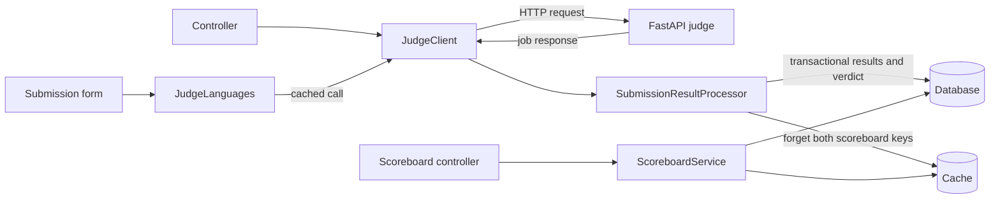
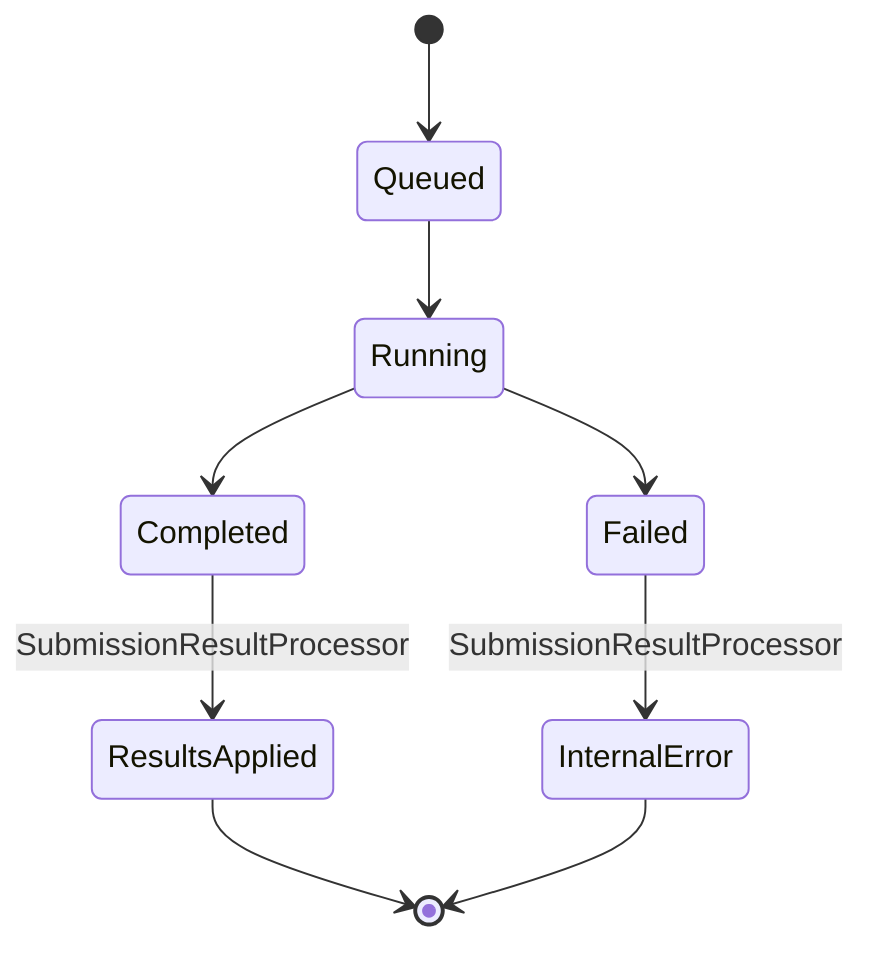

# Complete Services Section

This document contains the five service/support classes described in `service.txt`, with complete implementations, service responsibilities, unit conversions, integration notes, and the source's final note fragment.

## Services Included

| File | Purpose |
| --- | --- |
| `app/Exceptions/JudgeException.php` | Typed exceptions for judge failures. |
| `app/Services/JudgeClient.php` | HTTP client for the FastAPI judge: submit, status, languages, unit conversions, and verdict mapping. |
| `app/Services/JudgeLanguages.php` | Cached language list for the submission form. |
| `app/Services/SubmissionResultProcessor.php` | Parses judge status responses, writes results transactionally, and invalidates scoreboard cache. |
| `app/Services/ScoreboardService.php` | ICPC scoreboard computation with freeze window. |

No service provider is needed: Laravel auto-wires all five through the container. `JudgeClient` reads `config('judge.*')` in its constructor; other dependencies use typed constructor injection.

## Service Flow



## Judge and Database Units

Conversions between judge wire units and database units happen in `JudgeClient` and nowhere else.

| Value | Judge API | Database |
| --- | --- | --- |
| Problem time limit | Seconds (integer) | `problems.time_limit_ms`, milliseconds (integer) |
| Problem memory limit | Kilobytes (integer) | `problems.memory_limit_mb`, megabytes (integer) |
| Execution time | Seconds (float) | `submissions.max_time_ms` / `submission_results.time_ms`, milliseconds (integer) |
| Memory usage | Kilobytes (integer) | `submission_results.memory_kb`, kilobytes (integer) |

## Judge Job Lifecycle



The judge API contract described by the source:

- `POST /api/v1/submissions/` → `202 { job_id, job_status }`
- `GET /api/v1/submissions/{job_id}` → `{ job_id, job_status, result|null }`
- `GET /api/v1/languages/` → `{ languages: [{id, name, available, needs_compilation}] }`
- Verdicts: `Accepted`, `Wrong Answer`, `Time Limit Exceeded`, `Memory Limit Exceeded`, `Runtime Error`, `Compilation Error`, `Internal Error`.
- Job statuses: `Queued`, `Running`, `Completed`, `Failed`.

## 1. `app/Exceptions/JudgeException.php`

```php
<?php

namespace App\Exceptions;

use RuntimeException;
use Throwable;

/**
 * Single exception type for all judge-related failures.
 * Use the static factories — they carry the right context.
 */
final class JudgeException extends RuntimeException
{
    /**
     * @param array<string, mixed>|null $context
     */
    public function __construct(
        string $message,
        public readonly ?array $context = null,
        ?Throwable $previous = null,
    ) {
        parent::__construct($message, 0, $previous);
    }

    public static function unreachable(Throwable $previous): self
    {
        return new self(
            'Judge engine is unreachable.',
            ['error' => $previous->getMessage()],
            $previous,
        );
    }

    public static function rejected(int $status, string $body): self
    {
        return new self(
            "Judge rejected the request (HTTP {$status}).",
            [
                'status' => $status,
                'body'   => mb_substr($body, 0, 500),
            ],
        );
    }

    public static function invalidResponse(string $reason): self
    {
        return new self("Judge returned an invalid response: {$reason}");
    }

    public static function invalidPayload(string $reason): self
    {
        return new self("Cannot build judge payload: {$reason}");
    }
}
```

## 2. `app/Services/JudgeClient.php`

```php
<?php

namespace App\Services;

use App\Exceptions\JudgeException;
use App\Models\Problem;
use App\Models\Submission;
use App\Models\TestCase;
use Illuminate\Support\Facades\Http;

/**
 * The only class in the application that talks to the FastAPI judge engine.
 *
 * Everything the rest of the app knows about the judge's wire format lives
 * here: endpoint paths, request shape, response shape, unit conversions,
 * and verdict string mapping. If the judge's contract changes, this is the
 * one file to update.
 *
 * Confirmed from the judge API docs:
 *   POST /api/v1/submissions/           → 202 { job_id, job_status }
 *   GET  /api/v1/submissions/{job_id}   → { job_id, job_status, result|null }
 *   GET  /api/v1/languages/             → { languages: [{id, name, available, needs_compilation}] }
 *
 * Verdict strings: Accepted, Wrong Answer, Time Limit Exceeded,
 * Memory Limit Exceeded, Runtime Error, Compilation Error, Internal Error.
 *
 * Job status strings: Queued, Running, Completed, Failed.
 *
 * Units on the wire:
 *   time_limit     seconds (int)
 *   memory_limit   kilobytes (int)
 *   execution_time seconds (float)
 *   memory_usage   kilobytes (int)
 *
 * Units in our database:
 *   problems.time_limit_ms       milliseconds (int)
 *   problems.memory_limit_mb     megabytes (int)
 *   submissions.max_time_ms      milliseconds (int)
 *   submission_results.time_ms   milliseconds (int)
 *   submission_results.memory_kb kilobytes (int)
 *
 * The conversions happen here and nowhere else.
 */
final class JudgeClient
{
    private string $baseUrl;
    private string $submitPath;
    private string $statusPath;
    private string $languagesPath;
    private int $submitTimeout;
    private int $statusTimeout;

    public function __construct()
    {
        $this->baseUrl       = rtrim((string) config('judge.base_url'), '/');
        $this->submitPath    = (string) config('judge.submit_path');
        $this->statusPath    = (string) config('judge.status_path');
        $this->languagesPath = (string) config('judge.languages_path');
        $this->submitTimeout = (int) config('judge.submit_timeout', 10);
        $this->statusTimeout = (int) config('judge.status_timeout', 30);
    }

    // ================================================================
    // Public API
    // ================================================================

    /**
     * Submit a solution to the judge.
     *
     * @return array{job_id: string, job_status: string}
     * @throws JudgeException
     */
    public function submit(Submission $submission): array
    {
        $problem = $submission->contestProblem?->problem;
        if ($problem === null) {
            throw JudgeException::invalidPayload('Submission has no problem attached.');
        }

        $testCases = $this->buildTestCasesPayload($problem, $submission->is_sample_run);
        if (empty($testCases)) {
            throw JudgeException::invalidPayload('Problem has no test cases to send.');
        }

        $source = $submission->readSource();
        if ($source === '') {
            throw JudgeException::invalidPayload('Submission source is empty.');
        }

        $payload = [
            'language'     => $this->normalizeLanguage($submission->language),
            'source_code'  => $source,
            'test_cases'   => $testCases,
            'time_limit'   => $this->msToSeconds($problem->time_limit_ms),
            'memory_limit' => $this->mbToKb($problem->memory_limit_mb),
        ];

        try {
            $response = Http::baseUrl($this->baseUrl)
                ->timeout($this->submitTimeout)
                ->acceptJson()
                ->asJson()
                ->post($this->submitPath, $payload);
        } catch (\Illuminate\Http\Client\ConnectionException $e) {
            throw JudgeException::unreachable($e);
        }

        if (! $response->successful()) {
            throw JudgeException::rejected($response->status(), $response->body());
        }

        $data = $response->json();
        if (! is_array($data) || empty($data['job_id'])) {
            throw JudgeException::invalidResponse('Missing job_id in submit response.');
        }

        return [
            'job_id'     => (string) $data['job_id'],
            'job_status' => (string) ($data['job_status'] ?? 'Queued'),
        ];
    }

    /**
     * Query the status of a job.
     *
     * @return array<string, mixed>  Raw judge response — parsed by SubmissionResultProcessor.
     * @throws JudgeException
     */
    public function status(string $jobId): array
    {
        $path = str_replace('{job_id}', rawurlencode($jobId), $this->statusPath);

        try {
            $response = Http::baseUrl($this->baseUrl)
                ->timeout($this->statusTimeout)
                ->acceptJson()
                ->get($path);
        } catch (\Illuminate\Http\Client\ConnectionException $e) {
            throw JudgeException::unreachable($e);
        }

        if (! $response->successful()) {
            throw JudgeException::rejected($response->status(), $response->body());
        }

        $data = $response->json();
        if (! is_array($data)) {
            throw JudgeException::invalidResponse('Status response is not JSON.');
        }

        return $data;
    }

    /**
     * Query the list of languages the judge supports.
     *
     * @return array<int, array{id: int, name: string, available: bool, needs_compilation: bool}>
     * @throws JudgeException
     */
    public function languages(): array
    {
        try {
            $response = Http::baseUrl($this->baseUrl)
                ->timeout($this->statusTimeout)
                ->acceptJson()
                ->get($this->languagesPath);
        } catch (\Illuminate\Http\Client\ConnectionException $e) {
            throw JudgeException::unreachable($e);
        }

        if (! $response->successful()) {
            throw JudgeException::rejected($response->status(), $response->body());
        }

        $data = $response->json();
        if (! is_array($data) || ! isset($data['languages']) || ! is_array($data['languages'])) {
            throw JudgeException::invalidResponse('Languages response is malformed.');
        }

        return $data['languages'];
    }

    // ================================================================
    // Verdict mapping
    // ================================================================

    /**
     * Map a judge verdict string to our internal short code.
     */
    public function mapVerdict(string $judgeVerdict): string
    {
        return match ($judgeVerdict) {
            'Accepted'              => Submission::VERDICT_ACCEPTED,
            'Wrong Answer'          => Submission::VERDICT_WRONG_ANSWER,
            'Time Limit Exceeded'   => Submission::VERDICT_TIME_LIMIT,
            'Memory Limit Exceeded' => Submission::VERDICT_MEMORY_LIMIT,
            'Runtime Error'         => Submission::VERDICT_RUNTIME_ERROR,
            'Compilation Error'     => Submission::VERDICT_COMPILE_ERROR,
            'Internal Error'        => Submission::VERDICT_INTERNAL_ERROR,
            default                 => Submission::VERDICT_INTERNAL_ERROR,
        };
    }

    /**
     * Human-readable display string from our internal short code.
     * Used by Blade views; symmetric to mapVerdict().
     */
    public function displayVerdict(?string $shortCode): string
    {
        return match ($shortCode) {
            Submission::VERDICT_ACCEPTED       => 'Accepted',
            Submission::VERDICT_WRONG_ANSWER   => 'Wrong Answer',
            Submission::VERDICT_TIME_LIMIT     => 'Time Limit Exceeded',
            Submission::VERDICT_MEMORY_LIMIT   => 'Memory Limit Exceeded',
            Submission::VERDICT_RUNTIME_ERROR  => 'Runtime Error',
            Submission::VERDICT_COMPILE_ERROR  => 'Compilation Error',
            Submission::VERDICT_INTERNAL_ERROR => 'Internal Error',
            null                               => '—',
            default                            => $shortCode,
        };
    }

    // ================================================================
    // Job status helpers
    // ================================================================

    public function jobIsPending(string $jobStatus): bool
    {
        return in_array($jobStatus, ['Queued', 'Running'], true);
    }

    public function jobIsCompleted(string $jobStatus): bool
    {
        return $jobStatus === 'Completed';
    }

    public function jobIsFailed(string $jobStatus): bool
    {
        return $jobStatus === 'Failed';
    }

    // ================================================================
    // Test case payload construction
    // ================================================================

    /**
     * @return array<int, array{stdin: string, expected_output: string}>
     * @throws JudgeException
     */
    private function buildTestCasesPayload(Problem $problem, bool $samplesOnly): array
    {
        $query = $problem->testCases()->orderBy('ordinal');
        if ($samplesOnly) {
            $query->where('kind', TestCase::KIND_SAMPLE);
        }

        $testCases = $query->get();

        if ($testCases->isEmpty()) {
            throw JudgeException::invalidPayload(
                $samplesOnly
                    ? 'Problem has no sample test cases.'
                    : 'Problem has no test cases.'
            );
        }

        return $testCases->map(function (TestCase $tc) {
            try {
                return [
                    'stdin'           => $tc->readInput(),
                    'expected_output' => $tc->readOutput(),
                ];
            } catch (\Throwable $e) {
                throw JudgeException::invalidPayload(
                    "Failed to read test case #{$tc->ordinal}: {$e->getMessage()}"
                );
            }
        })->all();
    }

    // ================================================================
    // Unit conversions
    // ================================================================

    private function msToSeconds(int $ms): int
    {
        // Ceil so a 1500ms limit doesn't get truncated to 1s.
        return max(1, (int) ceil($ms / 1000));
    }

    private function mbToKb(int $mb): int
    {
        return $mb * 1024;
    }

    /**
     * Public helper — used by SubmissionResultProcessor when converting
     * execution_time (float seconds) back to milliseconds.
     */
    public function secondsToMs(float $seconds): int
    {
        return (int) round($seconds * 1000);
    }

    // ================================================================
    // Language normalization
    // ================================================================

    /**
     * The judge expects lowercase language names ('python', 'cpp').
     * Accept anything our DB might hold and normalize.
     */
    private function normalizeLanguage(string $language): string
    {
        return strtolower(trim($language));
    }
}
```

## 3. `app/Services/JudgeLanguages.php`

```php
<?php

namespace App\Services;

use Illuminate\Support\Facades\Cache;

/**
 * Thin cache wrapper around JudgeClient::languages().
 * The submission form dropdown reads from available() — this keeps the
 * form fast and avoids hammering the judge for its language list.
 *
 * Falls back to an empty list if the judge is unreachable so the form
 * still renders (with a friendly error surfaced separately).
 */
final class JudgeLanguages
{
    private const CACHE_KEY = 'judge:languages';
    private const TTL_SECONDS = 300; // 5 minutes

    public function __construct(private readonly JudgeClient $judge)
    {
    }

    /**
     * Full language list as returned by the judge, cached.
     *
     * @return array<int, array{id: int, name: string, available: bool, needs_compilation: bool}>
     */
    public function all(): array
    {
        return Cache::remember(self::CACHE_KEY, self::TTL_SECONDS, function () {
            try {
                return $this->judge->languages();
            } catch (\Throwable $e) {
                report($e);
                return [];
            }
        });
    }

    /**
     * Only languages whose required compiler/runtime is detected on the judge host.
     *
     * @return array<int, array{id: int, name: string, available: bool, needs_compilation: bool}>
     */
    public function available(): array
    {
        return array_values(array_filter(
            $this->all(),
            fn (array $l) => ($l['available'] ?? false) === true,
        ));
    }

    /**
     * Just the language names, lowercased. Used for validation against
     * what the contestant submitted.
     *
     * @return array<int, string>
     */
    public function availableNames(): array
    {
        return array_map(
            fn (array $l) => strtolower($l['name']),
            $this->available(),
        );
    }

    public function supports(string $language): bool
    {
        return in_array(strtolower(trim($language)), $this->availableNames(), true);
    }

    public function forget(): void
    {
        Cache::forget(self::CACHE_KEY);
    }
}
```

## 4. `app/Services/SubmissionResultProcessor.php`

```php
<?php

namespace App\Services;

use App\Exceptions\JudgeException;
use App\Models\Submission;
use App\Models\TestCase;
use Illuminate\Support\Facades\Cache;
use Illuminate\Support\Facades\DB;
use Illuminate\Support\Facades\Log;

/**
 * Applies a judge status response to a submission.
 *
 * Handles the three possible states the judge can be in:
 *   - Queued / Running → update last_judge_check_at, return false
 *   - Completed        → write per-test-case results + finalize submission, return true
 *   - Failed           → mark submission as error/IE, return true
 *
 * Idempotent: if the submission is already finalized, returns false without
 * touching the database. Safe to call from the contestant endpoint, the
 * background poller, and the admin rejudge path without coordination.
 *
 * Ordinal mapping: the judge returns test_result entries with a 1-based
 * `test_case` field. We sent test cases sorted by ordinal, so ordinal N in
 * the response corresponds to test cases[N-1] in our sorted collection.
 * Early stopping means the response may have fewer entries than test cases
 * — the missing cases simply get no SubmissionResult row.
 */
final class SubmissionResultProcessor
{
    public function __construct(private readonly JudgeClient $judge)
    {
    }

    /**
     * @param  array<string, mixed>  $judgeResponse
     * @return bool  True if the submission was newly finalized by this call.
     * @throws JudgeException
     */
    public function apply(Submission $submission, array $judgeResponse): bool
    {
        if ($submission->isFinal()) {
            return false;
        }

        $jobStatus = (string) ($judgeResponse['job_status'] ?? '');

        if ($this->judge->jobIsPending($jobStatus)) {
            return $this->handlePending($submission);
        }

        if ($this->judge->jobIsCompleted($jobStatus)) {
            return $this->handleCompleted($submission, $judgeResponse['result'] ?? []);
        }

        if ($this->judge->jobIsFailed($jobStatus)) {
            return $this->handleFailed($submission);
        }

        throw JudgeException::invalidResponse("Unknown job_status: {$jobStatus}");
    }

    // ================================================================
    // Handlers
    // ================================================================

    private function handlePending(Submission $submission): bool
    {
        $submission->forceFill(['last_judge_check_at' => now()])->save();
        return false;
    }

    /**
     * @param  array<string, mixed>|mixed  $result
     */
    private function handleCompleted(Submission $submission, mixed $result): bool
    {
        if (! is_array($result) || empty($result)) {
            // Judge said Completed but provided no result object — treat as internal error.
            $this->markInternalError($submission);
            return true;
        }

        $judgeVerdict = (string) ($result['status'] ?? 'Internal Error');
        $mappedVerdict = $this->judge->mapVerdict($judgeVerdict);
        $testResults = is_array($result['test_results'] ?? null) ? $result['test_results'] : [];

        if ($mappedVerdict === Submission::VERDICT_ACCEPTED && empty($testResults)) {
            Log::warning('Judge reported Accepted with no test_results', [
                'submission_id' => $submission->id,
                'job_id'        => $submission->judge_job_id,
            ]);
        }

        $problem = $submission->contestProblem?->problem;
        if ($problem === null) {
            throw JudgeException::invalidResponse(
                "Submission #{$submission->id} has no problem attached."
            );
        }

        // Load test cases in the same order they were sent to the judge.
        // For sample-only runs, we filtered to sample cases before sending,
        // so we filter here too — the ordinals must match.
        $tcQuery = $problem->testCases()->orderBy('ordinal');
        if ($submission->is_sample_run) {
            $tcQuery->where('kind', TestCase::KIND_SAMPLE);
        }
        $testCases = $tcQuery->get()->values();

        $maxTimeMs   = null;
        $maxMemoryKb = null;

        DB::transaction(function () use (
            $submission,
            $mappedVerdict,
            $testResults,
            $testCases,
            &$maxTimeMs,
            &$maxMemoryKb,
        ) {
            // Clear any prior partial results (idempotency safety if a previous
            // apply() crashed mid-transaction — belt and braces).
            $submission->results()->delete();

            foreach ($testResults as $tr) {
                if (! is_array($tr)) {
                    continue;
                }

                $ordinal = (int) ($tr['test_case'] ?? 0);
                $testCase = $testCases->get($ordinal - 1);

                if ($testCase === null) {
                    Log::warning('Judge returned unknown test_case ordinal', [
                        'submission_id'   => $submission->id,
                        'ordinal'         => $ordinal,
                        'available_count' => $testCases->count(),
                    ]);
                    continue;
                }

                $timeSec  = (float) ($tr['execution_time'] ?? 0);
                $timeMs   = $this->judge->secondsToMs($timeSec);
                $memoryKb = (int) ($tr['memory_usage'] ?? 0);

                $submission->results()->create([
                    'test_case_id' => $testCase->id,
                    'verdict'      => $this->judge->mapVerdict((string) ($tr['status'] ?? 'Internal Error')),
                    'time_ms'      => $timeMs,
                    'memory_kb'    => $memoryKb > 0 ? $memoryKb : null,
                    'message'      => $this->buildMessage($tr),
                ]);

                if ($maxTimeMs === null || $timeMs > $maxTimeMs) {
                    $maxTimeMs = $timeMs;
                }
                if ($memoryKb > 0 && ($maxMemoryKb === null || $memoryKb > $maxMemoryKb)) {
                    $maxMemoryKb = $memoryKb;
                }
            }

            $submission->forceFill([
                'status'              => Submission::STATUS_DONE,
                'verdict'             => $mappedVerdict,
                'max_time_ms'         => $maxTimeMs,
                'max_memory_kb'       => $maxMemoryKb,
                'judged_at'           => now(),
                'last_judge_check_at' => now(),
            ])->save();
        });

        $this->invalidateScoreboardCache($submission);

        return true;
    }

    private function handleFailed(Submission $submission): bool
    {
        $this->markInternalError($submission);
        return true;
    }

    // ================================================================
    // Helpers
    // ================================================================

    private function markInternalError(Submission $submission): void
    {
        $submission->forceFill([
            'status'              => Submission::STATUS_ERROR,
            'verdict'             => Submission::VERDICT_INTERNAL_ERROR,
            'judged_at'           => now(),
            'last_judge_check_at' => now(),
        ])->save();

        $this->invalidateScoreboardCache($submission);
    }

    /**
     * Extract a message from a per-test-case result.
     * Prefers stderr; falls back to a truncated stdout-diff-like hint if any.
     */
    private function buildMessage(array $testResult): ?string
    {
        $stderr = trim((string) ($testResult['stderr'] ?? ''));
        if ($stderr !== '') {
            return mb_substr($stderr, 0, 2000);
        }

        return null;
    }

    private function invalidateScoreboardCache(Submission $submission): void
    {
        Cache::forget(ScoreboardService::cacheKey($submission->contest_id, false));
        Cache::forget(ScoreboardService::cacheKey($submission->contest_id, true));
    }
}
```

`apply()` is idempotent. Pending jobs update `last_judge_check_at` and return `false`; completed jobs map verdicts and write per-case results in a transaction; failed jobs are marked as internal errors. Test-case ordinals from the judge are 1-based and map to the sorted local test-case collection. If the judge stops early, omitted cases get no result row.

## 5. `app/Services/ScoreboardService.php`

```php
<?php

namespace App\Services;

use App\Models\Contest;
use App\Models\Submission;
use Carbon\CarbonInterface;
use Illuminate\Support\Facades\Cache;

/**
 * ICPC-style scoreboard builder.
 *
 * Ranking rules:
 *   1. Solved count — more is better
 *   2. Penalty — less is better
 *      Penalty per solved problem = minutes from contest start to first AC
 *                                 + 20 × (failed attempts before that AC)
 *   3. Teams with same (solved, penalty) share a rank
 *   4. For display order within a rank, sort by team name (stable, deterministic)
 *
 * Freeze:
 *   - When $frozen = true and the contest has freeze_minutes > 0, submissions
 *     with submitted_at >= (end_time - freeze_minutes) are hidden from the
 *     score computation. The team's score reflects only pre-freeze submissions.
 *   - Problems where a team has a freeze-window submission are marked
 *     'frozen' status (unless already solved before the freeze, in which case
 *     they stay 'solved').
 *   - Admins call with $frozen = false — they always see the truth.
 *   - The cache key is per (contest_id, frozen) so both views coexist.
 *
 * Row shape:
 *   [
 *     'rank'             => int,
 *     'participation_id' => int,
 *     'team_id'          => int,
 *     'team_name'        => string,
 *     'username'         => string,
 *     'solved'           => int,
 *     'penalty'          => int,
 *     'last_ac_at'       => string|null   (ISO8601),
 *     'problems'         => [
 *         'A' => [
 *             'status'              => 'solved' | 'attempted' | 'frozen' | 'none',
 *             'attempts'            => int,        // failed attempts before first AC
 *             'accepted_at_minutes' => int|null,   // minutes from start to AC
 *             'is_frozen'           => bool,       // there was freeze-window activity
 *         ],
 *         ...
 *     ],
 *   ]
 */
final class ScoreboardService
{
    /**
     * Cached scoreboard. TTL is short (5s) to smooth over submission bursts
     * without stale data being visible for long. Contestant polling is 10s,
     * so this is well within the perceived-freshness window.
     */
    public function build(Contest $contest, bool $frozen = false, int $ttlSeconds = 5): array
    {
        $key = self::cacheKey($contest->id, $frozen);

        return Cache::remember(
            $key,
            $ttlSeconds,
            fn () => $this->compute($contest, $frozen),
        );
    }

    public static function cacheKey(int $contestId, bool $frozen = false): string
    {
        return "scoreboard:contest:{$contestId}:" . ($frozen ? 'frozen' : 'unfrozen');
    }

    public function forget(Contest $contest): void
    {
        Cache::forget(self::cacheKey($contest->id, false));
        Cache::forget(self::cacheKey($contest->id, true));
    }

    // ================================================================
    // Core computation
    // ================================================================

    private function compute(Contest $contest, bool $frozen): array
    {
        $startedAt = $contest->started_at ?? $contest->start_time;
        if ($startedAt === null) {
            return [];
        }

        $freezeStart = $this->freezeStart($contest, $frozen);

        $participations = $contest->participations()
            ->with('team')
            ->get();

        $contestProblems = $contest->contestProblems()
            ->orderBy('sort_order')
            ->get();

        $submissions = Submission::query()
            ->where('contest_id', $contest->id)
            ->where('is_sample_run', false)
            ->where('status', Submission::STATUS_DONE)
            ->orderBy('submitted_at')
            ->get(['id', 'participation_id', 'contest_problem_id', 'verdict', 'submitted_at']);

        $byKey = $submissions->groupBy(
            fn (Submission $s) => "{$s->participation_id}:{$s->contest_problem_id}"
        );

        $rows = [];
        foreach ($participations as $participation) {
            $rows[] = $this->buildRow(
                participation: $participation,
                contestProblems: $contestProblems,
                byKey: $byKey,
                startedAt: $startedAt,
                freezeStart: $freezeStart,
            );
        }

        $this->sortRows($rows);
        $this->assignRanks($rows);

        return $rows;
    }

    /**
     * @param  \Illuminate\Support\Collection<int, \App\Models\ContestProblem> $contestProblems
     * @param  \Illuminate\Support\Collection<string, \Illuminate\Support\Collection<int, Submission>> $byKey
     */
    private function buildRow(
        \App\Models\ContestParticipation $participation,
        $contestProblems,
        $byKey,
        CarbonInterface $startedAt,
        ?CarbonInterface $freezeStart,
    ): array {
        $row = [
            'rank'             => 0,
            'participation_id' => $participation->id,
            'team_id'          => $participation->team_id,
            'team_name'        => $participation->team?->name ?? $participation->username,
            'username'         => $participation->username,
            'solved'           => 0,
            'penalty'          => 0,
            'last_ac_at'       => null,
            'problems'         => [],
        ];

        foreach ($contestProblems as $cp) {
            $problemSubs = $byKey->get("{$participation->id}:{$cp->id}", collect());

            $attempts = 0;
            $firstAcAt = null;
            $hasFreezeActivity = false;

            foreach ($problemSubs as $sub) {
                /** @var Submission $sub */
                $inFreeze = $freezeStart !== null && $sub->submitted_at->gte($freezeStart);

                if ($inFreeze) {
                    $hasFreezeActivity = true;
                    continue; // doesn't count toward score during freeze
                }

                if ($sub->verdict === Submission::VERDICT_ACCEPTED) {
                    $firstAcAt = $sub->submitted_at;
                    break; // first AC wins; later submissions for this problem don't count
                }

                $attempts++;
            }

            if ($firstAcAt !== null) {
                $minutes = (int) $startedAt->diffInMinutes($firstAcAt);
                $row['solved']++;
                $row['penalty'] += $minutes + (20 * $attempts);

                if ($row['last_ac_at'] === null || $firstAcAt->gt($row['last_ac_at'])) {
                    $row['last_ac_at'] = $firstAcAt;
                }

                $row['problems'][$cp->label] = [
                    'status'              => 'solved',
                    'attempts'            => $attempts,
                    'accepted_at_minutes' => $minutes,
                    'is_frozen'           => $hasFreezeActivity,
                ];
            } elseif ($hasFreezeActivity) {
                $row['problems'][$cp->label] = [
                    'status'              => 'frozen',
                    'attempts'            => $attempts,
                    'accepted_at_minutes' => null,
                    'is_frozen'           => true,
                ];
            } elseif ($attempts > 0) {
                $row['problems'][$cp->label] = [
                    'status'              => 'attempted',
                    'attempts'            => $attempts,
                    'accepted_at_minutes' => null,
                    'is_frozen'           => false,
                ];
            } else {
                $row['problems'][$cp->label] = [
                    'status'              => 'none',
                    'attempts'            => 0,
                    'accepted_at_minutes' => null,
                    'is_frozen'           => false,
                ];
            }
        }

        return $row;
    }

    private function sortRows(array &$rows): void
    {
        usort($rows, function (array $a, array $b): int {
            if ($a['solved'] !== $b['solved']) {
                return $b['solved'] <=> $a['solved'];
            }
            if ($a['penalty'] !== $b['penalty']) {
                return $a['penalty'] <=> $b['penalty'];
            }
            // Deterministic display order within a tie — team name ascending.
            return strcmp($a['team_name'], $b['team_name']);
        });
    }

    private function assignRanks(array &$rows): void
    {
        $prevSolved = null;
        $prevPenalty = null;
        $prevRank = 0;

        foreach ($rows as $i => &$row) {
            $position = $i + 1;

            if ($prevSolved === $row['solved'] && $prevPenalty === $row['penalty']) {
                $row['rank'] = $prevRank;
            } else {
                $row['rank'] = $position;
                $prevRank = $position;
            }

            $prevSolved = $row['solved'];
            $prevPenalty = $row['penalty'];

            $row['last_ac_at'] = $row['last_ac_at']?->toIso8601String();
        }
    }

    private function freezeStart(Contest $contest, bool $frozen): ?CarbonInterface
    {
        if (! $frozen || $contest->freeze_minutes <= 0) {
            return null;
        }

        $end = $contest->ended_at ?? $contest->end_time;
        if ($end === null) {
            return null;
        }

        return $end->copy()->subMinutes($contest->freeze_minutes);
    }
}
```

## 6. Notes and Integration Points

- **Judge client configuration:** `JudgeClient` reads configuration in its constructor. No service provider is required. The container instantiates it and reads `config('judge.*')`; tests can use `Http::fake()` to intercept calls without mocking the class.
- **Processor idempotency:** `SubmissionResultProcessor::apply()` immediately returns `false` for a finalized submission. The contestant polling loop, `submissions:poll` command, and admin rejudge path can call it without coordination. The source notes that duplicate writes cannot happen because the row is already `status = 'done'` and `judge_job_id` is unique.
- **Clear then write:** The processor deletes prior result rows inside the transaction before creating new ones. This is defensive idempotency; it is consistent with the admin rejudge path, which also clears results before resubmitting.
- **Scoreboard invalidation:** After finalization the processor forgets both cache keys using `ScoreboardService::cacheKey(...)`, so the next build sees the new result. Broadcast events (`SubmissionJudged` / `ScoreboardUpdated`) are deliberately deferred to a future event system such as Reverb.
- **Scoreboard cache duration:** `ScoreboardService::build()` caches for 5 seconds by default. Contestants poll every 10 seconds, so the data should be within the expected freshness window. Faster admin polling can use cache hits to avoid database load; pass `$ttlSeconds = 0` to bypass cache for instant admin updates.
- **Ranking/ties:** Exact `(solved, penalty)` ties share a rank. Team name provides deterministic display order within a shared rank. To use last AC time as a true ranking tiebreaker, add it to sorting and remove shared-rank behavior.
- **Freeze behavior:**
  - `frozen = false` (admin): every submission counts. `is_frozen` remains an informational flag for rows with freeze-window activity.
  - `frozen = true` (contestant during a running contest): freeze-window submissions do not count toward score. A problem with freeze-window activity is marked `frozen` unless already solved before freeze.
  - When the contest ends, call with `frozen = false` to reveal the final scoreboard.
- **Sample runs:** `is_sample_run = false` filters sample runs out of the scoreboard; they remain visible on the submission detail page to the submitting team.
- **Judge language fallback:** `JudgeLanguages` catches exceptions and returns an empty list. The submission form can still render when the judge is down, with an empty language list. The source says the submit validation then fails against the languages list and the admin sees a warning on the problem page. To hard-fail instead, remove the `try/catch` in `all()`.
- **System-only fields:** `SubmissionResultProcessor` uses `forceFill(...)->save()` so it can update fields not in `$fillable`. `last_judge_check_at` should not be mass-assignable; the same reasoning applies to `judge_job_id` updates elsewhere.
- **What the processor does not do:**
  - Fire broadcast events (deferred until Reverb/event support is added).
  - Update the `submissions:stale` cutoff (the command owns that behavior).
  - Touch a submission already finalized (idempotency guard).
- **What the scoreboard does not do:**
  - Cache per participation; each build loads the needed contest data. This is acceptable for a few thousand submissions; optimize if it becomes a bottleneck.
  - Include pending submissions in ranking; only `status = 'done'` verdicts count.
  - Handle partial scoring; it is deliberately pure ICPC in the current design.

## Source Ending

The supplied `service.txt` ends mid-sentence after this fragment; it is preserved without guessing the missing continuation:

> Handle partial scoring (deliberately pure ICPC — see `$cp->points` in contest_problems if you ever change
