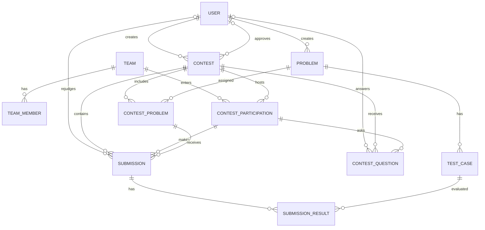
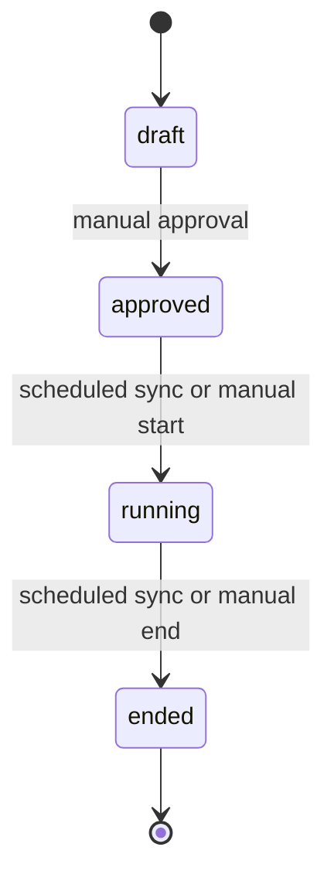

# Complete Eloquent Models

This document contains the 11 business models for the contest platform, their full Laravel 11 implementations, required configuration, relationship diagrams, and implementation notes.

## Assumptions and Conventions

- Laravel 11 conventions, including `protected function casts(): array`.
- MySQL 8 with timestamps stored in UTC.
- `config/auth.php` has the contestant guard pointing at `ContestParticipation`.
- `config/filesystems.php` defines a test-case disk, or the default `local` disk is used. The models read a config value so the disk can be changed later.
- `config/judge.php` defines a language map used by `JudgeClient`. It is not accessed by the models themselves.
- `active_slot` is a generated database column and must never be mass-assigned or added to `$fillable`.
- Models are pure data and convenience accessors. They do not call the judge or make HTTP requests.

## Model Relationship Diagram



The `Contest::problems()` and `Problem::contests()` methods expose the many-to-many relation through `contest_problems`, with `label`, `points`, and `sort_order` pivot fields. The explicit `contestProblems()` and `ContestProblem::submissions()` relations provide access to the pivot model. `Submission` also exposes convenience methods for its problem, label, and team through those relations.

## Contest State Diagram



## Authentication and Storage Flow

```mermaid
flowchart LR
    WEB[Admin web session] --> WG[web guard]
    WG --> USER[User model]
    CG[contestant guard] --> PART[ContestParticipation model]
    LOGIN[Contestant session login] --> CG

    TC[TestCase] --> TCD[configured test-case disk]
    TC --> TCF[input and output files]
    SUB[Submission] --> SD[configured source disk]
    SUB --> SF[submitted source file]
    JC[JudgeClient] -. language map from config/judge.php .-> LANG[Judge language ID]
    SUB -. language string .-> JC
```

## 1. `app/Models/User.php`

```php
<?php

namespace App\Models;

use Illuminate\Database\Eloquent\Factories\HasFactory;
use Illuminate\Database\Eloquent\Relations\HasMany;
use Illuminate\Foundation\Auth\User as Authenticatable;
use Illuminate\Notifications\Notifiable;

class User extends Authenticatable
{
    use HasFactory, Notifiable;

    public const ROLE_ADMIN    = 'admin';
    public const ROLE_OPERATOR = 'operator';

    protected $fillable = [
        'name',
        'email',
        'password',
        'role',
    ];

    protected $hidden = [
        'password',
        'remember_token',
    ];

    protected function casts(): array
    {
        return [
            'password'    => 'hashed',
            'email_verified_at' => 'datetime',
            'created_at'  => 'datetime',
            'updated_at'  => 'datetime',
        ];
    }

    public function isAdmin(): bool
    {
        return $this->role === self::ROLE_ADMIN;
    }

    public function createdContests(): HasMany
    {
        return $this->hasMany(Contest::class, 'created_by');
    }

    public function approvedContests(): HasMany
    {
        return $this->hasMany(Contest::class, 'approved_by');
    }

    public function createdProblems(): HasMany
    {
        return $this->hasMany(Problem::class, 'created_by');
    }

    public function answeredQuestions(): HasMany
    {
        return $this->hasMany(ContestQuestion::class, 'answered_by');
    }
}
```

## 2. `app/Models/Team.php`

```php
<?php

namespace App\Models;

use Illuminate\Database\Eloquent\Factories\HasFactory;
use Illuminate\Database\Eloquent\Model;
use Illuminate\Database\Eloquent\Relations\HasMany;

class Team extends Model
{
    use HasFactory;

    protected $fillable = [
        'name',
    ];

    protected function casts(): array
    {
        return [
            'created_at' => 'datetime',
            'updated_at' => 'datetime',
        ];
    }

    public function members(): HasMany
    {
        return $this->hasMany(TeamMember::class)->orderBy('ordinal');
    }

    public function participations(): HasMany
    {
        return $this->hasMany(ContestParticipation::class);
    }

    /**
     * A team "display name" for the credential PDF / scoreboard.
     * Returns e.g. "Team Alpha (Alice, Bob)".
     */
    public function fullLabel(): string
    {
        $names = $this->members->pluck('name')->implode(', ');

        return $names ? "{$this->name} ({$names})" : $this->name;
    }
}
```

`fullLabel()` returns the team name followed by member names when members exist; if none exist, it returns only the team name.

## 3. `app/Models/TeamMember.php`

```php
<?php

namespace App\Models;

use Illuminate\Database\Eloquent\Factories\HasFactory;
use Illuminate\Database\Eloquent\Model;
use Illuminate\Database\Eloquent\Relations\BelongsTo;

class TeamMember extends Model
{
    use HasFactory;

    protected $fillable = [
        'team_id',
        'name',
        'email',
        'ordinal',
    ];

    protected function casts(): array
    {
        return [
            'ordinal'    => 'integer',
            'created_at' => 'datetime',
            'updated_at' => 'datetime',
        ];
    }

    public function team(): BelongsTo
    {
        return $this->belongsTo(Team::class);
    }
}
```

## 4. `app/Models/Contest.php`

```php
<?php

namespace App\Models;

use Illuminate\Database\Eloquent\Builder;
use Illuminate\Database\Eloquent\Factories\HasFactory;
use Illuminate\Database\Eloquent\Model;
use Illuminate\Database\Eloquent\Relations\BelongsTo;
use Illuminate\Database\Eloquent\Relations\BelongsToMany;
use Illuminate\Database\Eloquent\Relations\HasMany;

class Contest extends Model
{
    use HasFactory;

    public const STATUS_DRAFT    = 'draft';
    public const STATUS_APPROVED = 'approved';
    public const STATUS_RUNNING  = 'running';
    public const STATUS_ENDED    = 'ended';

    protected $fillable = [
        'slug',
        'name',
        'status',
        'start_time',
        'end_time',
        'started_at',
        'ended_at',
        'freeze_minutes',
        'is_public',
        'approved_at',
        'approved_by',
        'created_by',
    ];

    protected $guarded = [
        'id',
        'active_slot',   // generated column — never mass-assign
    ];

    protected function casts(): array
    {
        return [
            'start_time'     => 'datetime',
            'end_time'       => 'datetime',
            'started_at'     => 'datetime',
            'ended_at'       => 'datetime',
            'approved_at'    => 'datetime',
            'is_public'      => 'boolean',
            'freeze_minutes' => 'integer',
            'created_at'     => 'datetime',
            'updated_at'     => 'datetime',
        ];
    }

    // ---------- Relationships ----------

    public function creator(): BelongsTo
    {
        return $this->belongsTo(User::class, 'created_by');
    }

    public function approver(): BelongsTo
    {
        return $this->belongsTo(User::class, 'approved_by');
    }

    public function participations(): HasMany
    {
        return $this->hasMany(ContestParticipation::class);
    }

    public function contestProblems(): HasMany
    {
        return $this->hasMany(ContestProblem::class)->orderBy('sort_order');
    }

    public function problems(): BelongsToMany
    {
        return $this->belongsToMany(Problem::class, 'contest_problems')
            ->withPivot(['label', 'points', 'sort_order'])
            ->withTimestamps()
            ->orderBy('contest_problems.sort_order');
    }

    public function submissions(): HasMany
    {
        return $this->hasMany(Submission::class);
    }

    public function questions(): HasMany
    {
        return $this->hasMany(ContestQuestion::class);
    }

    // ---------- State helpers ----------

    public function isDraft(): bool
    {
        return $this->status === self::STATUS_DRAFT;
    }

    public function isApproved(): bool
    {
        return $this->status === self::STATUS_APPROVED;
    }

    public function isRunning(): bool
    {
        return $this->status === self::STATUS_RUNNING;
    }

    public function isEnded(): bool
    {
        return $this->status === self::STATUS_ENDED;
    }

    public function isLocked(): bool
    {
        return in_array($this->status, [
            self::STATUS_APPROVED,
            self::STATUS_RUNNING,
            self::STATUS_ENDED,
        ], true);
    }

    public function acceptsSubmissions(): bool
    {
        return $this->status === self::STATUS_RUNNING;
    }

    public function startTimeLocked(): bool
    {
        return now()->gte($this->start_time);
    }

    public function endTimeLocked(): bool
    {
        return $this->status !== self::STATUS_DRAFT;
    }

    // ---------- Scopes ----------

    public function scopeDraft(Builder $q): Builder
    {
        return $q->where('status', self::STATUS_DRAFT);
    }

    public function scopeApproved(Builder $q): Builder
    {
        return $q->where('status', self::STATUS_APPROVED);
    }

    public function scopeRunning(Builder $q): Builder
    {
        return $q->where('status', self::STATUS_RUNNING);
    }

    public function scopeEnded(Builder $q): Builder
    {
        return $q->where('status', self::STATUS_ENDED);
    }

    public function scopeOccupiesActiveSlot(Builder $q): Builder
    {
        return $q->whereIn('status', [self::STATUS_APPROVED, self::STATUS_RUNNING]);
    }

    /**
     * The one contest currently in approved/running state (or null).
     * Used to block approvals / creations.
     */
    public static function activeContest(): ?self
    {
        return static::query()->occupiesActiveSlot()->first();
    }

    // ---------- State transitions ----------

    /**
     * Called by middleware/scheduler on every request/tick.
     * Idempotent. Only saves when a transition happens.
     */
    public function syncState(): void
    {
        $changed = false;

        if ($this->status === self::STATUS_APPROVED && now()->gte($this->start_time)) {
            $this->status = self::STATUS_RUNNING;

            // Absorb scheduler jitter if we're close to start_time;
            // otherwise use now() (late approval case).
            $this->started_at = now()->diffInMinutes($this->start_time, true) <= 2
                ? $this->start_time
                : now();

            $changed = true;
        }

        if ($this->status === self::STATUS_RUNNING && now()->gte($this->end_time)) {
            $this->status   = self::STATUS_ENDED;
            $this->ended_at = now();
            $changed        = true;
        }

        if ($changed) {
            $this->save();
        }
    }

    /**
     * Manual start (admin override, typically early).
     * Assumes caller has validated state == APPROVED and no other active contest.
     */
    public function manualStart(): void
    {
        $this->status     = self::STATUS_RUNNING;
        $this->started_at = now();
        $this->save();
    }

    /**
     * Manual end (admin override, typically early).
     * Assumes caller has validated state == RUNNING.
     */
    public function manualEnd(): void
    {
        $this->status   = self::STATUS_ENDED;
        $this->ended_at = now();
        $this->save();
    }
}
```

`syncState()` is idempotent and writes only when a transition occurs. On auto-start, `started_at` is set to `start_time` when the scheduler is within two minutes of it, absorbing scheduler jitter; otherwise it is set to `now()` for a late transition. `manualStart()` and `manualEnd()` deliberately do not validate the current state; the calling controller/service must validate `APPROVED` before start and `RUNNING` before end.

## 5. `app/Models/ContestParticipation.php`

```php
<?php

namespace App\Models;

use Illuminate\Database\Eloquent\Factories\HasFactory;
use Illuminate\Database\Eloquent\Relations\BelongsTo;
use Illuminate\Database\Eloquent\Relations\HasMany;
use Illuminate\Foundation\Auth\User as Authenticatable;

/**
 * Contest-scoped team account.
 * Extends Authenticatable so it can be used with Auth::guard('contestant').
 */
class ContestParticipation extends Authenticatable
{
    use HasFactory;

    protected $fillable = [
        'contest_id',
        'team_id',
        'username',
        'password',
        'seat_number',
        'credentials_generated_at',
    ];

    protected $hidden = [
        'password',
    ];

    protected function casts(): array
    {
        return [
            'password'                => 'hashed',
            'seat_number'             => 'integer',
            'credentials_generated_at'=> 'datetime',
            'created_at'              => 'datetime',
            'updated_at'              => 'datetime',
        ];
    }

    // ---------- Relationships ----------

    public function contest(): BelongsTo
    {
        return $this->belongsTo(Contest::class);
    }

    public function team(): BelongsTo
    {
        return $this->belongsTo(Team::class);
    }

    public function submissions(): HasMany
    {
        return $this->hasMany(Submission::class);
    }

    public function questions(): HasMany
    {
        return $this->hasMany(ContestQuestion::class);
    }

    // ---------- Helpers ----------

    /**
     * Display name on scoreboard / PDF.
     */
    public function teamLabel(): string
    {
        return $this->team?->name ?? $this->username;
    }

    public function hasGeneratedCredentials(): bool
    {
        return $this->credentials_generated_at !== null;
    }
}
```

`ContestParticipation` is an `Authenticatable` model so `Auth::guard('contestant')->login($participation)` and `auth('contestant')->user()` work with the session guard. It does not use `HasApiTokens`; no Sanctum, tokens, or custom user provider are needed for session authentication.

## 6. `app/Models/Problem.php`

```php
<?php

namespace App\Models;

use Illuminate\Database\Eloquent\Builder;
use Illuminate\Database\Eloquent\Factories\HasFactory;
use Illuminate\Database\Eloquent\Model;
use Illuminate\Database\Eloquent\Relations\BelongsTo;
use Illuminate\Database\Eloquent\Relations\BelongsToMany;
use Illuminate\Database\Eloquent\Relations\HasMany;

class Problem extends Model
{
    use HasFactory;

    protected $fillable = [
        'code',
        'title',
        'statement_md',
        'time_limit_ms',
        'memory_limit_mb',
        'created_by',
    ];

    protected function casts(): array
    {
        return [
            'time_limit_ms'   => 'integer',
            'memory_limit_mb' => 'integer',
            'created_at'      => 'datetime',
            'updated_at'      => 'datetime',
        ];
    }

    // ---------- Relationships ----------

    public function creator(): BelongsTo
    {
        return $this->belongsTo(User::class, 'created_by');
    }

    public function testCases(): HasMany
    {
        return $this->hasMany(TestCase::class)->orderBy('ordinal');
    }

    public function sampleTestCases(): HasMany
    {
        return $this->hasMany(TestCase::class)->where('kind', TestCase::KIND_SAMPLE)->orderBy('ordinal');
    }

    public function hiddenTestCases(): HasMany
    {
        return $this->hasMany(TestCase::class)->where('kind', TestCase::KIND_HIDDEN)->orderBy('ordinal');
    }

    public function contestProblems(): HasMany
    {
        return $this->hasMany(ContestProblem::class);
    }

    public function contests(): BelongsToMany
    {
        return $this->belongsToMany(Contest::class, 'contest_problems')
            ->withPivot(['label', 'points', 'sort_order'])
            ->withTimestamps();
    }

    // ---------- Helpers ----------

    /**
     * A problem is "used" if any contest referencing it is locked
     * (approved / running / ended). While used, editing statements or
     * test cases must be blocked at the controller level.
     */
    public function isInUse(): bool
    {
        return $this->contestProblems()
            ->whereHas('contest', function (Builder $q) {
                $q->whereIn('status', [
                    Contest::STATUS_APPROVED,
                    Contest::STATUS_RUNNING,
                    Contest::STATUS_ENDED,
                ]);
            })
            ->exists();
    }

    public function nextTestCaseOrdinal(): int
    {
        return (int) $this->testCases()->max('ordinal') + 1;
    }
}
```

`isInUse()` treats a problem as in use when a contest referencing it is approved, running, or ended; the controller must block statement/test-case edits. `nextTestCaseOrdinal()` returns the current maximum ordinal plus one.

## 7. `app/Models/ContestProblem.php`

```php
<?php

namespace App\Models;

use Illuminate\Database\Eloquent\Factories\HasFactory;
use Illuminate\Database\Eloquent\Model;
use Illuminate\Database\Eloquent\Relations\BelongsTo;
use Illuminate\Database\Eloquent\Relations\HasMany;

class ContestProblem extends Model
{
    use HasFactory;

    protected $fillable = [
        'contest_id',
        'problem_id',
        'label',
        'points',
        'sort_order',
    ];

    protected function casts(): array
    {
        return [
            'points'     => 'integer',
            'sort_order' => 'integer',
            'created_at' => 'datetime',
            'updated_at' => 'datetime',
        ];
    }

    public function contest(): BelongsTo
    {
        return $this->belongsTo(Contest::class);
    }

    public function problem(): BelongsTo
    {
        return $this->belongsTo(Problem::class);
    }

    public function submissions(): HasMany
    {
        return $this->hasMany(Submission::class);
    }

    /**
     * Human-readable "A — Two Sum".
     */
    public function displayLabel(): string
    {
        return "{$this->label} — {$this->problem->title}";
    }
}
```

## 8. `app/Models/TestCase.php`

```php
<?php

namespace App\Models;

use Illuminate\Database\Eloquent\Factories\HasFactory;
use Illuminate\Database\Eloquent\Model;
use Illuminate\Database\Eloquent\Relations\BelongsTo;
use Illuminate\Database\Eloquent\Relations\HasMany;
use Illuminate\Support\Facades\Storage;

class TestCase extends Model
{
    use HasFactory;

    public const KIND_SAMPLE = 'sample';
    public const KIND_HIDDEN = 'hidden';

    protected $fillable = [
        'problem_id',
        'ordinal',
        'kind',
        'input_path',
        'output_path',
        'input_sha256',
        'output_sha256',
        'input_size_bytes',
        'output_size_bytes',
    ];

    protected function casts(): array
    {
        return [
            'ordinal'           => 'integer',
            'input_size_bytes'  => 'integer',
            'output_size_bytes' => 'integer',
            'created_at'        => 'datetime',
            'updated_at'        => 'datetime',
        ];
    }

    // ---------- Relationships ----------

    public function problem(): BelongsTo
    {
        return $this->belongsTo(Problem::class);
    }

    public function submissionResults(): HasMany
    {
        return $this->hasMany(SubmissionResult::class);
    }

    // ---------- Storage helpers ----------

    protected function disk(): string
    {
        return config('filesystems.test_cases_disk', 'local');
    }

    public function readInput(): string
    {
        return Storage::disk($this->disk())->get($this->input_path);
    }

    public function readOutput(): string
    {
        return Storage::disk($this->disk())->get($this->output_path);
    }

    public function writeInput(string $content): void
    {
        Storage::disk($this->disk())->put($this->input_path, $content);
        $this->forceFill([
            'input_sha256'      => hash('sha256', $content),
            'input_size_bytes'  => strlen($content),
        ])->save();
    }

    public function writeOutput(string $content): void
    {
        Storage::disk($this->disk())->put($this->output_path, $content);
        $this->forceFill([
            'output_sha256'      => hash('sha256', $content),
            'output_size_bytes'  => strlen($content),
        ])->save();
    }

    public function deleteFiles(): void
    {
        $disk = Storage::disk($this->disk());
        $disk->delete($this->input_path);
        $disk->delete($this->output_path);
    }

    public function isSample(): bool
    {
        return $this->kind === self::KIND_SAMPLE;
    }

    public function isHidden(): bool
    {
        return $this->kind === self::KIND_HIDDEN;
    }

    // ---------- Lifecycle hooks ----------

    protected static function booted(): void
    {
        static::deleting(function (self $testCase) {
            $testCase->deleteFiles();
        });
    }
}
```

`TestCase::disk()` reads `filesystems.test_cases_disk` and defaults to `local`. Reads and writes go through Laravel's `Storage` facade. Writes update the SHA-256 checksum and byte size in the database with `forceFill()`. The deleting lifecycle hook removes both files. The source design expects this hook to run for each deleted test case, including when test cases are removed through a problem foreign-key cascade.

## 9. `app/Models/Submission.php`

```php
<?php

namespace App\Models;

use Illuminate\Database\Eloquent\Builder;
use Illuminate\Database\Eloquent\Factories\HasFactory;
use Illuminate\Database\Eloquent\Model;
use Illuminate\Database\Eloquent\Relations\BelongsTo;
use Illuminate\Database\Eloquent\Relations\HasMany;
use Illuminate\Support\Facades\Storage;

class Submission extends Model
{
    use HasFactory;

    // ---------- Status constants ----------
    public const STATUS_QUEUED  = 'queued';
    public const STATUS_JUDGING = 'judging';
    public const STATUS_DONE    = 'done';
    public const STATUS_ERROR   = 'error';

    // ---------- Verdict constants ----------
    public const VERDICT_ACCEPTED       = 'AC';
    public const VERDICT_WRONG_ANSWER   = 'WA';
    public const VERDICT_TIME_LIMIT     = 'TLE';
    public const VERDICT_MEMORY_LIMIT   = 'MLE';
    public const VERDICT_RUNTIME_ERROR  = 'RE';
    public const VERDICT_COMPILE_ERROR  = 'CE';
    public const VERDICT_INTERNAL_ERROR = 'IE';

    protected $fillable = [
        'contest_id',
        'participation_id',
        'contest_problem_id',
        'language',
        'source_path',
        'status',
        'verdict',
        'max_time_ms',
        'max_memory_kb',
        'score',
        'judge_job_id',
        'is_sample_run',
        'submitted_at',
        'judged_at',
        'rejudge_count',
        'last_rejudged_at',
        'last_rejudged_by',
    ];

    protected function casts(): array
    {
        return [
            'max_time_ms'      => 'integer',
            'max_memory_kb'    => 'integer',
            'score'            => 'decimal:2',
            'is_sample_run'    => 'boolean',
            'rejudge_count'    => 'integer',
            'submitted_at'     => 'datetime',
            'judged_at'        => 'datetime',
            'last_rejudged_at' => 'datetime',
            'created_at'       => 'datetime',
            'updated_at'       => 'datetime',
        ];
    }

    // ---------- Relationships ----------

    public function contest(): BelongsTo
    {
        return $this->belongsTo(Contest::class);
    }

    public function participation(): BelongsTo
    {
        return $this->belongsTo(ContestParticipation::class, 'participation_id');
    }

    public function contestProblem(): BelongsTo
    {
        return $this->belongsTo(ContestProblem::class);
    }

    public function results(): HasMany
    {
        return $this->hasMany(SubmissionResult::class);
    }

    public function lastRejudgedBy(): BelongsTo
    {
        return $this->belongsTo(User::class, 'last_rejudged_by');
    }

    // ---------- Convenience accessors ----------

    public function problem(): ?Problem
    {
        return $this->contestProblem?->problem;
    }

    public function label(): ?string
    {
        return $this->contestProblem?->label;
    }

    public function team(): ?Team
    {
        return $this->participation?->team;
    }

    // ---------- State helpers ----------

    public function isFinal(): bool
    {
        return in_array($this->status, [self::STATUS_DONE, self::STATUS_ERROR], true);
    }

    public function isAccepted(): bool
    {
        return $this->verdict === self::VERDICT_ACCEPTED;
    }

    public function isPending(): bool
    {
        return in_array($this->status, [self::STATUS_QUEUED, self::STATUS_JUDGING], true);
    }

    /**
     * Duration from contest start (penalty base), in whole minutes.
     */
    public function minutesSinceContestStart(): int
    {
        $start = $this->contest?->started_at ?? $this->contest?->start_time;

        return $start ? (int) $start->diffInMinutes($this->submitted_at) : 0;
    }

    // ---------- Storage helper ----------

    public function readSource(): string
    {
        return Storage::disk(config('filesystems.sources_disk', 'local'))
            ->get($this->source_path);
    }

    // ---------- Scopes ----------

    public function scopeAccepted(Builder $q): Builder
    {
        return $q->where('verdict', self::VERDICT_ACCEPTED);
    }

    public function scopeJudged(Builder $q): Builder
    {
        return $q->where('status', self::STATUS_DONE);
    }

    public function scopePending(Builder $q): Builder
    {
        return $q->whereIn('status', [self::STATUS_QUEUED, self::STATUS_JUDGING]);
    }

    public function scopeForParticipation(Builder $q, int $participationId): Builder
    {
        return $q->where('participation_id', $participationId);
    }

    public function scopeForContestProblem(Builder $q, int $contestProblemId): Builder
    {
        return $q->where('contest_problem_id', $contestProblemId);
    }

    public function scopeScoreboard(Builder $q, int $contestId): Builder
    {
        return $q
            ->where('contest_id', $contestId)
            ->where('is_sample_run', false)
            ->where('status', self::STATUS_DONE);
    }
}
```

`judge_job_id` is fillable because the controller sets it after `JudgeClient` returns. `Submission` does not call `JudgeClient`: the controller creates a submission, calls the client, and updates the row. This keeps models testable without HTTP. `language` remains a plain string; numeric judge IDs are mapped by `JudgeClient`, not by the model.

## 10. `app/Models/SubmissionResult.php`

```php
<?php

namespace App\Models;

use Illuminate\Database\Eloquent\Factories\HasFactory;
use Illuminate\Database\Eloquent\Model;
use Illuminate\Database\Eloquent\Relations\BelongsTo;

class SubmissionResult extends Model
{
    use HasFactory;

    protected $fillable = [
        'submission_id',
        'test_case_id',
        'verdict',
        'time_ms',
        'memory_kb',
        'message',
    ];

    protected function casts(): array
    {
        return [
            'time_ms'    => 'integer',
            'memory_kb'  => 'integer',
            'created_at' => 'datetime',
            'updated_at' => 'datetime',
        ];
    }

    public function submission(): BelongsTo
    {
        return $this->belongsTo(Submission::class);
    }

    public function testCase(): BelongsTo
    {
        return $this->belongsTo(TestCase::class);
    }

    public function isAccepted(): bool
    {
        return $this->verdict === Submission::VERDICT_ACCEPTED;
    }

    /**
     * Whether this result's test-case content may be shown to the
     * contestant who submitted. Sample test cases always show; hidden
     * ones only reveal verdict, time, memory.
     */
    public function contentVisibleToContestant(): bool
    {
        return $this->testCase?->isSample() ?? false;
    }
}
```

`contentVisibleToContestant()` is the "belt" for preventing hidden test-case content from appearing. The other protection ("braces") is to never load hidden test-case content into the contestant detail view; expose only `test_case_id` and verdict/timing/memory data. The contestant Blade view calls this method before showing case content.

## 11. `app/Models/ContestQuestion.php`

```php
<?php

namespace App\Models;

use Illuminate\Database\Eloquent\Builder;
use Illuminate\Database\Eloquent\Factories\HasFactory;
use Illuminate\Database\Eloquent\Model;
use Illuminate\Database\Eloquent\Relations\BelongsTo;

class ContestQuestion extends Model
{
    use HasFactory;

    public const VISIBILITY_PUBLIC  = 'public';
    public const VISIBILITY_PRIVATE = 'private';

    protected $fillable = [
        'contest_id',
        'participation_id',
        'body',
        'answer',
        'answered_by',
        'answered_at',
        'visibility',
    ];

    protected function casts(): array
    {
        return [
            'answered_at' => 'datetime',
            'created_at'  => 'datetime',
            'updated_at'  => 'datetime',
        ];
    }

    // ---------- Relationships ----------

    public function contest(): BelongsTo
    {
        return $this->belongsTo(Contest::class);
    }

    public function participation(): BelongsTo
    {
        return $this->belongsTo(ContestParticipation::class, 'participation_id');
    }

    public function answeredBy(): BelongsTo
    {
        return $this->belongsTo(User::class, 'answered_by');
    }

    // ---------- State helpers ----------

    public function isAnswered(): bool
    {
        return $this->answered_at !== null;
    }

    public function isPublic(): bool
    {
        return $this->visibility === self::VISIBILITY_PUBLIC;
    }

    public function isPrivate(): bool
    {
        return $this->visibility === self::VISIBILITY_PRIVATE;
    }

    /**
     * Whether a *different* team may see this question+answer.
     * Private stays private regardless of state; public is only
     * visible once answered (unresolved questions don't leak).
     */
    public function isVisibleToOtherTeams(): bool
    {
        return $this->isAnswered() && $this->isPublic();
    }

    // ---------- Scopes ----------

    public function scopeUnanswered(Builder $q): Builder
    {
        return $q->whereNull('answered_at');
    }

    public function scopeAnswered(Builder $q): Builder
    {
        return $q->whereNotNull('answered_at');
    }

    public function scopeVisibleToTeams(Builder $q, int $participationId): Builder
    {
        return $q->where(function (Builder $q) use ($participationId) {
            $q->where('participation_id', $participationId)
              ->orWhere(function (Builder $q) {
                  $q->where('visibility', self::VISIBILITY_PUBLIC)
                    ->whereNotNull('answered_at');
              });
        });
    }
}
```

The asking team can see its own question regardless of visibility or answer state. Other teams can see a question only when it is public and answered; unresolved public questions are not exposed.

## 12. Required Configuration (Not Models)

### `config/auth.php`: Two Guards and Providers

```php
'guards' => [
    'web' => [
        'driver'   => 'session',
        'provider' => 'users',
    ],
    'contestant' => [
        'driver'   => 'session',
        'provider' => 'participations',
    ],
],

'providers' => [
    'users' => [
        'driver' => 'eloquent',
        'model'  => App\Models\User::class,
    ],
    'participations' => [
        'driver' => 'eloquent',
        'model'  => App\Models\ContestParticipation::class,
    ],
],
```

The admin `web` guard uses `User`; the `contestant` session guard uses `ContestParticipation`. This is sufficient for session authentication and does not require token auth or a custom provider.

### `config/filesystems.php`: Storage Disks

```php
'disks' => [
    // ...existing...
],

// Add one config key per disk the models reference:
// 'test_cases_disk' is read by TestCase::disk()
// 'sources_disk' is read by Submission::readSource()
//
// Recommended config keys, so disk names are not hardcoded in models:
// 'test_cases_disk' => env('TEST_CASES_DISK', 'local'),
// 'sources_disk'    => env('SOURCES_DISK', 'local'),
```

Alternatively, add a small configuration adjustment so `TestCase::disk()` and `Submission::readSource()` can use existing disk configuration without top-level config keys; either approach is acceptable.

### `config/judge.php`: Judge Client Settings

```php
return [
    'base_url'         => env('JUDGE_BASE_URL'),
    'token'            => env('JUDGE_TOKEN'),
    'callback_secret'  => env('JUDGE_CALLBACK_SECRET'),
    'timeout'          => env('JUDGE_TIMEOUT', 10),
    'languages' => [
        'c'       => 1,   // values from judge docs
        'cpp17'   => 2,
        'python3' => 3,
        // ...
    ],
];
```

Models do not use this config. `Submission::language` is a plain string; the language-to-numeric-ID mapping belongs to `JudgeClient` in the service layer.

## 13. Model Summary

| Model | Extends | Trait | Notable behavior |
| --- | --- | --- | --- |
| `User` | `Authenticatable` | `HasFactory`, `Notifiable` | Hashed password cast; admin helpers and creator/approver/answerer relations |
| `Team` | `Model` | `HasFactory` | `members()`, `fullLabel()` |
| `TeamMember` | `Model` | `HasFactory` | `ordinal` integer cast |
| `Contest` | `Model` | `HasFactory` | Guards generated `active_slot`; state helpers, scopes, `syncState()`, `manualStart()`, `manualEnd()` |
| `ContestParticipation` | `Authenticatable` | `HasFactory` | Hashed/hidden password; contestant guard target |
| `Problem` | `Model` | `HasFactory` | `isInUse()`, sample/hidden test-case relations |
| `ContestProblem` | `Model` | `HasFactory` | Pivot model and `displayLabel()` |
| `TestCase` | `Model` | `HasFactory` | Storage read/write helpers and delete hook |
| `Submission` | `Model` | `HasFactory` | Status/verdict constants, state helpers, storage helper, scopes |
| `SubmissionResult` | `Model` | `HasFactory` | `contentVisibleToContestant()` |
| `ContestQuestion` | `Model` | `HasFactory` | Visibility helpers and `visibleToTeams` scope |

## 14. Operational Notes and Caveats

1. **Generated `active_slot`:** It is in `Contest::$guarded`. Eloquent's `$guarded` applies to `fill()` and `create()`. Direct assignment such as `$contest->status = 'approved'; $contest->save();` is fine because the generated field is not touched. Trying to create a row with `active_slot` would also fail at the database layer because generated columns cannot be written; `$guarded` blocks it earlier.
2. **Contest synchronization:** `Contest::syncState()` is idempotent and does no database write unless it transitions state. If called in middleware, only the request that triggers a transition pays the `save()` cost.
3. **Start-time fairness:** `started_at` absorbs scheduler jitter. When the scheduled transition is within two minutes of `start_time`, it uses `start_time`; when later (such as late approval), it uses `now()`. This avoids seconds-of-drift penalty while remaining fair when the start is genuinely late.
4. **Contestant authentication:** `ContestParticipation` extending `Authenticatable` enables `Auth::guard('contestant')->login($participation)`. Point `config/auth.php` at the model; no custom user provider is needed.
5. **Test-case file cleanup:** The `TestCase::booted()` deleting hook removes input and output files when a test case is deleted. The source design notes that a problem foreign-key cascade deletes test cases and expects the deleting hook to run for each row so files are cleaned.
6. **Judge calls stay out of models:** `Submission` does not call `JudgeClient`; the controller creates the row, calls the client, then updates the row. This keeps models testable without HTTP.
7. **No token auth by default:** `ContestParticipation` intentionally has no `HasApiTokens`. Add token support only if a mobile/API client is introduced; session authentication is the current design.
8. **Language mapping:** `Submission::language` remains a string. Numeric judge IDs are configured in `config/judge.php` and consumed by `JudgeClient`; models do not map languages.
9. **Hidden test-case privacy:** `SubmissionResult::contentVisibleToContestant()` checks whether the related case is a sample. Also avoid loading hidden case content into contestant views; expose only the case ID and verdict/time/memory. Both checks are intentional.
10. **Manual transitions:** `Contest::manualStart()` and `manualEnd()` do not check state. The controller/service must verify `status === APPROVED` before starting and `status === RUNNING` before ending. The model methods do exactly the state mutation their names promise, which keeps them straightforward to test.
